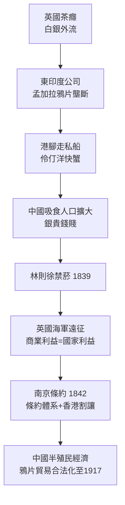

## 1839 - 第一次鴉片戰爭（一場為毒品開打的國際戰爭）

## 案件摘要

**本案的兇器，是 40,000 箱印度鴉片，和一支為商業利益開火的皇家海軍。**

1839 年，清廷欽差大臣林則徐在虎門銷毀英商鴉片 20,283 箱，切斷走私鏈；英國以此為由出兵，1842 年《南京條約》戰勝——割香港、開五口、賠款。此後至 20 世紀初，印度鴉片對華出口從每年數千箱升至上萬箱，中國「鴉片人口」估計在清末達 2,000 萬以上。這是人類歷史上唯一一場主要為毒品貿易而開打的國際戰爭，也是「毒品＝帝國經濟工具」的最赤裸案例。本案偵查：一個自給自足的帝國，為什麼會在幾十年內變成一個「被毒品貿易擊穿」的國家？

## 前因 -- 為什麼會有這個案子

- **貿易失衡**。18 世紀英國大量進口中國茶（見 `1652-倫敦咖啡館與提神飲料全球化.md`），白銀外流。中國對英國商品無需求，英國需要一種「中國人一定會買」的產品——答案是鴉片。
- **三角貿易的完成**。英國棉紡織品 → 印度；印度鴉片 → 中國；中國茶葉、絲、白銀 → 英國。東印度公司（1773 年起壟斷孟加拉鴉片拍賣）不直接賣鴉片給中國（違反清廷禁令），而是把鴉片拍賣給「港腳商人」（country traders），由他們走私上岸——**帝國親手種鴉片，卻讓私人資本去犯罪**。
- **清朝的禁令與執行缺口**。雍正（1729）、嘉慶（1796）已下禁令，但沿海官吏、走私網、吸毒官僚使執行崩潰。到 1830 年代，鴉片逆差使白銀外流，銅銀比價失衡，農民稅負加重——財政危機使禁菸從道德議題升級為國安議題。
- **黃爵滋的奏摺（1838）**。指出「鴉片不禁，國將不國」；林則徐被派往廣州，提出「若鴉片一日未絕，本大臣一日不回」。

## 線索與推理 -- 數學式、程式、理論

本案的推理核心是**貿易數學**。白銀外流量可以近似為：

$ \Delta \text{白銀} = (\text{茶絲出口收入}) - (\text{鴉片進口支出}) $

1830 年代此項轉為每年數百萬兩的淨流出，觸發銀貴錢賤 → 農民以銅錢換銀納稅的實際稅負上升 → 動搖統治基礎。清朝的診斷正確（鴉片是財政與治安危機的源頭），但解方（全面禁運）撞上了英國的商業與海軍力量。

**社會面推理**：為何吸食在中國擴散如此之快？菸斗吸食法（而非口服）是關鍵技術——明末菸草傳入帶來了吸食器具與文化，鴉片嫁接到吸食儀式上，藥物動力學上「吸入給藥速度快」（同 `1559-讓尼科與菸草入歐.md` 的菸鹼案例）使鴉片從「藥」變成「娛樂」。這是物質史上最著名的「給藥路徑改變→成癮規模改變」案例之一，與 1805 年嗎啡注射（`1805-嗎啡分離與注射時代.md`）互為鏡像。

## 結案 -- 後果與影響

- **條約體系**。南京條約（1842）、虎門條約、天津條約（1858 把鴉片以「洋藥」名義合法化）、北京條約——鴉片貿易在條約保護下持續到 1917 年。香港的割讓，本質上是一座為毒品貿易服務的轉運港。
- **中國的百年創傷**。鴉片戰爭成為中國近代史敘事的起點（「百年國恥」）；清末「鴉片捐」一度是各省財政支柱——連禁菸都要靠向吸食者收稅，形成「政府依賴毒品收入」的悖論。
- **管制制度的全球反彈**。傳教士與改革者推動的國際鴉片運動，促成 1909 年上海萬國禁菸會與 1912 年《海牙鴉片公約》——現代國際毒品管制的直接起源（見 `1914-哈里森法案.md`）。
- **一句話結案**：當一個帝國需要平衡貿易帳，而它手中最強的商品是成癮物質時，戰爭不是意外，而是資產負債表的延伸。

## 關鍵人物與文獻

- 林則徐（1785–1850）——欽差大臣，虎門銷煙。
- William Jardine 與 James Matheson——怡和洋行創辦人，最大的港腳鴉片走私商；Jardine 回英遊說議會開戰（「Jardine Paper」）。
- 欽差VS外交官 Charles Elliot——英方駐華商務總監，交出鴉片並主張強硬。
- Julia Lovell, *The Opium War*（2011）。
- James Polachek, *The Inner Opium War*（1992）。
- Tan Chung 與 Michael Greenberg, *British Trade and the Opening of China*——三角貿易數據。
