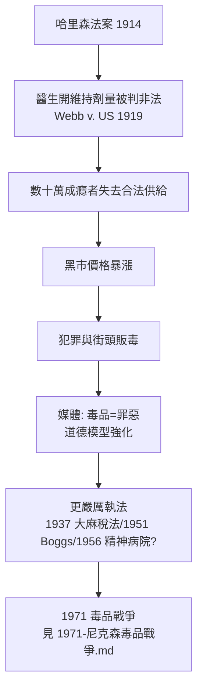

## 1914 - 哈里森法案（禁毒時代的開端）

## 案件摘要

**本案的兇手，是一部名為「稅法」的禁令。**

1914 年 12 月，美國國會通過《Harrison Narcotics Tax Act》，以「課稅與登記」為名管制鴉片與古柯鹼製品：醫生、藥師需註冊繳稅並留存處方紀錄，非醫療用途一律非法。它表面是稅法（為繞過憲法對聯邦權力的限制），實質是美國第一部聯邦毒品禁令。此後十年，最高法院判決（*Webb v. US*, 1919; *Jin Fuey Moy*, 1916/1922）把「醫生為成癮者開維持劑量」判為非法——數十萬維持治療的病人瞬間變成罪犯，黑市與「dope fiend」形象誕生。本案偵查：美國如何從「鴉片隨處可買的國家」，一步跨入「毒品戰爭」？

## 前因 -- 為什麼會有這個案子

- **成癮人口的結構轉變**。1900 年前後，美國鴉片成癮者約 25–30 萬（人口比約 0.3%），多為白人中年女性（醫生處方造成）；到 1920 年代，成癮者形象轉為「年輕、男性、城市底層、少數族裔」——**誰在吸毒的想像，決定了政策用什麼手段**。
- **國際壓力**。1909 年上海萬國禁菸會、1912 年海牙鴉片公約（中國與傳教士運動推動）要求締約國管制鴉片——美國需要一部國內法來履約。
- **種族恐慌的立法燃料**。舊金山報紙把鴉片館與華工連結；南方報紙宣稱「古柯鹼讓黑人強暴白人女性」（1914 年 NY Times 的著名聳動報導）；西部把大麻與墨西哥移民連結——每一種毒品都被貼上一個族群標籤。
- **清教改革浪潮**。進步主義時代＋禁酒運動（WCTU、ASL）正把「個人道德立法化」推上高峰，毒品管制是同一波立法哲學的一部分。

## 線索與推理 -- 理論

本案的推理核心：**禁令的經濟學**。維持治療時代（1900–1914），成癮者從醫生處以合法價格取得嗎啡，價格低、品質穩、無犯罪需求。哈里森法案執行後：

$ P_{\text{黑市}} \approx P_{\text{合法}} \times (1 + \text{風險溢酬}) \times \frac{1}{\text{供給彈性}} $

供給被壓縮 → 價格暴漲數十倍 → 成癮者需要錢 → 財產與暴力犯罪上升 → 媒體與公眾把犯罪歸咎於「毒品使人邪惡」（而非禁令使價格上漲）→ 支持更嚴厲的執法。

**醫學 vs 法律的地盤之爭**：法案之前，成癮在美國是醫療問題（診所、門診戒癮）；法案之後是執法問題（逮捕、監獄）。1919 年最高法院判定醫生不能為「維持成癮」開藥——這一紙判決把成癮醫學打斷 40 年（要到 1935 年 Lexington 與 1964 年美沙酮才重啟，見 `1935-成癮醫學誕生.md`、`1964-美沙酮維持療法.md`）。偵探的判決：哈里森法案真正的受害者不是毒品，而是**醫療手段與執法手段之間的邊界**。

## 結案 -- 後果與影響

- **美國毒品戰爭的制度起點**。1937 年《大麻稅法》、1951 年 Boggs 法案（強制最低刑）、1970 年 CSA 排程制度、1971 年「毒品戰爭」宣言——全部可以追溯到 1914 年的立法邏輯：用刑法處理健康問題。
- **監獄人口**。20 世紀後半美國因毒品入監的人數以百萬計，且不成比例地落在非裔與拉丁裔社區——1914 年種族恐慌的立法燃料，在百年後仍以 mass incarceration 的形式燃燒。
- **全球管制體系的複製**。美國模式經國際公約（1961、1971、1988）輸出全球，形成今日的國際毒品管制體制。
- **一句話結案**：哈里森法案用一張稅表把醫學趕出了成癮的治療現場——五十年後人們才承認，這場「戰爭」從第一天就選錯了武器。

## 關鍵人物與文獻

- Francis Burton Harrison——紐約眾議員，法案提案人。
- David F. Musto, *The American Disease*（1973）——本案的權威史學敘事。
- David T. Courtwright, *Dark Paradise*——成癮人口結構轉變的數據分析。
- *Webb v. United States*（1919）、*Jin Fuey Moy v. United States*——醫療維持治療被判非法的關鍵判例。
- Helena Hansen 與 Jules Netherland 的「pharmaceutical segregation」研究——毒品管制的種族政治。
