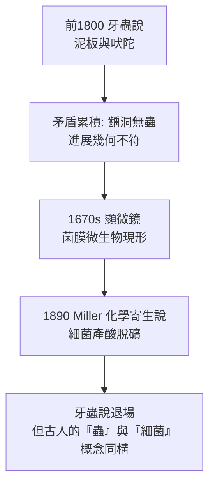

## -0500 - 牙蟲說的五千年統治（史上最長壽的錯誤病因理論）

## 案件摘要

**牙痛的元兇是誰？古人給出的答案是一條蟲——而且這個答案統治了五千年。**

從美索不達米亞楔形文字泥板、印度《阿闥婆吠陀》讚歌、埃及紙草到中世紀歐洲的民間醫療，「齲齒與牙痛是『牙蟲（dental worm）』在牙齒裡鑽噬」的理論橫跨所有古代文明。這是醫學史上流傳最久、覆蓋最廣的單一病因學說——直到 1890 年 Miller 的化學寄生說（見 `1890-Miller化學寄生說.md`）才把它送進歷史。耐人尋味的是：**這個錯誤理論，方向上竟然歪打正著地「接近」了微生物病因。**

## 前因 -- 為什麼會有這個案子

- **最早的文本證據**：約前 1800 年的美索不達米亞「牙蟲傳說」泥板，講述牙蟲如何受神明指派鑽入牙齒吸吮血液、啃噬牙髓；約前 1000 年的《阿闥婆吠陀》以咒語「詛咒牙蟲現形而出」。
- **為什麼是蟲？推理的環境證據極充分**：蛀洞的形態像蟲蛀的木頭；疼痛是蠕動性的、時有時無；糞便中確實可見寄生蟲——古人以可見的寄生蟲類推不可見的病因，是完全合理的類比推理。
- **古代的治療處方全由此導出**：以煙燻（燒乳香、瀝青）「熏走」牙蟲、以腐蝕性藥物「毒殺」牙蟲、以咒語驅蟲——有趣的是，煙薰確能暫時止痛（酚類化合物有局部麻醉作用），**錯誤理論有時也能碰上正確的藥理**。

## 線索與推理 -- 數學式、程式、理論

**線索一：牙蟲說的內部矛盾。** 顯微鏡問世後（1670s），雷文霍克在牙菌膜中看見微生物（見 `1683-雷文霍克看見牙菌膜.md`），牙蟲說一度「復活」為微生物說。但本案的反證在 18 世紀逐漸累積：

1. 齲洞中**從未**有人找到過蟲——任何懷疑自己有牙蟲的病人，沒有一位醫生能在洞裡抓出活蟲。
2. 同樣的「蟲」無法解釋為何齲齒偏好特定牙位（咬合面溝裂）、特定部位。
3. 1756 年 P. Fauchard 與 1770 年代 Bourdet 以屍體牙齒的切片展示：齲壞始於琺瑯質的化學性脫礦，呈現層狀進展——**與蟲啃出的隨機孔道幾何不符**。

**線索二：陳述的轉折。** 1881 年 Underwood 與 Miles 以組織學研究齲齒進展，提出化學—微生物機制；1890 年 Miller 以培養實驗封棺：

$$ \text{碳水化合物} \xrightarrow{\text{口腔細菌發酵}} \text{有機酸} \rightarrow \text{琺瑯質脫礦} \Rightarrow \text{齲齒} $$

酸 $[\text{H}^+]$ 使羥磷灰石溶解：

$$ \text{Ca}_{10}(\text{PO}_4)_6(\text{OH})_2 + 8\text{H}^+ \rightarrow 10\text{Ca}^{2+} + 6\text{PO}_4^{3-} + 2\text{H}_2\text{O} $$

兇手是**酸**，不是蟲；但釋放酸的**發酵菌**，某種意義上就是古人稱之為「蟲」的東西。

## 結案 -- 後果與影響

- **最長壽的醫學理論謝幕**：從泥板到 19 世紀教科書，牙蟲說存續約 3700 年（民間殘存至 20 世紀），比四體液說還長壽。
- **驅蟲式治療的正面遺產**：煙薰、含漱、清潔——這些基於錯誤理論的處方中，「清潔」最終被證明是對的：去除菌膜正是現代齲齒預防的核心。
- **病因學的方法論教訓**：牙蟲說是一個「可解釋一切、卻無法證偽」的理論——它提醒後世：好的病因學必須能被找到、被培養、被排除後疾病即不發生（柯霍式檢驗）。
- **一句話結案**：古人沒有顯微鏡，卻憑痛覺與蛀洞的形態猜出了「微小生物在牙裡作祟」的方向；真正的偵查失誤不在方向，而在把發酵菌的化學武器（酸）誤認為蟲的牙齒。

## 關鍵人物與文獻

- **《阿闥婆吠陀》**（約前 1000）——牙蟲咒語（Yatudhana 蟲），印度醫學《妙聞本集》亦沿用蟲說並分類牙病。
- **美索不達米亞泥板（約前 1800）**——現存最早的牙痛病因敘事，現藏大英博物館。
- **W.D. Miller（1890）**——化學寄生說，見 `1890-Miller化學寄生說.md`。
- **Underwood & Miles（1881）**——組織學示齲齒層狀進展，蟲說的重要反證。
- 現代註腳——2010 年代古 DNA 研究在古代牙結石中檢出變形鏈球菌與乳桿菌，證實這兩種產酸菌正是現代意義上的「牙蟲」——五千年後，那條蟲終於被指名道姓。
