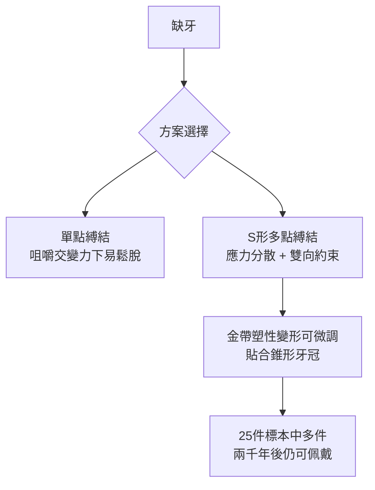

## -0700 - 伊特魯里亞金帶假牙（公元前七世紀的修復工程）

## 案件摘要

**在沒有黏著劑、沒有植體、沒有教科書的年代，誰能讓掉落的牙齒重新咬合？**

公元前 700 年至前 400 年間，義大利中部的伊特魯里亞人（Etruscans）留下了一批震驚考古學界的金質牙橋：以寬約 1 cm 的薄金帶環繞健康鄰牙，用金線以精密的「S 形」穿縛技術，把**人牙或牛牙雕成的假牙**固定在缺牙隙上。現存約 30 件實物中，許多在兩千五百年後仍結構完好——這是歐洲最早的假牙，也是古代修復牙科的技術巔峰。

## 前因 -- 為什麼會有這個案子

- **伊特魯里亞是古代西方的黃金加工霸主**。托斯卡尼的伊特魯里亞人以金銀細工（granulation 珠粒工藝）聞名地中海，金工技術外溢到牙科是最自然的跨界。
- **社會動機**：假牙出土多見於貴族女性墓中。一說是修復齲病缺牙（伊特魯里亞人飲食含大量果乾與蜂蜜，齲齒率極高），一說是地位象徵——能戴「金牙」本身就是奢侈品消費。
- **當時的競爭方案**：埃及人用金線縛牙但多為防腐/固定鬆牙；腓尼基用金帶但工藝粗簡。伊特魯里亞方案的獨特處在於**力學設計**。

## 線索與推理 -- 數學式、程式、理論

**線索一：固定式的力學本質。** 金帶假牙是懸臂樑（cantilever）與固定橋（fixed bridge）的原型。缺失一顆牙後，橋體承受咬合力 $F$，兩側基牙各分擔彎矩。現代橋力學指出：

$$ M = F \cdot \frac{L}{2}, \quad \sigma_{abutment} \propto \frac{F \cdot L}{W} $$

基牙牙周膜必須長期承受額外負荷——因此**基牙必須健康且穩固**。伊特魯里亞工匠顯然懂這點：他們的標本幾乎都選用健康的鄰牙做基牙。

**線索二：S 形穿縛的智慧。** 顯微觀察顯示金帶在每顆基牙上繞出交錯的 S 形環扣，這不是裝飾：單點縛結會在咀嚼的交變應力下鬆脫，而 S 形繞法提供多點、雙向的約束——等於發明了**應力分散的縛結幾何**。

**線索三：義齒材料學。** 假牙多用人的門齒（來源不明，可能是死者親屬或買賣），也有以牛象牙雕成者。牛牙的琺瑯質厚度與色澤接近人牙——在沒有陶瓷的年代，這是最合理的仿生材料選擇。

**線索四：為何用金？** 黃金的屈服強度低、延展性極佳，可反覆冷作變形而不斷裂，且在口腔內完全耐蝕。以現代觀點：金是**唯一兼具生物惰性與可塑性形變能力的古代可用金屬**。

## 結案 -- 後果與影響

- **技術斷裂**：羅馬吞併伊特魯里亞後，此項金工縛牙技術水準千年未再復現——中世紀歐洲的假牙工藝反而更粗糙，直到文藝復興才追平。
- **現代固定橋的直系祖先**：今日牙橋「基牙—橋體—連接體」的力學三要素，與伊特魯里亞金帶方案完全同構；差別只是把金帶縛結換成了黏著劑。
- **牙科職業化的最早線索**：如此精密的手藝必出自專門匠人——伊特魯里亞可能有最早的「牙科技工」分工。
- **一句話結案**：伊特魯里亞工匠沒有材料學，卻用金帶的冷作硬化與 S 形縛結解出了懸臂樑的受力難題——修復牙科的第一份工程圖紙，畫在死人嘴裡。

## 關鍵人物與文獻

- **實物證據**——現藏於梵蒂岡博物館、佛羅倫斯考古博物館等處的約 30 件伊特魯里亞假牙。
- **Marshall Becker 與 P. Von Eles**——2000 年代對 Tarquinia 出土假牙的冶金學再分析，確認 S 形縛結工藝。
- **G. Oner 等民族學比較**——將伊特魯里亞方案與埃及、腓尼基縛牙並列比較，確立其力學優勢。
- 現代註腳——2010 年代的實驗復原顯示，一位熟練金工可在數小時內完成一座金帶橋；其咬合效率足以嚼麵包——這座橋不是隨葬品，而是**真的被用過**。
