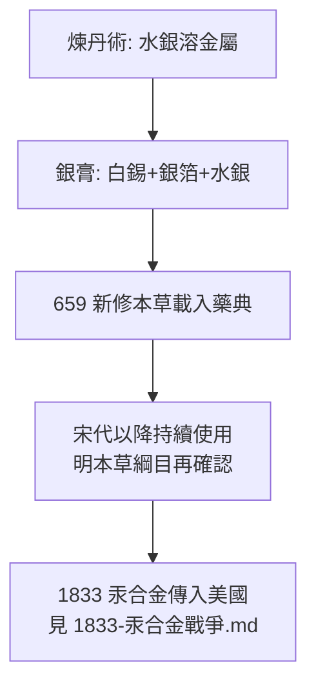

## 0650 - 唐代銀膏補牙（比西方早一千一百年的汞合金）

## 案件摘要

**在歐洲牙醫還只會拔牙與縛牙的年代，中國醫書裡出現了一種「以汞合銀」的補牙材料。**

唐顯慶四年（659 年），蘇敬等二十餘人奉敕編成《新修本草》（世界最早由政府頒布的藥典），其中記載一種名為「**銀膏**」的物質：「其法用白錫和銀薄及水銀合成之，凝硬如銀……補牙齒缺落。」——這是全世界最早的金屬（汞齊）補牙記錄，比 19 世紀西方引入汞合金早了一千一百多年。

## 前因 -- 為什麼會有這個案子

- **中國早有補牙需求與技術積累**：漢代張仲景《金匱要略》已有「小兒疳蟲蝕齒方」（含雄黃——砷劑殺牙髓，可視為最早的失活劑之一）；《史記·倉公列傳》記載齲齒針灸與藥物療法。
- **汞的化學知識成熟**：煉丹術傳統使唐代工匠對「水銀能溶金屬成膏、靜置後硬化」這一現象極為熟悉——汞齊化反應正是煉丹爐邊的日常觀察。
- **《新修本草》的官方性質**：這不是江湖偏方，而是朝廷頒布的國家藥典——銀膏補牙在當時已是可核查、可重複的正式療法。

## 線索與推理 -- 數學式、程式、理論

**線索一：成分配方。** 《本草綱目》（1578）轉引唐代配方並補充：「銀膏……用白錫、銀箔、水銀合成」。以現代冶金學覆核，這正是**錫—銀—汞齊**，與 19 世紀西方汞合金（銀錫汞）幾乎同構：

$$ \text{Ag}_3\text{Sn} + \text{Hg} \rightarrow \gamma\text{-Ag}_3\text{Sn} + \text{Sn}_x\text{Hg}(\gamma_1, \gamma_2) \quad \text{（汞齊化反應）} $$

**線索二：為何「凝硬如銀」？** 液態汞溶解銀錫粉末後，析出金屬間化合物結晶，膏體在數分鐘內硬化——這正是現代汞合金凝固動力學。唐代工匠未必知道結晶學，但以經驗掌握了「調和後需迅速填壓」的操作窗口。

**線索三：與西方線的時間差。** 西方最早的汞合金補牙見於 1528 年左右 Johannes Stenner 的德文手稿，及 19 世紀初法國 Taveau（1816–1826）。中國記錄比兩者早約 900–1200 年。

**線索四：為何未傳播開？** 本案的未解之謎：銀膏在中國醫書中此後記載稀少，可能因（1）汞的毒性顧慮使精英醫家卻步，僅民間匠人流傳；（2）宮廷與文人醫學偏好藥物內治，視補牙為匠技——**技術存在，但未被制度化**。

## 結案 -- 後果與影響

- **證明汞合金的可行性早於西方千年**：本案是材料史的重要證據——「以汞補牙」並非 19 世紀歐洲的突發奇想，而是被至少兩個文明獨立驗證過的解。
- **與 1833 年 Amalgam War 的呼應**：見 `1833-汞合金戰爭.md`——西方牙醫界對汞毒性的爭論，中國醫家其實早有同款顧慮。
- **中醫外科史的註腳**：銀膏是中國古代少數「以材料學解決結構問題」的醫療技術，在以內治為主流的體系中顯得格外超前。
- **一句話結案**：唐代的煉丹爐邊，有人把水銀、錫與銀箔調成膏，凝硬如銀地填進牙洞——一個被藥典記載卻未被制度接住的技術，沉睡了一千年才在西方被重新發明。

## 關鍵人物與文獻

- **蘇敬等《新修本草》（659）**——唐政府頒布的國家藥典，世界藥典史上的首部官修本草，載銀膏補牙。
- **李時珍《本草綱目》（1578）**——金石部轉載並詳述銀膏配方，使唐代技術得以流傳。
- **張仲景《金匱要略》**——含砷劑「殺蟲蝕齒」方，砷失活牙髓的最早記錄之一。
- 現代註腳——當代高銅汞合金已大幅減少 γ₂ 相（腐蝕弱相），而無汞的玻璃離子與樹脂黏著材料正逐步取代汞合金；銀膏的故事成為材料演化史的「起點回聲」。
