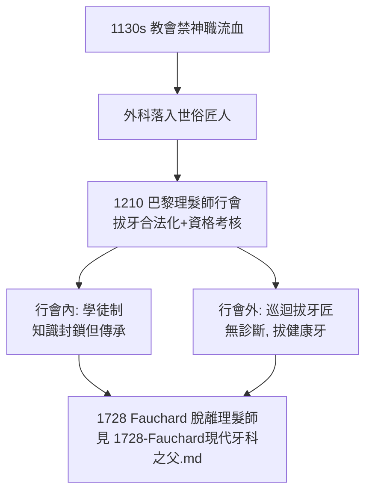

## 1210 - 理髮師外科行會（紅白招牌下的拔牙匠）

## 案件摘要

**誰在 800 年前的巴黎替你拔牙？答案：你的理髮師。**

1210 年前後，巴黎的理髮師與外科匠人組成行會（Confrérie des barbiers et chirurgiens），獲准執行包括**拔牙、放血、灌腸、小手術**在內的「外科技術」。此後數百年，「理髮師兼外科醫生（barber-surgeon）」成為歐洲牙科的實際壟斷者——紅白相間的招牌（紅色代表血、白色代表繃帶）掛在店門口，旁邊擺著一串拔下的人牙作為廣告。牙科作為行業的「史前史」，就是在理髮店的剪刀聲與慘叫聲中度過的。

## 前因 -- 為什麼會有這個案子

- **中世紀的階級分工**：大學訓練的內科醫師（physicians）視動手為低賤，教會又禁止神職人員「讓身體流血」（1130 年起教廷多道敕令），外科操作遂落入世俗匠人之手。
- **外科與理髮的技術重疊**：放血需要刀與止血繃帶，理髮師本就天天與刀片、血液打交道——拔牙只是多添一把鐵鉗。
- **牙痛的巨大市場**：在中世紀城市，齲齒與牙周病幾乎是全民疾病，而唯一「有效」的治療就是拔牙——需求量足以養活一個專門階層。

## 線索與推理 -- 數學式、程式、理論

**線索一：行會制度的兩面性。** 行會帶來了**學徒制＋資格考核**（1210 年代起巴黎要求拔牙匠通過行會考試），這是牙科專業化的種子；但也用壟斷把知識封鎖在師徒口傳之中——技術進步緩慢。

**線索二：拔牙技術的物理學。** 當時的拔牙鉗（如 Guy de Chauliac 1363 年《大外科》所述與描繪者）多以「撬、槓桿」為主，忽視牙根解剖，牙根折斷、下頜骨骨折是家常便飯。現代拔牙力學（1840s 之後）以「**楔入—旋轉—脫位**」三步驟順牙周膜纖維方向施力：

$$ F_{extraction} \parallel \text{牙根長軸}, \quad \text{斷根率} \propto \frac{1}{\text{解剖知識} \times \text{器械設計}} $$

中世紀拔牙匠不懂牙根解剖——他們的斷根率高得驚人，而斷根殘留常導致死骨與感染。

**線索三： traveling tooth-drawers（巡迴拔牙匠）**。行會之外另有一批趕集賣藝者，以被拔牙者的慘叫與拔牙後的「奇蹟痊癒」為活廣告。他們留下的紀錄（如英國 17 世紀 Peter de la Roche 的街頭拔牙）顯示：許多人被拔掉的其實是**健康牙**——只憑病人指認痛處，而牙痛常源於鄰牙或反射痛。這是「無診斷、只治療」的極端案例。

## 結案 -- 後果與影響

- **行會制度是牙科專業化的胎盤**：資格考核、學徒制、行業倫理——這些現代牙科制度的雛形都誕生於理髮師行會；但其壟斷性也使牙科知識停滯五百年。
- **紅白招牌的遺產**：理髮店旋轉彩柱（barber pole）至今是紅白（美式加藍）配色——那是外科與理髮未分家時代的活化石。
- **「牙醫」一詞的誕生**：直到 1728 年 Fauchard 創造「chirurgien dentiste」（牙科外科醫師）一詞，牙科才開始從理髮師職業中切割出來（見 `1728-Fauchard現代牙科之父.md`）。
- **一句話結案**：中世紀的牙科沒有獨立身份，寄居在理髮店的血與繃帶之間；行會給了它資格制度，卻也給了它五百年的知識封鎖——牙科要成為科學，必須先從剪刀鋪裡搬出來。

## 關鍵人物與文獻

- **Guy de Chauliac（1300–1368）**——《大外科》（Chirurgia Magna, 1363）記載拔牙技術與牙病分類，是中世紀外科牙科最重要文獻。
- **巴黎行會章程（13 世紀）**——記載理髮師與外科匠人的執業範圍與考核。
- **Ambroise Paré（1510–1590）**——理髮外科出身而成為外科大師者，其著作含牙科章節（牙移植的早期嘗試）。
- 現代註腳——英國直到 1745 年才由喬治二世敕令將外科與理髮師行會分家；牙科完全脫離理髮師，則要到 19 世紀學院化（見 `1840-世界首所牙科學院.md`）之後。
