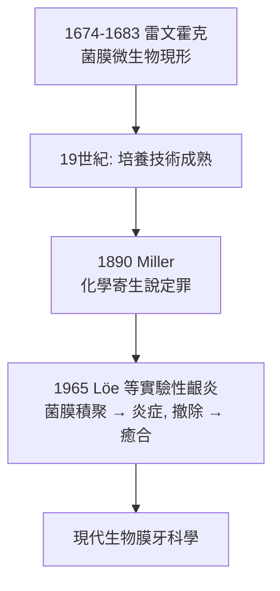

## 1683 - 雷文霍克看見牙菌膜（牙齒上的小動物）

## 案件摘要

**1674 年的一個早晨，代爾夫特的一位布商在刮下自己牙齒上的白色黏稠物後，把它放進顯微鏡——然後震驚了。**

Antonie van Leeuwenhoek 以自製的單式顯微鏡（放大約 270 倍）觀察牙齒表面的白色軟垢，看見「許多極小的動物（little animals），以最活潑的方式游動」。1676 年他系統化觀察雨水與口腔標本，1683 年 9 月在致倫敦皇家學會的信件中附上**史上第一張細菌圖繪**——包括今天所知的球菌、桿菌與螺旋體，正是牙菌膜微生物的寫真。這是細菌學史與牙科病因學的共同起點：**齲齒與牙周病的嫌犯，第一次被肉眼之外的器官目擊。**

## 前因 -- 為什麼會有這個案子

- **雷文霍克的自我取樣**：他長期以鹽水漱口、以醋擦拭牙齒，並稱自己「牙齦以上無垢」——他拿不潔者與自己潔淨的口腔對照，正是最早的「自身對照實驗」。
- **當時的病因學真空**：牙蟲說（見 `-0500-牙蟲說的五千年統治.md`）已開始動搖，但沒有替代理論。顯微鏡提供了新的證人，卻尚未能定罪。
- **皇家學會的懷疑**：單式顯微鏡的觀察一度被視為幻覺，直到 Hooke 的《顯微圖譜》（1665）與雷文霍克反覆驗證——「看見」在 17 世紀是需要被鑑識認可的證據。

## 線索與推理 -- 數學式、程式、理論

**線索一：菌膜的本質。** 雷文霍克看到的「白色黏稠物」正是**牙菌膜（dental plaque）**——附著於牙面的生物膜（biofilm）。現代認識：菌膜是細菌分泌胞外多醣（EPS）構成的三維結構，抗菌劑難以穿透。其密度驚人：

$$ n \approx 10^{11} \ \text{細胞/g 濕重菌膜}, \quad \text{物種數} > 700 $$

**線索二：醋實驗的化學推理。** 雷文霍克記載：以醋漱口後刮取菌膜，「小動物」大多死亡。今日解釋：菌膜外層細菌暴露於 pH 驟降而死亡，**但深層菌膜中的細菌存活**——這正是他誤以為「醋能根除」而齲齒仍持續的原因：他殺死了證人，卻沒端掉窩點。

**線索三：從目擊到病因的兩百年距離。** 看見微生物 ≠ 證明致病。需待 1890 年 Miller 以培養與發酵實驗完成因果鏈（見 `1890-Miller化學寄生說.md`）：

**線索四：口腔自身的防禦參數。** 雷文霍克注意到唾液能限制「小動物」數量——現代口 microbiology 確認：唾液流量、溶菌酶、免疫球蛋白與碳酸氫鹽緩衝（維持 $\text{pH} \gtrsim 6.5$ 的臨界值以下不脫礦）構成動態平衡。齲齒 = 平衡被打破：

$$ \text{脫礦} \xrightleftharpoons[\text{再礦化}]{pH<5.5} \text{齲壞} $$

## 結案 -- 後果與影響

- **細菌學與牙科在同一天誕生**：1683 年那封信的插圖，既是人類第一張細菌圖，也是第一張牙菌膜微生物圖——兩個學科共享同一份案卷。
- **漱口與清潔獲得科學依據**：雷文霍克的自我實驗使「清潔牙面」從習俗升格為技術——兩百年後 mechanical plaque control（刷牙＋牙線）成為預防醫學的基石。
- **未竟之業**：他至死未建立「微生物 → 齲齒」的因果證明；這一步要等培養基、柯霍法則與 Miller 的發酵實驗。
- **一句話結案**：一個代爾夫特布商刮下自己牙齒上的白垢，看見了扭動的小動物——嫌犯現身了，但定罪書還要等兩百年，由一位德國化學家補上「酸」這一筆。

## 關鍵人物與文獻

- **Antonie van Leeuwenhoek（1632–1723）**——代爾夫特布商、顯微鏡先驅；1683 年 9 月 17 日致皇家學會信函附口腔細菌圖繪。
- **Robert Hooke《Micrographia》（1665）**——使微觀觀察獲得科學界承認的奠基之作。
- **Löe, Theilade & Jensen（1965）**——實驗性齦炎研究，證實菌膜積聚與牙齦炎的因果關係，完成雷文霍克時代的未竟偵查。
- 現代註腳——2010 年代焦磷酸測序揭示口腔微生物組全貌（HOMD 資料庫收錄逾 700 種）；「菌膜生態失衡（dysbiosis）」取代單一病原論，成為齲齒與牙周病病因學的新範式——雷文霍克看見的「小動物們」，原來是一整個生態系。
