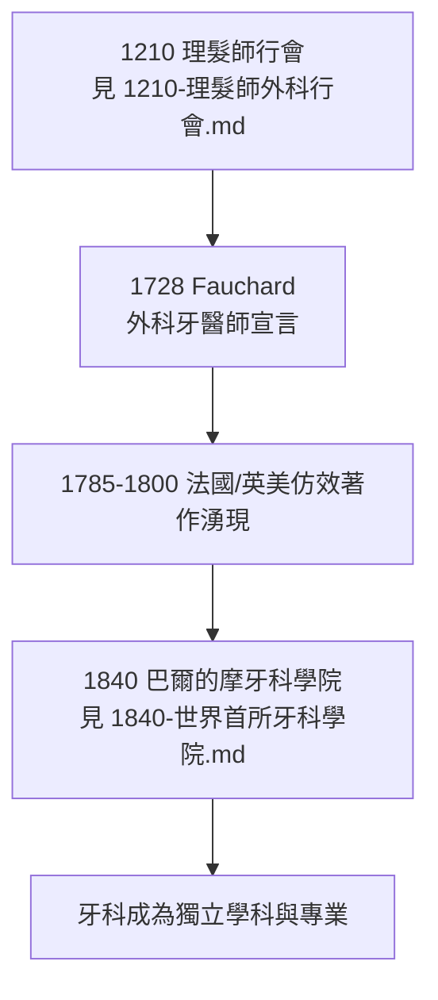

## 1728 - Fauchard 現代牙科之父（牙醫第一次自己寫書）

## 案件摘要

**1728 年，一位來自布列塔尼鄉下的法國外科牙醫，出版了兩大冊、共 863 頁的《外科牙醫師》（Le Chirurgien Dentiste, ou Traité des Dents）——牙科史上第一部系統性、原創性的綜合教科書。**

Pierre Fauchard（1678–1761）在本書中創造了「**chirurgien dentiste**」（牙科外科醫師）一詞，把牙科從理髮師的剪刀鋪裡切割出來，首次以科學態度系統整理牙齒解剖、齲齒病因、補牙材料、假牙製作與矯正技術。此後「Fauchard 之前」與「Fauchard 之後」成為牙科史的斷代線。

## 前因 -- 為什麼會有這個案子

- **18 世紀初的法國牙科現場**：行會拔牙匠、巡迴騙子、江湖藥水充斥；知識以秘方與口訣壟斷，「每次治療都是一次賭博」。
- **Fauchard 的經歷**：他 15 歲起隨海軍外科醫師 Alexandre Poteleret 學藝，在軍中與西部外省行醫二十年，1719 年定居巴黎——見盡了同行的一切弊端。
- **動機**：他在序言中直言，寫書是為了「揭露江湖術士的騙術、教授正確技術」——這是一本既是教科書又是打假報告的書。

## 線索與推理 -- 數學式、程式、理論

**線索一：病因學的理性化。** Fauchard 反對牙蟲說，主張齲齒源於「腐敗體液」與外部損傷，並強調清潔。雖然理論仍未正確（要等 Miller，見 `1890-Miller化學寄生說.md`），但他做了一件更關鍵的事：**把病因學從神話移到可辯論的經驗層面**。

**線索二：技術的系統化清單。** 本書記載並改良了：

```python
fauchard_1728 = {
    "填補": "以鉛、金箔、熔融鉛填補齲洞（首倡以金箔充填）",
    "根管": "提出清除壞死牙髓、以鉛條填充根管——根管治療的先聲",
    "假牙": "以象牙、河馬牙雕製全口與局部假牙；以彈簧固定上頜假牙",
    "矯正": "『帶狀矜（bandeulette）』弓絲矯正排列不齊——固定矯正器的原型",
    "器械": "設計拔牙鉗、牙挺，並主張『保留牙齒』而非一概拔除",
    "預防": "建議每日以海綿刷牙，反對以尿漱口的民間偏方",
}
# 影響: 這份清單就是『牙科學科』的第一份目錄
```

**線索三：「保留牙齒」範式的確立。** 在拔牙等於治療的年代，Fauchard 主張能用充填與假牙救回的牙就拔不得——這一範式後來長出根管治療學（見 `1945-根管治療學體系化.md`）與補綴學（見 `1907-Taggart精密鑄造.md`）。

**線索四：命名即宣言。** 「dentiste」古已有之，但「chirurgien dentiste」把它嵌進外科等級體系：牙醫師是有解剖學與手術訓練的外科專家，不是理髮匠。命名是職業階層的起訴書。



## 結案 -- 後果與影響

- **牙科有了自己的文獻傳統**：此後各國教科書（Bunon、Berdmore、Harris……）皆以 Fauchard 為參照點，知識累積第一次成為可能。
- **職業身份的重塑**：「dentist」逐漸取代「tooth-drawer」，牙科在歐美走向資格認證；美國 1840 年學院化直接受益於此傳統。
- **技術遺產**：金箔充填、根管充填、彈簧固位假牙、弓絲矯正——本書的每一個條目都能在今日臨床找到直系後代。
- **一句話結案**：Fauchard 沒有發現新的病原、也沒有發明麻醉，他做的是更根本的事——**把散落在江湖秘方裡的牙科知識收進一本公開的書，並宣告牙醫是一種外科職業**。教科書，才是現代牙科真正的第一顆補牙材料。

## 關鍵人物與文獻

- **Pierre Fauchard（1678–1761）**——《外科牙醫師》（1728；1746 增訂二版擴至 2 卷），被尊為「現代牙科之父」。
- **Alexandre Poteleret**—— Fauchard 的海軍外科啟蒙師。
- **Philippe Bunon（1743）**——繼 Fauchard 之後法國牙科文獻的推手，早於現代 250 年提出「預防性充填」概念。
- 現代註腳——法國 Fauchard 學會（Académie Pierre Fauchard）與美國同名學會至今以他為職業榮譽象徵；2018 年巴黎牙科史協會確認其巴黎宅邸原址並設紀念牌——第一位公開寫書的牙醫，最後以地址的形式留在巴黎街頭。
