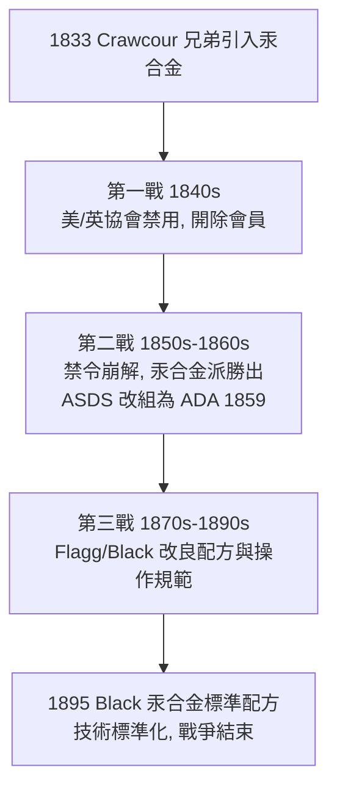

## 1833 - 汞合金戰爭（一種補牙材料引發的行業內戰）

## 案件摘要

**「以劇毒的水銀補牙」——這個指控在 19 世紀的美國牙醫界掀起了長達半世紀的戰爭。**

1833 年左右，法國裔商人 Crawcour 兄弟將銀汞合金（amalgam：銀、錫、汞調成的膏狀補牙材料）傳入紐約。它便宜、快速、不需精湛技術，迅速席捲市場——卻被主流牙醫斥為「劇毒騙術」。1840 年代，美國與英國的牙科協會相繼**禁止會員使用汞合金**（1845 年美國協會決議開除使用者），支持者與反對者互相攻訐、登報互斥，史稱 **Amalgam War**。這不只是一場材料安全之爭，更是一場**職業壟斷 vs 市場顛覆**的戰爭。

## 前因 -- 為什麼會有這個案子

- **技術背景**：金箔充填（Fauchard 以來的正統）昂貴、費時、需要數年訓練；汞合金可一步到位填入後牙窩洞——是**窮人的補牙**。
- **Crawcour 兄弟的商業模式**：登報廣告、快速連鎖式接診、治後即走——正統牙醫視之為江湖作風。
- **真正的火藥桶**：汞合金搶走了金箔派牙醫的利潤，而且降低了行業門檻。「毒性」指控與「商業」恐慌在此刻完全重疊，難以分辨動機。

## 線索與推理 -- 數學式、程式、理論

**線索一：汞的毒性問題——劑量與化學形態。** 反方證據：元素汞蒸氣有毒（工業汞中毒已廣為人知）。正方辯護：汞在合金中以金屬間化合物存在，蒸氣壓與游離汞含量極低。現代毒理學給出的框架：

$$ \text{毒性} = f(\text{劑量}, \text{形態}, \text{暴露途徑}, \text{時間}) $$

汞合金的每日汞蒸氣暴露量級為數 μg，低於 WHO 參考值，但確實不為零——「劇毒」與「安全」都是錯誤的二分。

**線索二：第一代汞合金的技術缺陷。** 1830 年代配方（銀錫比例失衡）導致：凝固緩慢、邊緣滲漏、過大的凝固膨脹**崩裂牙齒**——臨床失敗案例是真的，只是原因主要是**配方與操作**，而非汞毒。

**線索三：戰爭的三次戰役**。

**線索四：戰爭的意外成果——標準化。** 為了「證明汞合金能做對」，G.V. Black 於 1895 年提出標準合金配方（銀 68.5%、錫 25.7%、金 5.4%、鋅 0.4% 原子比設計），並規範調拌與充填技術——汞合金從江湖材料變成有化學規範的工程材料。

## 結案 -- 後果與影響

- **行業政治的定型**：Amalgam War 使美國牙科協會體系重組（1859 年 ADA 成立），專業組織學會了用「科學標準」而非「行會禁令」管理材料——這是牙科治理範式的轉移。
- **材料學成為牙科核心學科**：此戰催生牙科材料學（dental materials science），Black 的標準配方是史上第一個「處方化」的牙科材料。
- **汞毒爭議的長尾**：「anti-amalgam」運動延續至 21 世紀；2013 年聯合國《水俁公約》將汞合金列為逐步削減項目——173 年後，這場戰爭以國際條約的形式收尾（以樹脂與玻璃離子替代，見 `1955-Buonocore酸蝕技術.md`）。
- **一句話結案**：汞合金戰爭的「兇手」從來不是水銀本身，而是**沒有標準**——一旦 Black 把配方與操作寫成規範，同一種材料就從「騙術」變成「工程」。材料無罪，無知才有罪。

## 關鍵人物與文獻

- **Crawcour 兄弟**——1833 年將汞合金商業化引入紐約，戰爭的導火索。
- **American Society of Dental Surgeons（ASDS, 1840）**——1845 年決議會員禁用汞合金，1856 年因禁令失守而瓦解；1859 年改組為 American Dental Association（ADA）。
- **G.V. Black（1895）**——標準汞合金配方與操作規範，終結戰爭；見 `1890-GV Black窩洞分類.md`。
- 現代註腳——2010 年代 FDA 仍認可汞合金用於成人（對孕婦與兒童持保留態度）；奈米銀粉與高銅合金不斷改良其性能——一種被詛咒了兩百年的材料，至今仍在世界各地的後牙咬合面上服役。
