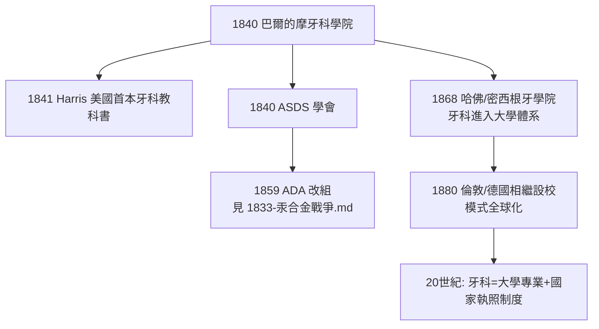

## 1840 - 世界首所牙科學院（牙科從手藝變成學科）

## 案件摘要

**1840 年 3 月 6 日，美國馬里蘭州巴爾的摩，世界第一家牙科學院開學——牙科第一次擁有了自己的大學、自己的學位（DDS）與自己的知識體系。**

巴爾的摩牙外科學院（Baltimore College of Dental Surgery，今馬里蘭大學牙學院）由 Horace Hayden 與 Chapin Harris 創立。同年夏天，兩人再創立美國牙外科學會（ASDS，ADA 前身）。這兩件事合起來完成了一場「身份革命」：牙科從理髮匠與學徒制的世界，升格為**有入學考試、有三年課程、有臨床實習、有國家學位**的獨立專業。

## 前因 -- 為什麼會有這個案子

- **學院拒收的屈辱**：Harris 曾申請就讀醫學院以習牙科，被拒——當時美國醫學院認為牙科不配進入大學課程。這一挫折成為「另起爐灶」的直接動機。
- **牙科的知識真空**：Fauchard（見 `1728-Fauchard現代牙科之父.md`）之後雖有文獻，但培養仍靠學徒口傳——品質無法保證，江湖術士與正統牙醫難以區分。
- **美國的社會條件**：民主化、市場化、無貴族行會壟斷——恰恰是新專業最容易自立門戶的環境。

## 線索與推理 -- 數學式、程式、理論

**線索一：創立者的雙人組合邏輯。** Hayden 是資深牙醫兼地質學講師（後成為賓州大學礦物學教授），Harris 是年輕牙醫兼編著者（1841 年出版美國第一本牙科教科書 *The Dental Art*）。一個提供學術合法性，一個提供課程綱要——**專業化需要「學科＋制度」兩條腿**。

**線索二：學位的發明。** 學院頒發 **DDS（Doctor of Dental Surgery）**——世界上第一個牙科學位。學位不只是榮譽，而是**可驗證的資格信號**，讓公眾能在江湖與專業之間做出選擇。

**線索三：課程架構的推理。** 初期課程（冬季課程約 4–5 個月）：

```python
curriculum_1840 = {
    "基礎科學": ["解剖學", "生理學", "病理學", "化學"],
    "臨床科學": ["牙體操作", "補綴學", "口腔外科"],
    "實習": "學院附設診室臨床操作（世界首創的牙科教學診所）",
    "畢業要求": "兩個冬季課程 + 臨床病例 + 論文答辯",
}
# 設計原則: 牙科=醫學基礎科學+專科操作技術, 兩者缺一不可
```

**線索四：制度擴散的速度**。



## 結案 -- 後果與影響

- **專業壟斷的合法性來源改變**：從行會師徒（見 `1210-理髮師外科行會.md`）轉為「學院教育＋國家執照」——現代牙科治理的基礎設施由此鋪設。
- **美國模式的世界勝利**：DDS 學位、四年制學院、教學診所的模式被全球採用；牙科在多數國家成為與醫學並列的獨立一級學科（世界僅有的少數例子之一）。
- **陰影**：學院化也使牙科與醫學體系**分離**至今——口腔是身體的一部分，但牙醫與內科醫生的培養、保險、制度長期割裂，成為現代醫療體系的著名結構缺陷。
- **一句話結案**：Harris 被醫學院拒之門外，於是帶著 Hayden 另建一扇門——1840 年的巴爾的摩證明：一門手藝要成為科學，需要的不是更精的鉗子，而是一間教室、一份課表和一張文憑。

## 關鍵人物與文獻

- **Horace Henry Hayden（1769–1844）**——創院院長、地質學家；美國牙科學院化之父。
- **Chapin Aaron Harris（1806–1860）**——首任教務長，著 *The Dental Art*（1841）；「牙科教育之父」。
- **Baltimore College of Dental Surgery（1840）**——現為 University of Maryland School of Dentistry，世界最古老牙學院。
- 現代註腳——2020 年代，牙科教育正以虛擬模擬器、AI 影像判讀重回「與醫學融合」的討論——1840 年那道被拒的門，正在以數位化的方式重新打開。
