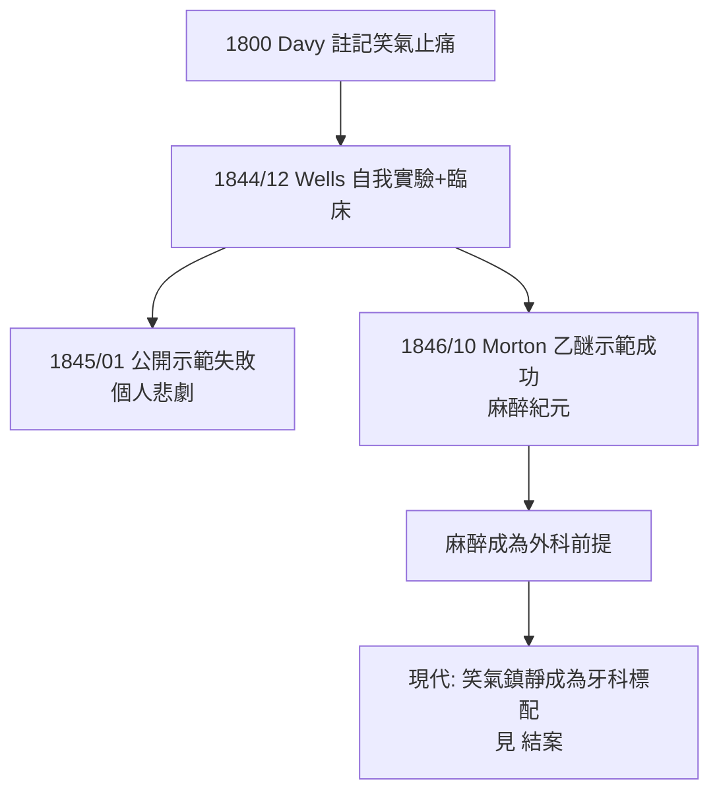

## 1844 - 笑氣麻醉拔牙（牙科診椅上的麻醉革命）

## 案件摘要

**1844 年 12 月 11 日，康乃狄克州哈特福。一位 29 歲的牙醫 Horace Wells 在看過一場「笑氣狂歡秀」後，次日讓同事替自己吸入笑氣、拔掉自己的一顆牙——全程無痛。麻醉醫學的第一頁，寫在牙科的診椅上。**

Wells 隨即在波士頓公開示範，卻因病人喊痛而當眾受辱，抑鬱終至悲劇結局；1846 年他的前合夥人 William Morton 以乙醚完成麻醉史上最著名的公開示範，並同樣以拔牙為展示項目。麻醉的發明權之爭（Wells、Morton、Jackson 三人至死互訟）也是醫學史上最慘烈的優先權戰爭——但本案的核心是：**牙痛，逼人類發明了無痛手術。**

## 前因 -- 為什麼會有這個案子

- **拔牙的恐怖統治**：在麻醉之前，拔牙=公開處刑級的痛；病人以烈酒、鴉片勉強撐住，休克與猝死並不罕見。誰能止痛，誰就擁有市場。
- **笑氣的娛樂前置**：1800 年 Davy 已注意到笑氣止痛性（自己牙痛時吸入緩解），並寫下「或許可用於外科手術」——但四十年無人當真；笑氣淪為巡迴秀的笑料。
- **Wells 的關鍵觀察**：1844 年 12 月 10 日，他在秀場看到一名吸笑氣者絆倒撞腿流血卻**毫無痛覺**——他立刻做出因果推理：不是藥使他不痛到撞牆，而是藥**關閉了痛覺**。

## 線索與推理 -- 數學式、程式、理論

**線索一：笑氣的作用機理。** $\text{N}_2\text{O}$ 是 NMDA 受體拮抗劑兼內源性鴉片系統促動劑：鎮痛強、意識保留、恢復快——**恰好是拔牙的理想麻醉窗**：

$$ \text{鎮痛} \gg \text{鎮靜} > \text{意識消失（高濃度才發生）} $$

拔牙只需鎮痛＋輕度鎮靜，不需深度意識喪失——這就是為何麻醉史選擇牙科作為首戰：**戰場最小，成功門檻最低。**

**線索二：Wells 的自我實驗流程**。

```python
def wells_experiment_1844():
    date = "1844-12-11"
    subjects = "Wells 本人（先試）→ 15 餘例臨床病人"
    agent = "一氧化二氮（笑氣）"
    protocol = "玻璃袋吸入 → 意識淺昏迷 → 拔牙 → 蘇醒追問"
    result = "本人: 『無痛拔牙的新時代開始了』; 多數病人證實無痛"
    failure = "1845-01 波士頓麻省總醫院公開示範: 病人中途喊痛, 當眾失敗"
    return {"success_private": True, "failure_public": True}

print(wells_experiment_1844())
```

**線索三：為何公開示範會失敗？** 復盤指向兩個混淆變項：（1）劑量不足或病人已部分甦醒；（2）**病人心理預期**——劇場式示範中病人的焦慮抬高了痛覺。個案有效 ≠ 可重複公開——這是麻醉藥理與臨床心理的第一課。

**線索四：從笑氣到乙醚的接力。** 1846 年 10 月 16 日 Morton 以乙醚在麻省總醫院完成麻醉示範（病人同日先被 Morton 拔牙證實無痛）；1848 年 James Young Simpson 再將氯仿用於產科。三者共同的先聲都是**拔牙試驗**。



## 結案 -- 後果與影響

- **外科手術範式的跳變**：麻醉使「速度競賽」（19 世紀初切腿手術以分鐘計）轉為「精度競賽」——沒有麻醉，就沒有後來的根管治療（見 `1945-根管治療學體系化.md`）與植牙（見 `1952-Branemark骨整合.md`）。
- **牙科的榮耀與冤屈**：Wells 1848 年在紐約街頭以氯仿自傷被捕，當晚自殺——他在遺書中堅稱自己是麻醉發現者。法國科學院 1870 年代裁定 Wells 為麻醉「發現者」、Morton 為「應用者」；今日公認兩人皆有貢獻。
- **現代牙科的鎮痛階梯**：笑氣鎮靜（1844 起用至今）、局部麻醉（1884 年可卡因、1905 年 Procaine——皆由牙科醫生/藥理學家推動）、靜脈鎮靜——牙科診椅始終是麻醉技術最先落地的地方。
- **一句話結案**：一個看戲的牙醫從別人的腿傷裡讀出了止痛的可能性，並用自己的牙齒做了對照組——麻醉不是外科醫生的發明，而是一個被牙痛逼到牆角、又被一場喜劇點醒的年輕人的推理。

## 關鍵人物與文獻

- **Horace Wells（1815–1848）**——笑氣麻醉的發現者；哈特福 1844-12-11 自我實驗。
- **William T.G. Morton（1819–1868）**——乙醚麻醉公開示範者；其墓誌銘之爭延續至今。
- **Humphry Davy（1778–1829）**——*Researches, Chemical and Philosophical*（1800）最早記錄笑氣止痛。
- 現代註腳——笑氣至今仍是全球牙科最常用的吸入鎮靜劑；2020 年代研究更提示亞麻醉劑量 $\text{N}_2\text{O}$ 具快速抗抑鬱潛力——這個在狂歡秀上被當笑料的氣體，仍在改寫醫學。
