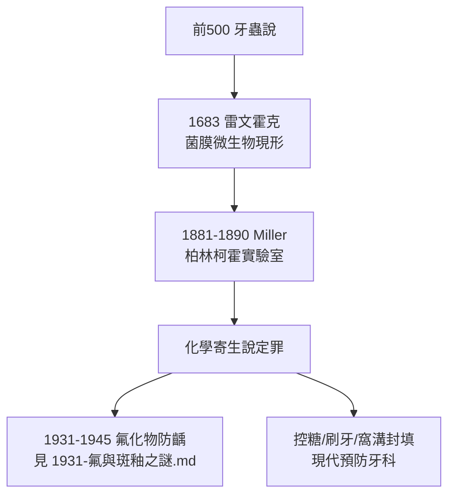

## 1890 - Miller 化學寄生說（齲齒病因學的牛頓時刻）

## 案件摘要

**牙為什麼會蛀？五千年來的答案是「牙蟲」（見 `-0500-牙蟲說的五千年統治.md`）；1890 年，一位在柏林柯霍研究所工作的美國牙醫，用試管與發酵管給出了最終答案：細菌＋糖＋酸。**

Willoughby D. Miller（1853–1907）於 1881–1890 年間在柯霍（Robert Koch）實驗室完成系統研究，1890 年出版《人類口腔中的微生物》（*The Micro-organisms of the Human Mouth*），提出齲齒的**化學寄生說（chemico-parasitic theory）**：口腔細菌發酵碳水化合物產酸，酸溶解琺瑯質，細菌隨後侵入牙本質。這是醫學史上第一次有人把齲齒的因果鏈完整地放進試管。

## 前因 -- 為什麼會有這個案子

- **證人早已在場**：1674 年雷文霍克已看見菌膜微生物（見 `1683-雷文霍克看見牙菌膜.md`），但兩百年間無人證明它們與齲齒的因果關係。
- **柏林的技術優勢**：1880 年代柯霍的固體培養基與純種培養技術剛剛問世——這是全世界的細菌學中心；Miller 作為牙醫走進細菌學聖地，帶去了沒人研究的標本：牙齒。
- **個人的跨界身份**：Miller 是賓州出身的美國牙醫，先取得牙科學位、後赴柏林深造化學與細菌學——**牙科知識＋柯霍方法**，這個組合在當時全球僅此一人。

## 線索與推理 -- 數學式、程式、理論

**線索一：核心方程。** 化學寄生說可濃縮為一條三段式因果鏈：

$$ \text{碳水化合物} \xrightarrow{\text{產酸菌}} \text{有機酸（乳酸為主）} \rightarrow [\text{H}^+] \uparrow \Rightarrow \text{琺瑯質脫礦} $$

$$ \text{Ca}_{10}(\text{PO}_4)_6(\text{OH})_2 \rightleftharpoons 10\text{Ca}^{2+} + 6\text{PO}_4^{3-} + 2\text{OH}^- $$

當菌膜局部 pH 低於臨界值（約 5.5），平衡右移，羥磷灰石溶解——**「寄生」指細菌，「化學」指酸；兩者缺一不可。**

**線索二：Miller 的實驗設計**。

```python
def miller_experiments_1881_1890():
    results = {
        "拔下的人牙+唾液+糖, 37-42°C 培養": "數週後出現類似齲齒的脫礦軟化",
        "加入防腐劑(殺菌)的對照組": "不發生脫礦 → 細菌是必要條件",
        "以無菌酸液處理": "出現同樣脫礦 → 酸是充分執行者",
        "自齲洞分離出數十種菌": "多數能在體外產酸 → 兇手是一個團夥",
        "觀察齲洞細菌侵入牙本質小管": "證實細菌參與後期基質破壞",
    }
    return results
# 結論: 齲齒 = 細菌產酸的化學溶解過程, 而非『蟲』的啃噬
```

**線索三：團夥作案的生態學洞見。** Miller 的重要細節：沒有任何單一菌種能獨自解釋全部齲齒——他認定兇手是**由多種產酸與產蛋白酶細菌構成的菌叢**。1960 年代 Keyes 與 1970 年代 Loesche 將此發展為「特定菌斑假說」，並指認變形鏈球菌（*Streptococcus mutans*）與乳酸桿菌為主犯——Miller 的「團夥論」在近百年後獲得分子確認。

**線索四：為何化學寄生說能勝出？** 它滿足了病因學的全部檢驗：可分離（培養）、可再現（體外復現病變）、可預測（糖攝取頻率與齲齒率的關係）、可干預（控糖＋清潔即降齲）——牙蟲說五千年做不到的，試管兩年做到了。



## 結案 -- 後果與影響

- **現代預防牙科的理論地基**：刷牙（除菌膜）、控糖（斷底物）、氟化物（強化琺瑯質，見 `1931-氟與斑釉之謎.md`、`1945-自來水加氟.md`）——三大支柱全部由化學寄生說直接導出。
- **糖與齲齒的流行病學**：「糖的**攝取頻率**比總量更關鍵」（每一次加餐都是一次 pH 驟降）——這一推論至今指導全球飲食建議。
- **未竟之問**：Miller 的理論解釋了「酸從哪來」，卻未回答「為何有人蛀、有人不蛀」——宿主因素（唾液、氟、菌叢結構）的個體差異，要到氟化物時代（1930s）與微生物組時代（2010s）才補齊。
- **Miller 本人的悲劇結局**：1907 年他因闌尾炎術後感染去世，年僅 54 歲——被自己畢生對抗的「細菌感染」擊倒。
- **一句話結案**：Miller 把牙齒、糖和細菌一起放進試管，五千年懸案就此定讞：兇手是細菌，兇器是酸，幫凶是糖——而人類手中從此握有第一份可以執行的預防守則。

## 關鍵人物與文獻

- **W.D. Miller（1853–1907）**——*The Micro-organisms of the Human Mouth*（1890）；德文版 *Die Mikroorganismen der Mundhöhle*（1889）。
- **Robert Koch（1843–1910）**——純種培養技術與柯霍法則的建立者，Miller 的實驗室東家。
- **Keyes（1960）、Loesche（1976）**——特定菌斑假說與變形鏈球菌確認，Miller 理論的 20 世紀續章。
- 現代註腳——2010 年代口腔微生物組研究揭示：健康牙面與齲壞面是同一生態系的兩種狀態（dysbiosis）——化學寄生說被升級為「生態菌斑假說」，但核心方程「糖＋菌→酸→脫礦」一個字都沒改。
