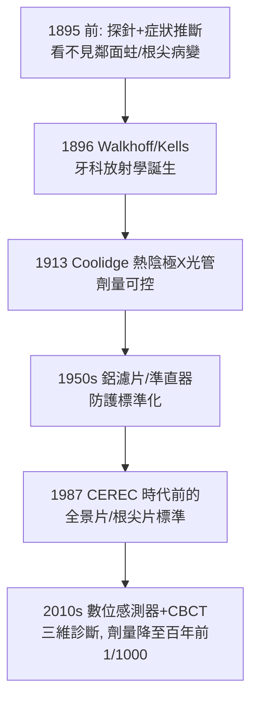

## 1895 - X 光透視牙齒（看不見的蛀洞現形）

## 案件摘要

**1895 年 11 月 8 日，倫琴在維爾茨堡發現 X 光；僅僅七週後——1896 年 1 月，一位德國牙醫就把它對準了自己的牙齒。牙科成為最早採用 X 光的臨床專科之一，比外科手術透視還早。**

Otto Walkhoff 於 1896 年 1 月以玻璃照相底片咬在口中、曝光 25 分鐘，拍出史上第一張牙科 X 光片；同年 Frank Harrison（英格蘭）與 C. Edmund Kells（美國，1896 年 4 月）相繼跟進。Kells 此後三十年推動牙科放射學，其本人卻因長期無防護曝露而失去手指、最終死於輻射相關癌症——牙科放射學的第一頁，寫著巨大的個人代價。

## 前因 -- 為什麼會有這個案子

- **牙科的診斷盲區**：1895 年之前，牙醫只能看見牙冠；鄰面蛀洞、牙根形態、根尖病變、埋伏齒、頜骨囊腫——全部藏在骨頭後面。「探針＋經驗」時代的誤診率極高。
- **倫琴的發現瞬間引爆全球實驗**：X 光能穿透軟組織、被骨與金屬阻擋的物理特性（1895-12-28 論文《論一種新型射線》），幾週內被全球實驗室復現。
- **牙科的天然優勢**：牙齒小、金屬修復體阻射性極強、口內定位直觀——牙科是 X 光最容易「立刻有用」的領域。

## 線索與推理 -- 數學式、程式、理論

**線索一：成像的物理原理。** X 光衰減服從朗伯定律：

$$ I = I_0 \, e^{-\mu t}, \quad \mu_{\text{金屬}} \gg \mu_{\text{牙質}} \gg \mu_{\text{軟組織}} $$

琺瑯質（礦物密度最高）最白、牙本質次之、齲壞脫礦區偏黑、根尖骨質破壞區現出暗影——**齲齒與根尖病變第一次可以被「看見」而非被猜測。**

**線索二：Walkhoff 的 25 分鐘**。

```python
def first_dental_xray_1896():
    film = "玻璃乾版（市售照相底片）"
    exposure = 25 * 60          # 秒：今日同片位曝光約 0.1-0.2 秒
    subject = "Walkhoff 本人右上後牙"
    finding = "牙冠與金修復體可辨 → 技術可行性確認"
    dose_ratio = exposure / (0.15 * 60)   # 約一萬倍
    return f"曝光時間為現代劑量的約 {dose_ratio:.0f} 倍"

print(first_dental_xray_1896())
# 結果: 開創性 = 可行性證明, 而非安全示範
```

**線索三：Kells 的系統化與悲劇。** Kells（新奧爾良）1896 年起將 X 光引入牙科臨床，發明牙科 X 光機支架與口內持片器，1920 年代推廣「每顆待治療牙都應拍片」；他在無防護環境中反覆以自己的手測試射線強度，手指壞疽截肢逾 8 次，1928 年死於輻射誘發惡性腫瘤。他的日記式記錄成為輻射防護法規的血淚原始數據。

**線索四：診斷學的邏輯改變**。



## 結案 -- 後果與影響

- **牙科診斷從「症狀驅動」變成「影像驅動」**：鄰面齲、根尖周炎、牙周骨吸收、阻生齒——現代治療計畫（根管測長、植牙定位，見 `1952-Branemark骨整合.md`）無一不以 X 光為前提。
- **輻射防護學的臨床起點**：牙科放射的早期傷亡（Kells 與眾多先驅）直接推動 1920–1930 年代國際輻射防護委員會（ICRP）體系建立；今日牙科單張根尖片劑量僅數 μSv，是百年前的約千分之一。
- **法醫學的新工具**：牙科 X 光比對（修復體形態的個體獨特性）自 20 世紀中葉成為災難遇難者辨識的標準方法——牙齒成為「不會燒毀的指紋」。
- **一句話結案**：倫琴發現了射線，牙醫們在七週內就把它咬進了嘴裡——他們不知道劑量、不戴鉛衣、用自己的手指當測試計；牙科放射學不是被設計出來的學科，而是一群急著看見蛀洞的人用血換來的。

## 關鍵人物與文獻

- **Wilhelm Conrad Röntgen（1845–1923）**——1895-11-08 發現 X 光，1901 年首屆諾貝爾物理學獎。
- **Otto Walkhoff**——1896 年 1 月首張牙科 X 光片（曝光 25 分鐘）。
- **C. Edmund Kells（1856–1928）**——牙科放射學之父；其截肢與死亡成為輻射防護史的原點文獻。
- **W.D. Coolidge（1913）**——熱陰極 X 光管，使牙科曝光可控且可重複。
- 現代註腳——CBCT（錐束 CT，1990 年代末引入牙科）使植牙定位精確至 0.1 mm 級；AI 齲齒影像判讀（2020 年代）正把「看片」推向自動化——從 Walkhoff 的 25 分鐘到今日的 0.1 秒，射線照亮的蛀洞始終是同一個。
