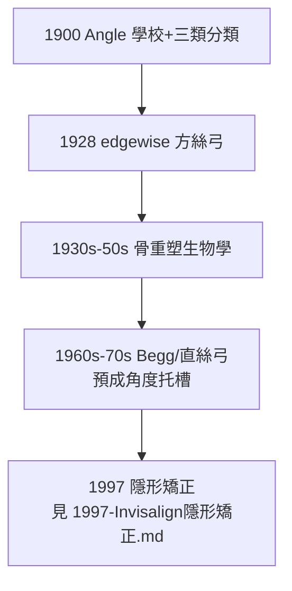

## 1900 - Angle 矯正學與錯矜分類（牙科的幾何美學誕生）

## 案件摘要

**牙齒長歪了該怎麼治？治到什麼樣算「對」？在 1900 年之前，這是無標準答案的手藝；1900 年之後，全世界用一套三類分法和一個「理想矜」的幾何定義作答。**

Edward H. Angle（1855–1930）——被尊為「現代矯正學之父」——於 1900 年在聖路易創辦世界首所矯正專科學校（Angle School of Orthodontia），提出沿用至今的**錯矜分類（Class I/II/III）**，並主張矯正的目標是「**理想正常矜（ideal occlusion）**」：上下頜十二對牙齒各就各位、尖窩交錯的完美幾何。矯正學從此成為牙科第一個正式專科。

## 前因 -- 為什麼會有這個案子

- **「矜（occlusion）」的問題意識覺醒**：19 世紀末假牙修復要求上下頜關係可複製，催生了咬合學；補牙與修復也要求「咬得對」。牙科需要一個共同的咬合座標系。
- **Angle 的雙重身份**：他既是補綴醫師（對咬合極敏感），又是系統編撰者——他先把別人的分類（1840s Lefoulon 等）整理、簡化，再以自己名字定型。
- **社會動機**：20 世紀初，牙齒排列開始被視為「社會形象」問題——中產階級願意為「美觀＋健康」付費，矯正成為牙科第一個**選擇性消費**專科。

## 線索與推理 -- 數學式、程式、理論

**線索一：以「上頜第一小臼齒」為錨點的分類。** Angle 的天才處在於**選一個參考系**：他認定上頜第一小臼齒位置永遠恆定（「解剖學鑰匙」），以咬合時下牙相對它的位置分類：

$$ \Delta_{arch} = \text{下頜第一小臼齒頰尖相對上頜第一小臼齒近頰溝的前後距離} $$

- $\Delta_{arch} = 0$：**Class I**（中性矜，牙列擁擠但關係正常）
- $\Delta_{arch} > 0$（下牙偏後）：**Class II**（遠中矜，俗稱「暴牙」）
- $\Delta_{arch} < 0$（下牙偏前）：**Class III**（近中矜，俗稱「地包天」）

**線索二：一套分類就夠了嗎？** Angle 假設「每個人都應有 32 顆牙排成理想弓形」，故主張**不拔牙**。其高足 Tweed（1930s–40s）以復發病例證明：不少病例必須拔牙才能穩定——Tweed 當眾拔除自己四顆健康前臼齒並接受矯正以示信念。本案的推理鏈：

```python
def angle_vs_tweed():
    assumption = "32 顆牙 + 理想弓形 = 穩定且美"
    test = "Tweed 復發病例的長期追蹤"
    finding = "牙弓長度不足時, 排齊 32 顆必致復發或前突"
    revision = "拔牙指數: 需求空間 > 可得空間 → 拔除前臼齒"
    return revision  # Angle 的『不拔牙教條』被其學生修正

print(angle_vs_tweed())
```

**線索三：矯正器的工程化**。Angle 陸續發明 E 形弓（1907）、釘管矯正器（1912）、帶狀弓（1916），至 **edgewise（1928）**定型——方槽配合方形弓絲，使醫師可對每顆牙施加**三維六自由度**的精確控制：

$$ \vec{F} = (F_x, F_y, F_z), \quad \vec{M} = (M_x, M_y, M_z) \quad \text{每顆牙的完全操縱} $$

這是生物力學在牙科最純粹的工程應用：**以梁的彎曲與扭轉力學，在兩年內把牙齒沿設計路徑推進骨內重塑。**

**線索四：骨重塑的生物學依據**。牙齒為何能被移動？1930 年代 Sandstedt、Oppenheim 與 1950s Reitan 的組織學確立：受壓側骨吸收、受張側骨沉積——牙齒「移動」其實是**牙槽骨圍繞牙根重建**。



## 結案 -- 後果與影響

- **牙科第一個專科誕生**：Angle 學校培養出早期所有矯正大師；1929 年美國確立矯正專科認證——專科化模式隨後複製到牙週、根管等（見 `1945-根管治療學體系化.md`）。
- **「理想矜」的遺產與反噬**：Angle 的完美幾何推動了技術，也製造了「不完美即病態」的過度醫療傾向；1960 年代起「以功能與穩定為目標」的務實路線回歸。
- **社會效應**：矯正成為青少年中產階級的成人禮，也成為牙科最「消費品化」的分支——今日全球正畸市場以百億美元計，其源頭是 1900 年聖路易的一間小學校。
- **一句話結案**：Angle 以一顆牙為錨、一套三類為座標，把「牙齒亂」這個人人看得見卻無人能定義的問題，變成了可測量、可分級、可施工的工程項目——牙科的第一門美學，是幾何學。

## 關鍵人物與文獻

- **Edward H. Angle（1855–1930）**——*Treatment of Malocclusion of the Teeth*（1907，第七版為經典）；Angle 學校（1900–1928）培養出約 180 名早期矯正核心人物。
- **Charles Tweed（1895–1970）**——拔牙爭論的實證派，1936 年成立 Tweed 基金會。
- **P. Raymond Begg（1950s）**——細絲輕力技術，適合拔牙病例的澳洲路線。
- 現代註腳——今日矯正以直絲弓、自鎖托槽與隱形矯正（見 `1997-Invisalign隱形矯正.md`）為主流；Angle 的 Class I/II/III 分類仍是全球病歷的第一行——1900 年的座標系，120 年後依然在服役。
