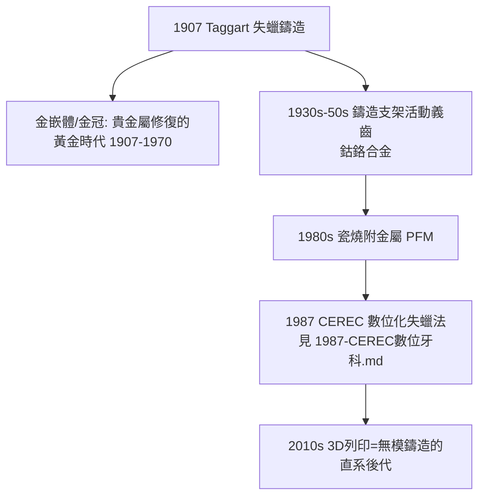

## 1907 - Taggart 精密鑄造（讓補牙物「一體成形」）

## 案件摘要

**如何給一顆磨損的牙做一個與牙齒嚴絲合縫、整塊成形的「金盔甲」？**

1907 年，芝加哥牙醫 William H. Taggart（1855–1935）發表牙科**精密鑄造法（lost-wax casting）**：以蠟在口內直接雕塑出窩洞的完美複製品，包埋在耐熱石膏中，燒失蠟體後以離心鑄造機將熔金瞬間注入空腔——一次澆鑄，得到與牙齒毫米級貼合的整鑄金嵌體。失蠟法是文藝復興大師（Cellini、Benvenuto）鑄銅像的古老技藝，Taggart 把它縮小百倍搬進了口腔。

## 前因 -- 為什麼會有這個案子

- **Black 範式的延伸需求**：G.V. Black 的窩洞幾何（見 `1890-GV Black窩洞分類.md`）解決了「怎麼磨」，但汞合金是「邊填邊塑」的多體材料，邊緣密合度受限；大面積缺損需要**整塊、預製、精確**的修復體。
- **前人的半步**：19 世紀已有用蠟取模再敲打金箔成型的方法（1860s W. H. Dixon 等），但鎚打金件無法精確複製複雜窩洞。
- **牙科技術的加持**：口內印模材（1860s 印模膏、1920s 水膠體）與牙科用電爐、包埋材已成熟——只差一個「把蠟像變成金屬」的關鍵動作。

## 線索與推理 -- 數學式、程式、理論

**線索一：失蠟法的物理核心——凝固收縮補償。** 金屬從熔點冷卻到室溫會收縮 1.2–1.5%，若不補償，鑄件必然偏小。Taggart 方案的解法藏在包埋材的**熱膨脹**：

$$ \Delta V_{casting} = \underbrace{\Delta V_{metal\ shrink}}_{-1.2\text{–}1.5\%} + \underbrace{\Delta V_{investment\ expand}}_{+1.5\text{–}2.0\%} \approx 0 $$

升溫燒圈時包埋材膨脹，恰好抵消金屬冷卻收縮——**用兩個相反的誤差做加法，得到一個精確。**

**線索二：離心鑄造的必要性**。熔金在毫秒內冷卻，重力澆鑄來不及填滿細部；Taggart 採用發條驅動的離心機，以離心加速度把熔金射入空腔：

$$ a_{centrifugal} = \omega^2 r \quad (\gg g, \text{數百倍重力}) $$

```python
def taggart_process_1907():
    steps = [
        "1. 口內以蠟直接雕刻窩洞複製品（含鄰接點與咬合面）",
        "2. 蠟型安插澆道, 以石膏-石英包埋材包埋",
        "3. 加熱燒圈: 蠟氣化逸失 → 精確負型",
        "4. 發條離心機: 熔金 (約1064°C) 瞬間注入",
        "5. 拆圈、噴砂、口內試戴與研磨拋光",
    ]
    precision = "邊緣密合度 ~20-50 μm（手工鎚打法無法達到）"
    return steps, precision
```

**線索三：優先權風波。** Taggart 1907 年發表並申請專利，此後以訴訟對同業收費，風評受損；同年 Philadelphians（如 J. F. & C. H. Smith）亦有相近展示，1869 年 Bevor 與 1880 年代 J. Marion Sims 時代已有零星齒科鑄造記錄——但**系統化、可重複、公開傳授**的是 Taggart，這也是他最終被記住的緣故。

**線索四：嵌體範式的誕生**。



## 結案 -- 後果與影響

- **補綴學的工業化**：牙科技工所（dental laboratory）作為獨立產業自此興起——牙醫負責口內、技工負責口外的分工沿用至今。
- **貴金屬修復的百年統治**：金嵌體、金冠、鑄造支架——1907–1980 年代，精密鑄造是牙科固定修復的絕對主流。
- **成為所有「預製修復體」範式的母版**：瓷嵌體、CAD/CAM 磨削（見 `1987-CEREC數位牙科.md`）與 3D 列印的邏輯都是「在口外做一個精確複製品」——Taggart 的失蠟法是它們的共同祖先。
- **一句話結案**：Taggart 把文藝復興的鑄銅術縮進了口腔：蠟的精確、火的消失、離心的推力——三個百年老技術的組合，讓「給牙齒鑄一副金甲」從想像變成標準工序。

## 關鍵人物與文獻

- **William H. Taggart（1855–1935）**——1907 年發表 *A New and Practical Method of Making Artistic and Perfect Fitting Cast Fillings*；美國牙科學會 1907 年會展示。
- **G.V. Black**——其窩洞設計為鑄造嵌體提供了幾何規範；兩人工作合稱「操作牙科的雙支柱」。
- **現代註腳**——數位化時代，口內掃描取代口內蠟雕、研磨/列印取代離心鑄造，但「熱膨脹補償收縮」的設計思想仍存在於陶瓷燒結收縮的演算法補償中——1907 年的誤差加法，以程式碼的形式繼續運行。
