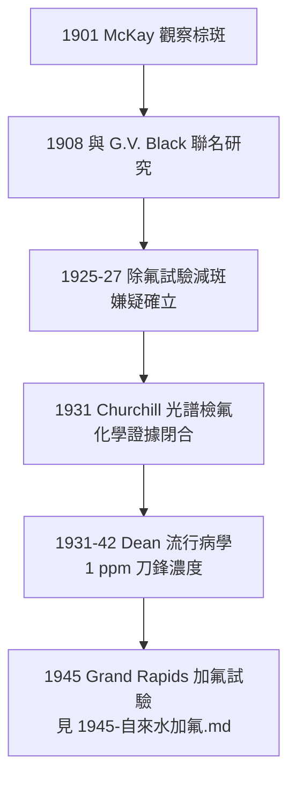

## 1931 - 氟與斑釉之謎（從棕斑牙到防齲聖杯）

## 案件摘要

**為什麼科羅拉多有些小鎮的孩子，牙齒上長著洗不掉的棕色斑紋——卻幾乎不蛀牙？**

1901 年起，年輕牙醫 Frederick McKay 在科羅拉多斯普林斯執業，被當地人稱為「科羅拉多棕斑（Colorado brown stain）」的釉質斑紋所困擾：斑牙極醜，卻齲齒極少。他花了三十年追查水源；1931 年，化學家 H.V. Churchill 以光譜分析一錘定音——斑釉的元兇是**飲水中的氟**。隨後 H. Trendley Dean 接手，把「致毒的氟」反轉為「防齲的氟」，寫出公共衛生史上最漂亮的偵探—反轉劇本。

## 前因 -- 為什麼會有這個案子

- **McKay 的執著**：1908 年他與 G.V. Black（見 `1890-GV Black窩洞分類.md`）聯名發表首篇研究；Black 至死認為病因未明——本案的第一位偵探，是把「地方怪病」升格為科學問題的人。
- **已有的毒理線索**：1916 年起文獻已猜測水質；1925–1927 年南非、義大利報告以鋁土礦除氟後斑牙減輕——氟嫌疑浮現，但缺**化學證據**。
- **關鍵的地理對照**：斑牙分布與水系完全重合、與人種經濟無關——「水裡有什麼」成為唯一待檢驗假設，但 1920 年代常規水質分析根本不測氟（含量極低）。

## 線索與推理 -- 數學式、程式、理論

**線索一：Churchill 的光譜定罪（1931）。** 阿爾圖納（賓州）供水公司為查自家水質怪案，請鋁業化學家 Churchill 做光譜分析；他在斑釉流行區水樣中檢出 **13.7 ppm 氟**，對照區僅 0–0.4 ppm。數月內三個實驗室（Churchill、Smith/Lantz/Mitchell、Velz）獨立確認——**同案三鑑定，證據鏈閉合**。

**線索二：Dean 的劑量—反應曲線（1931–1942）。** Dean（美國公共衛生署牙醫）帶隊調查 21 州 335 個城鎮，繪出經典雙相曲線：

$$ \text{氟斑率} \propto [F^-], \quad \text{齲齒率} \propto \frac{1}{[F^-]} \quad (0 \le [F^-] \lesssim 1\,\text{ppm}) $$

氟約 1 ppm 時齲齒下降約 50–60% 而氟斑輕微可忽略；>2 ppm 斑牙率急升——**1 ppm 是毒與藥的刀鋒**。

**線索三：機理——氟與琺瑯質化學**。氟的防齲機理是一組化學反應的疊加：

1. **形成氟磷灰石**：$ \text{Ca}_{10}(\text{PO}_4)_6(\text{OH})_2 + \text{F}^- \rightarrow \text{Ca}_{10}(\text{PO}_4)_6\text{F}_2 + \text{OH}^- $，氟磷灰石的溶解度更低、臨界 pH 從 5.5 降至約 4.5——**同樣的酸，溶不動了**。
2. **促進再礦化**：低濃度氟使早期脫礦病灶重新沉積礦物（這是局部氟的關鍵機理，比「長進牙齒」更重要）。
3. **抑菌**：氟抑制細菌烯醇酶，切斷糖酵解——細菌產酸能力下降。

## 結案 -- 後果與影響

- **公共衛生最大的單一防齲杠杆**：飲水加氟、含氟牙膏（1955 年起）、氟漆氟膠——氟化物在 20 世紀使發達國家兒童齲齒率下降 50% 以上，被 CDC 列為 20 世紀十大公共衛生成就之一。
- **劑量思維的教科書案例**：「氟是毒還是藥」的唯一答案是「多少」——本案成為毒理學教學的經典（見 `1945-自來水加氟.md` 的後續爭議）。
- **牙科流行病學的成年禮**：Dean 的 335 城鎮調查建立了指數（Dean's fluorosis index, 1934/1942）與大規模對照調查的方法學——牙科第一次擁有流行病學的量尺。
- **一句話結案**：一個不願放棄疑點的小鎮牙醫追了三十年棕斑，最後由一位鋁業化學家用光譜儀抓到元兇——而人類的反轉操作更絕：他們沒有把氟關進監獄，而是把它按 1 ppm 的劑量請進了自來水廠。

## 關鍵人物與文獻

- **Frederick S. McKay（1874–1959）**——科羅拉多棕斑的三十年的追查者；1960 年代獲 Lasker 獎。
- **G.V. Black（1836–1915）**——早期合作者，賦予本案學術合法性。
- **H.V. Churchill**——Alcoa 化學家，1931 年光譜分析定罪（*J. Am. Water Works Assoc.*, 1931）。
- **H. Trendley Dean（1893–1962）**——「氟化物之父」；21 州流行病學調查（1931–1942）；後主持 1945 年加氟試驗。
- 現代註腳——2010 年代研究精修了氟的作用模型：釉下氟化鈣（CaF₂）儲庫—再礦化動態，解釋了為何**低頻高濃度局部用氟**效果優於高頻低濃度——斑釉之謎的最終答案，是一份可以寫成微分方程的化學劇本。
