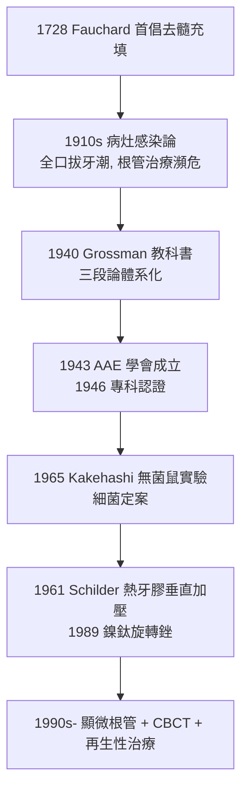

## 1945 - 根管治療學體系化（保住牙齒的第三條路）

## 案件摘要

**牙髓壞死的牙，必須拔掉嗎？**

二十世紀中葉之前，這問題的答案常常是「拔」。1940 年代前後，以 Louis Grossman（1900–2002）為代表的美國學派，把散落在各處的根管技術整理為**清創（debridement）—消毒（disinfection）—充填（obturation）**三段論，出版教科書（*Root Canal Therapy*, 1940 年首版後歷經八版）、創立學會（AAE，1943）與專科認證——根管治療從「江湖技藝」變成「可以教、可以評、可以複製」的科學。牙科因此獲得第三條路：**不拔、不換，救回自己的牙。**

## 前因 -- 為什麼會有這個案子

- **Fauchard 的先聲**（見 `1728-Fauchard現代牙科之父.md`）：18 世紀已有「去髓＋金屬充填」的嘗試，但感染控制與材料都不可靠，失敗率極高。
- **病灶感染論的反噬**：1910 年代，英國醫生 Hunter 的「病灶感染（focal infection）」學說席捲歐美——一切慢性病歸咎於「壞牙窩」，掀起**大規模全口拔牙潮**；根管治療被貼上「留著感染源」的標籤，瀕臨滅絕。
- **翻案的證據**：1930–40 年代細菌學與病理研究（Fish、Burket 等）證明：經過完善的根管清創與封閉，根尖病變可以癒合——「病灶」不是治療方法之罪，而是治療失敗之罪。

## 線索與推理 -- 數學式、程式、理論

**線索一：三段論的邏輯結構**。根管治療本質是「在密閉骨腔內滅菌再封填」的工程問題：

$$ \text{成功率} = f(\text{清創徹底度}, \text{封閉嚴密度}, \text{冠方密封}) $$

```python
def root_canal_protocol(grossman_school=True):
    if grossman_school:
        steps = {
            "1. 開髓與建立通路": "直線進入根管口",
            "2. 工作長度": "X光片法測定根尖止點（後由電子測長儀補強）",
            "3. 清創成形": "擴大銼去除感染牙本質, 形成連續錐度",
            "4. 消毒": "次氯酸鈉沖洗 + 根管封藥（氫氧化鈣）",
            "5. 充填": "牙膠+封糊劑側方/垂直加壓, 嚴密封閉根尖",
            "6. 冠方修復": "冠修復防微滲漏——治療成敗的最後一環",
        }
    return steps
# 三段論: 清創 → 消毒 → 充填, 每段都有可檢驗的量化標準
```

**線索二：細菌學的定案**。1965 年 Kakehashi、Stanley 與 Fitzgerald 的經典大鼠實驗：無菌鼠的露髓牙**不發生**髓壞死與根尖炎，普通鼠則發生——**牙髓壞死與根尖炎的元兇是細菌，且僅僅是細菌**。這使「滅菌」成為根管治療的絕對目標，體系的最後一塊理論基石落定。

**線索三：器械與材料的接力**。



**線索四：鎳鈦的力學革命（1988–1993）**。Walia 與 Luebke 將鎳鈦合金（超彈性）引入根管銼：彈性模量約為不鏽鋼的 1/4，可沿彎曲根管前進而少扭轉根管——彎根的清理徹底度大幅提升，此後成為全球標配。

## 結案 -- 後果與影響

- **「保留天然牙」範式勝利**：根管治療成功率（今日約 85–95%）使數以億計的牙齒免於拔除；現代根尖手術、意向再植乃至再生性牙髓治療（2010 年代）都是本範式的延伸。
- **專科制度成型**：AAE（1943）與根管治療專科（endo）成為繼矯正（見 `1900-Angle矯正學與錯矜分類.md`）後的重要專科——牙科專科化進入快車道。
- **病灶感染論的教訓**：以「可能有毒」為由系統性切除器官的時代教訓，成為今日對「預防性拔智齒」等議題的倫理參照。
- **一句話結案**：Grossman 一代人做的事，是把「抽神經」從上世紀的賭博變成一套有步驟、有標準、有成功率的滅菌工程——牙齒的神經死了，牙不必死。

## 關鍵人物與文獻

- **Louis I. Grossman（1900–2002）**——*Root Canal Therapy*（1940–1982 八版）；賓州大學根管治療學教授，學科體系化之父。
- **John R. Callahan（1894）**——次氯酸鈉沖洗的早期倡導者。
- **Kakehashi, Stanley & Fitzgerald（1965）**——無菌鼠實驗（*Oral Surg.*），確立細菌為根尖炎唯一病因。
- **Herbert Schilder（1967）**——「清理成形三維充填」哲學，熱牙膠垂直加壓技術。
- 現代註腳——CBCT 三維成像（見 `1895-X光透視牙齒.md`）與顯微根管使治療精確到 0.1 mm 級；2010 年代起的再生性牙髓治療嘗試以血凝塊支架讓年輕恆牙的牙髓**重新長出來**——三段論的終點，是讓第三條路本身消失。
