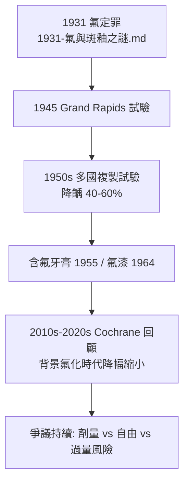

## 1945 - 自來水加氟（把流行病學寫進水廠）

## 案件摘要

**1945 年 1 月 25 日，密西根州大急流城（Grand Rapids）的自來水廠閥門緩緩開啟，氟化鈉以 1 ppm 的濃度流入全市水管——人類第一次給整座城市的水「加藥」，目標：蛀牙。**

這是全球首個社區飲水加氟試驗，以鄰市 Muskegon 為對照組。十年後的結果：大急流城兒童齲齒率下降約 **60%**。CDC 後來把飲水加氟列為 20 世紀美國十大公共衛生成就之一——同時，它也成為公共衛生史上爭議最持久的干預之一，質疑聲浪延續至今。

## 前因 -- 為什麼會有這個案子

- **Dean 的流行病學已完成推理**：1931–1942 年 21 州 335 城鎮調查（見 `1931-氟與斑釉之謎.md`）顯示天然氟 1 ppm 地區齲齒低、氟斑可忽略——「**既然天然水能做到，人工加到 1 ppm 是否同效且安全？**」
- **為何選社區試驗而非臨床試驗？** 氟的防齲效應是**群體、長期、環境暴露**性質——隨機對照在 1945 年尚無先例，社區配對（Grand Rapids vs Muskegon）是當時最嚴謹可行的設計。
- **戰後的公共衛生雄心**：二戰剛結束，美國公共衛生署正尋找大規模健康干預的旗艦項目。

## 線索與推理 -- 數學式、程式、理論

**線索一：試驗設計**。

```python
def grand_rapids_trial_1945():
    design = {
        "試驗組": "Grand Rapids（41.9 萬人）: 1945-01-25 起加氟 1 ppm",
        "對照組": "Muskegon（5.6 萬人）: 同一水源區域, 不加氟",
        "基線調查": "約 3 萬名學齡兒童口檢建檔（DMFT 指數）",
        "復查": "每年抽樣追蹤, 原計畫 10 年",
        "中途事件": "1950 Muskegon 因對照組『不公平』提前加氟<br/>（對照組受益太快 → 試驗提前宣告成功）",
    }
    return design
# 有趣的推理細節: 對照組家長抗議『憑什麼讓我們孩子多蛀牙』
# ——倫理壓力終止了對照, 也削弱了長期證據
```

**線索二：防齲的化學與暴露量計算**。兒童每日飲水約 1 L，1 ppm 意味每日攝入約 1 mg 氟——恰好落在致毒量（急性中毒 ~5 mg/kg）之下數百倍、防齲最優窗口之內：

$$ \text{每日攝入} \approx [F^-]_{water} \times V_{drinking} = 1\,\text{mg/L} \times 1\,\text{L} = 1\,\text{mg/day} $$

機理主軸（現代認識）：釉下 **CaF₂ 儲庫** 的緩釋與**再礦化促進**：

$$ \text{脫礦} \xrightleftharpoons[\text{F}^- \text{催化的再礦化}]{\text{產酸}} \text{病礦} \quad \text{氟把天平推向右側} $$

**線索三：證據的擴散**。1955 年後荷蘭 Tiel、紐西蘭 Hastings、加拿大 Brantford（與 Sarnia 對照）等多國試驗相繼確認降齲 40–60%；2000 年英國 York 系統性回顧與 2010 年代 Cochrane 綜述確認：加氟使兒童 DMFT 顯著下降（Cochrane 2024 更新版：約 26% 的降幅，低於早期——因為**含氟牙膏的背景效應稀釋了水氟的邊際效果**）。



## 結案 -- 後果與影響

- **20 世紀最有效的群體防齲干預**：加氟地區世代兒童缺牙數銳減；配合含氟牙膏，已開發國家老年人口第一次「帶著自己的牙齒進養老院」。
- **持久爭議的三個層次**：（1）**安全**——過量致氟斑與氟骨症（1 ppm 附近安全餘量大但非零，2010 年代研究對幼兒高氟暴露與智商的爭論仍在進行）；（2）**倫理**——未經個人同意的群體投藥；（3）**政治**——1950 年代的陰謀論（「共產主義陰謀」）使科學爭論長期變質。本案提醒：**公共衛生中最難的不是劑量計算，而是共識建構。**
- **方法學遺產**：社區試驗（community trial）作為研究設計類型自此確立，後來的碘鹽、葉酸強化麵粉皆循此模式。
- **一句話結案**：大急流城的水廠工人擰開的不是閥門，而是一個兩難的閥門——把藥放進所有人喝的水，是史上最划算的防齲工程，也是個人自由與集體利益最著名的化學摩擦。

## 關鍵人物與文獻

- **H. Trendley Dean（1893–1962）**——試驗總設計師；美國公共衛生署牙醫主管。
- **David Ast 与 Francis Arnold**——基線與歷年口檢報告（*Public Health Reports*, 1946–1956）。
- **Cochrane Database（2000, 2024）**——系統性回顧確認效力並量化「牙膏時代」的邊際效果。
- 現代註腳——2020 年代，美國數十個城市就停加氟舉行公投；科學界的共識仍然是：**在含氟牙膏普及的地區，水氟的邊際收益縮小，但在弱勢與低自費能力人群中最有效**——1945 年的方案，如今更像一個公平問題而非化學問題。
