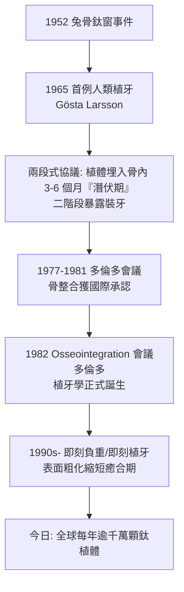

## 1952 - Branemark 骨整合（讓缺牙從骨頭裡「重新長出來」）

## 案件摘要

**缺掉的牙能再生嗎？牙科史上有兩種答案：做假牙「補」，或做植牙「種」。讓「種」成立的關鍵發現，來自一個與牙科毫無關係的兔子實驗——而且是一個差點被當成失誤丟掉的觀察。**

1952 年，瑞典哥德堡的解剖學家 Per-Ingvar Brånemark（1929–2014）研究骨髓顯微循環，把鈦製光學觀察窗埋進兔子脛骨；實驗結束時，**鈦窗與骨頭長在一起，取不下來了**。他命名這一現象為「**骨整合（osseointegration）**」，並在 1965 年把第一顆鈦植體種進一位下頜無牙病人的嘴裡——那位病人帶著這組植體用了四十多年，直到去世。牙科修復的最高難題，被一個「失誤」破解了。

## 前因 -- 為什麼會有這個案子

- **植牙的千年失敗史**：從古埃及以貝殼、金屬植牙，到 1809 年 Maggiolo 的金植體、1930–50 年代的螺旋植體與骨膜下框架植體——失敗的共同模式是**異物反應：纖維組織包裹，植體鬆動、感染、脫落**。
- **當時的教條**：醫學界公認金屬與活骨之間必然隔著一層纖維結締組織——「異物反應不可違背」。Brånemark 的觀察直接挑戰這一教條。
- **為何是鈦？** 鈦 1940 年代才進入航空業；其表面在空氣中即刻形成 3–5 nm 的二氧化鈉鈍化層，近乎絕對惰性——**「不反應」恰恰使它「被接受」**。

## 線索與推理 -- 數學式、程式、理論

**線索一：意外觀察的鑑識。** 1952 年的兔子脛骨實驗中，觀察窗無法取出——Brånemark 沒有把它當成裝置失誤，而是換了個問題：「**骨與鈦之間到底發生了什麼？**」組織學切片顯示：骨組織與鈦表面**直接接觸、無纖維介入層**——在當時的教科書裡，這是不該存在的影像。

**線索二：骨整合的力學定義**。Brånemark 團隊將骨整合量化定義為「在光學顯微鏡下，有序活骨與承力植體表面直接接觸」：

$$ \text{骨接觸率（BIC）} = \frac{\text{骨與植體表面直接接觸的周長}}{\text{植體總周長}} \quad \text{臨床穩定通常需} \gtrsim 50\% $$

一顆粗 4 mm、長 10 mm 的螺紋植體，表面積遠大於光滑樁——螺紋設計把咬合剪切力轉為**壓應力**（骨喜歡壓、討厭剪）：

$$ \tau_{shear} \downarrow, \quad \sigma_{compressive} \uparrow \Rightarrow \text{Wolff 定律: 骨依受力重建增強} $$

**線索三：從兔到人的十年堅持**。1952–1965 年，Brånemark 團隊在狗、兔反覆驗證，並自費購入南美蜘蛛猴做長期研究（申請經費被拒——評審認為「牙醫的問題不屬於基礎科學」）。1965 年 8 月，第一位病人 Gösta Larsson（下頜無牙＋唇顎裂）接受 4 顆植體，至其 2005 年去世植體仍在服役。

**線索四：臨床協議的誕生——兩段式**。

**線索五：學界的頑抗**。1960–70 年代，歐美主流斥植體為「瑞典人的時髦玩意」；Brånemark 的回應是**無懈可擊的長期數據**——1970 年代起發表 10 年成功率 >90%（當時假牙修復的任何方案都拿不出這種數字）。1982 年多倫多會議上，反對派親手檢視植入多年後取出的骨—鈦標本，陣營當場倒戈。

## 結案 -- 後果與影響

- **牙科修復的第三次革命**：活動假牙 → 固定橋（需磨小鄰牙）→ **植牙（不動鄰牙、咬合力直傳骨）**——缺牙治療從「替代」升級為「重建」。
- **跨科的技術外溢**：骨整合原理被移植到骨科（人工關節柄）、顱頜面赝復（義眼義耳的錨定）與聽骨鏈假體——牙科偶然的發現反哺了整個外科。
- **經濟規模**：植牙今日是牙科最大單一市場（全球年逾千萬顆），並催生 CBCT 定位、導航手術、即刻負重等整條技術鏈（見 `1895-X光透視牙齒.md`）。
- **Brånemark 的晚年**：他始終自稱「觀察現象的解剖學家」，並堅持稱病人為「受邀參與研究者」；2014 年去世前仍致力於降低植牙成本的免費診療項目。
- **一句話結案**：兔子腿上一顆取不下來的鈦片，推翻了「金屬必被纖維包裹」的百年教條——骨整合的故事告訴我們：**劃時代的發現常常不缺技術，只缺一個不肯把異常當失誤扔掉的人。**

## 關鍵人物與文獻

- **Per-Ingvar Brånemark（1929–2014）**——骨整合發現者與命名者；1977/1985 年專著 *Tissue-Integrated Prostheses*；1992 年獲瑞典皇家工程科學院大獎（常被戲稱「植牙界的未頒諾獎」）。
- **Gösta Larsson（1931–2005）**——1965 年首例植牙病人，人類骨整合的活檔案。
- **Tomas Albrektsson**——長期合作者，骨整合生物學與長期成功率研究的定調者。
- 現代註腳——表面粗化（噴砂酸蝕 SLA，1980s–90s）把癒合期從 6 個月縮到 3–8 週；鋯陶瓷植體與生物活性塗層正在挑戰鈦的壟斷——但所有後來者，都在追求 1952 年那個秋日裡「取不下來」的同一種奇蹟。
