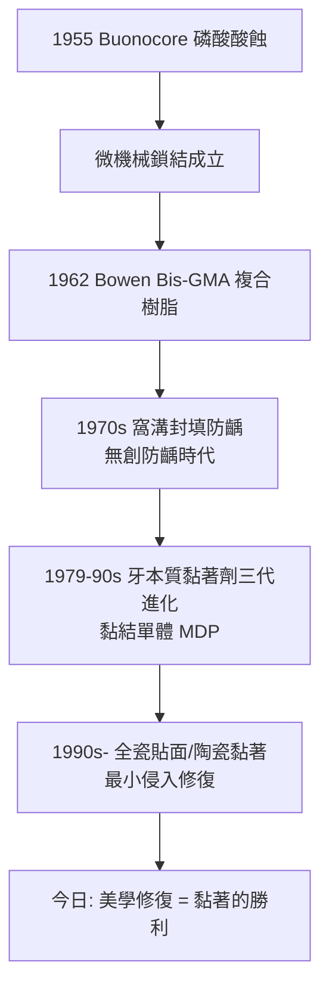

## 1955 - Buonocore 酸蝕技術（讓樹脂「長進」牙齒裡）

## 案件摘要

**補牙材料為什麼總會掉？因為汞合金只能「塞進」牙齒，不能「黏在」牙齒上。**

1955 年，紐約羅徹斯特東莞牙科診斷組的 Michael Buonocore（1918–1981）發表了一篇僅四頁的論文，提出以**磷酸酸蝕牙釉質表面**，使其出現微孔結構，再讓樹脂流入孔中固化——以「微機械鎖結」實現黏著。這是**黏著牙科（adhesive dentistry）**的起點：補牙從「洞的幾何」轉向「面的化學」，Black 的「擴展預防」帝國（見 `1890-GV Black窩洞分類.md`）從此開始崩塌。

## 前因 -- 為什麼會有這個案子

- **材料學的兩難**：1940–50 年代，丙烯酸樹脂（壓克力）已問世，但直接充填失敗率極高——樹脂與牙面之間**沒有任何化學或機械結合**，邊緣滲漏、脫落是常態。
- **靈感的跨界來源**：Buonocore 在工業界（塗料黏著）背景深厚；工業上「預處理表面以增強附著」的思路，被他類比到牙齒——**把牙釉質當成要噴漆的金屬來處理**。
- **窩溝封填的動機**：1950 年代起學界已認知咬合面窩溝是齲齒最大巢穴（Class I，見 Black 分類），急需一種「不磨牙的防齲塗層」——黏著是它的先決條件。

## 線索與推理 -- 數學式、程式、理論

**線索一：酸蝕的顯微結構**。37% 磷酸作用 15–30 秒，溶解釉柱間質，形成 5–50 μm 深的多孔層：

$$ \text{Ca}_{10}(\text{PO}_4)_6(\text{OH})_2 + \text{H}^+ \rightarrow \text{Ca}^{2+} + \text{H}_2\text{PO}_4^- \quad (\text{表面選擇性溶解}) $$

樹脂藉毛細作用流入微孔，聚合後形成**樹脂突（resin tag）**陣列——黏著力主要來自微機械互鎖：

$$ T_{bond} \approx 20\text{–}25\,\text{MPa} \quad (\text{未酸蝕} < 5\,\text{MPa}) $$

**線索二：Bowen 的接力——化學黏著的材料（1962）**。NIST 的 Ray Bowen 把環氧樹脂的強度與甲基丙烯酸的聚合性結合，合成 **Bis-GMA** 樹脂基質，並加入硅烷化石英填料——**複合樹脂**誕生。Buonocore 的「錨孔」＋Bowen 的「鉤子」，兩步合體：

**線索三：範式革命的推理**。黏著成立後，Black 時代的幾何前提逐一失效：

| Black 前提（無黏著） | 黏著時代的新解 |
|---|---|
| 需要倒凹/鴉尾固位 | 黏著即固位，可保留倒凹外的健康齒質 |
| 鄰面洞需擴至窩溝（預防性擴展） | 只清病灶＋窩溝封填即可 |
| 材料靠厚度抵抗咬合 | 樹脂黏著層分散應力，修復可薄可小 |

$$ V_{cavity}^{adhesive} \approx V_{lesion} \ll V_{cavity}^{Black} $$

**「最小侵入（minimally invasive dentistry）」**成為新教條——牙醫百年來第一次「越治越少磨」。

**線索四：意外的預防果實**。酸蝕＋樹脂的**窩溝封填（pit and fissure sealant）**於 1960–70 年代被系統驗證：封填後咬合面齲降低約 70%——Buonocore 原本為補牙設計的技術，最大受益者卻是**不補牙的孩子**。

## 結案 -- 後果與影響

- **補牙材料版圖重寫**：汞合金（見 `1833-汞合金戰爭.md`）百年霸主地位被複合樹脂逐步取代——2010 年代後，多數國家後牙樹脂充填量已超過汞合金。
- **牙科美學工業誕生**：貼面、瓷冠黏著、全瓷修復（見 `1907-Taggart精密鑄造.md` 的數位後裔）全部建立在黏著之上；「微笑設計」成為產業。
- **1955 年論文的孤獨**：Buonocore 的文章起初被主流期刊拒稿，發表於較小雜誌，數年內引用寥寥——黏著革命的火種，是一篇「無人引用的短文」。
- **一句話結案**：Buonocore 用一把牙刷、一瓶磷酸和工業塗料的思路，證明了樹脂可以「長進」牙齒的微孔裡——牙科史上最便宜的 15 秒（酸蝕時間），換來了此後 70 年的修復革命。

## 關鍵人物與文獻

- **Michael G. Buonocore（1918–1981）**——*A Simple Method of Increasing the Adhesion of Acrylic Filling Materials to Enamel Surfaces*（*J. Dent. Res.*, 1955）；「黏著牙科之父」。
- **Ray L. Bowen（1922–2020）**——Bis-GMA 與複合樹脂（1962）；NIST 終身研究員，美國國家技術獎章得主。
- **John W. McLean 與 Fujimaki/中林（1970s–80s）**——牙本質黏著與 4-META/MDP 黏結單體，把黏著從釉質推進牙本質。
- 現代註腳——第七代自酸蝕單瓶黏結劑把酸蝕—打底—黏著壓縮成一步 20 秒；而「再礦化黏著」（含 CaP/氨基酸）正嘗試讓黏著層自己修復微滲漏——1955 年開啟的化學，仍在迭代。
