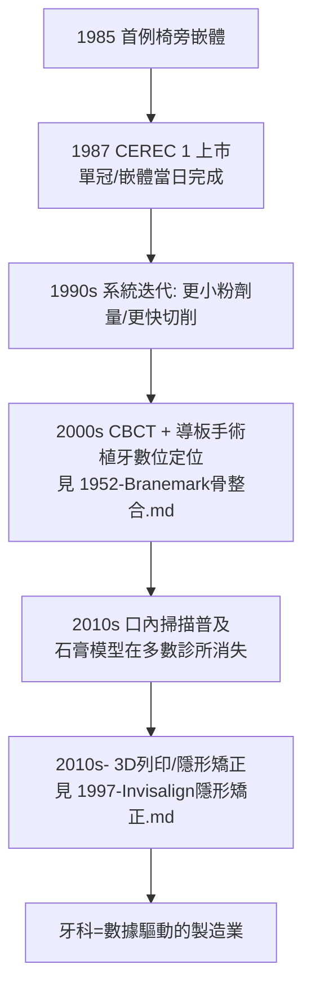

## 1987 - CEREC 數位牙科（把牙科搬進電腦裡）

## 案件摘要

**做一個牙冠，要幾次就診？傳統答案：兩次以上，中間戴著難看的臨時冠等數週。1987 年起，答案可以是「一次、兩小時、當場戴走」。**

1980 年，蘇黎世大學的 Werner Mörmann 與電機工程師 Marco Brandestini 開始研發**椅旁 CAD/CAM**系統；1985 年首例臨床應用，1987 年 CEREC（CEramic REConstruction）1 代系統由 Sirona 上市——光學口內取像、電腦設計、金剛砂磨盤當場切削陶瓷嵌體。這是牙科的數位化原點：**印模、石膏模型、技工所三件套，第一次被一台機器取代。**

## 前因 -- 為什麼會有這個案子

- **傳統工序的痛點**：印模材會收縮變形、石膏模型有誤差、技工往返郵寄耗時——每一步都在累積誤差與等待。
- **黏著革命鋪路**：Buonocore 酸蝕（見 `1955-Buonocore酸蝕技術.md`）使「少量磨牙＋黏著陶瓷」成為可能；Taggart 鑄造（見 `1907-Taggart精密鑄造.md`）確立了「口外預製修復體」範式——CEREC 是把這個範式從蠟與金換成**像素與陶瓷**。
- **陶瓷的成熟**：1970–80 年代可切削長石質陶瓷塊（Vita Mark I/II）研發成功——硬到能做牙冠，又恰好能被磨盤切削。

## 線索與推理 -- 數學式、程式、理論

**線索一：光學取像的原理**。CEREC 1 使用主動三角測量：將條紋光投在牙面，由相機與投影器的已知幾何反算深度：

$$ z = \frac{b \cdot f}{d} \quad (b\text{: 基線},\ f\text{: 焦距},\ d\text{: 視差}) $$

整顆牙被掃成數萬個深度點——**牙齒第一次變成了點雲**。

**線索二：設計與切削的工程邏輯**。

```python
def cerec_workflow_1987():
    steps = {
        "1. 光學印模": "粉劑反光處理 + 紅外條紋掃描 → 點雲",
        "2. 設計": "螢幕上以『基本體元』拼出嵌體外形（早期為半自動）",
        "3. 對接面定位": "以鄰牙與對矜齒自動約束",
        "4. 切削": "雙軸金剛砂盤, 預製陶瓷塊, 約 6 分鐘磨出嵌體",
        "5. 黏著": "酸蝕氫氟酸 + 矽烷偶聯 + 樹脂水門汀",
    }
    time = "首次就診約 1.5-2 小時, 無臨時冠、無二次印模"
    return steps, time
```

**線索三：誤差鏈的長度對比**。傳統路徑的誤差是**串聯疊加**的；數位路徑砍掉了兩個變形環節：

$$ \varepsilon_{traditional} = \varepsilon_{impression} + \varepsilon_{model} + \varepsilon_{wax} + \varepsilon_{casting} \gg \varepsilon_{digital} = \varepsilon_{scan} + \varepsilon_{mill} $$

實測：早期 CEREC 邊緣間隙約 100–200 μm（可接受），現代系統與口掃已達 30–50 μm——**與頂級手工相當，且沒有手抖**。

**線索四：數位化的擴散曲線**。



## 結案 -- 後果與影響

- **技工產業的顛覆與重生**：手工蠟雕技工大量轉型為數位設計師；牙科技工從「工坊手藝」變成「軟體＋製造」行業。
- **一次就診範式的確立**：椅旁修復改寫了病人體驗，也改寫了診所經濟學——設備投資換取流程壓縮。
- **數位牙科成為牙科的「作業系統」**：今日的口掃、CBCT、AI 影像診斷、導航植牙、隱形矯正，全部運行在 1987 年 CEREC 開創的「取像—設計—製造」閉環之上。
- **一句話結案**：Mörmann 把牙齒變成點雲、把陶瓷塊變成墨水匣——CEREC 證明了一件事：牙科的核心工序從來不是「手藝」，而是**資訊的採集與還原**；一旦資訊可以數位化，牙科就必然變成製造業。

## 關鍵人物與文獻

- **Werner H. Mörmann（1934–）**——蘇黎世大學牙醫，CEREC 概念與臨床驗證的主導者。
- **Marco Brandestini**——電機工程師，光學測量與機電切削系統的設計者。
- **Sirona Dental Systems（後併入 Dentsply Sirona）**——1987 年起量產 CEREC，全球裝機逾 3 萬台。
- 現代註腳——2020 年代的 AI 設計輔助可在數秒內生成修復體外形、自動識別邊緣線；椅旁 3D 列印開始與磨削並行——CEREC 1 那台需要反光粉的笨重機器，如今看來像一個時代的 DOS 介面，但「一次就診」這個承諾，正是從它開始兌現的。
