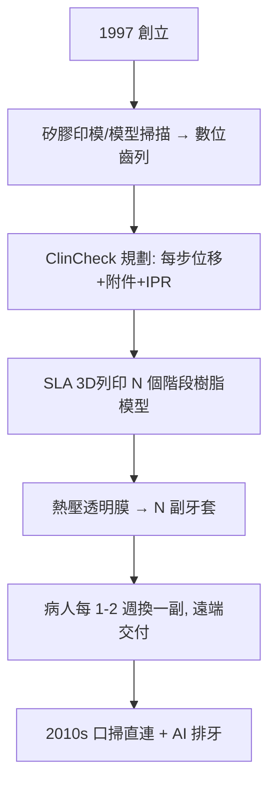

## 1997 - Invisalign 隱形矯正（把矯正器變成演算法）

## 案件摘要

**矯正一定要戴滿口鋼絲嗎？1997 年，兩位毫無牙科背景的史丹佛學生——一位想避免自己重戴矯正器的 Zia Chishta，與工程師 Kelsey Wirth——提出了一個瘋狂方案：用 3D 列印做出一整套透明牙套，讓牙齒在數十個「塑膠外殼」之間逐步搬家。**

Align Technology 於 1997 年創立，1998 年獲 FDA 許可，1999 年以 Invisalign 名義上市。起初被矯正學界集體嘲笑為「玩具」，20 年後它佔據全球矯正病例的相當份額，並迫使所有傳統廠商跟進——**矯正學從 Angle 的幾何手藝（見 `1900-Angle矯正學與錯矜分類.md`），被改寫成數據與演算法的製造業。**

## 前因 -- 為什麼會有這個案子

- **需求端的痛點**：鋼絲矯正的外觀成本（社交、職場）、清潔困難、每次回診調整——成人矯正市場長期因「不好看」而嚴重受限。
- **技術拼圖恰好湊齊（1990s）**：CT 斷層掃描（可掃石膏模型）、3D 列印（SLA 光固化已商用）、熱壓塑膠膜材（透明 PETG）、以及——關鍵的——**CAD 軟體能對牙齒做三維移動模擬**。
- **創辦人的反直覺**：Chishta 的原始構想來自自身經驗的抱怨，而非牙科知識——「外行」身份後來反而成了顛覆者的通行證。

## 線索與推理 -- 數學式、程式、理論

**線索一：分段移動的力學分解**。隱形牙套的原理是把「終點位形」切分成 N 個小步，每一步的位移量控制在生物安全範圍內：

$$ \Delta_{step} \lesssim 0.25\text{–}0.3\,\text{mm/步}, \quad N = \left\lceil \frac{\|\vec{x}_{final} - \vec{x}_{initial}\|}{\Delta_{step}} \right\rceil $$

每副牙套對牙齒施加的力來自**形變回彈**（套的目標形 − 當前齒列形）：

$$ \vec{F} = k \cdot \delta, \quad k \approx \text{膜材剛度} \cdot \text{包覆幾何} $$

**線索二：為何「塑膠殼」能控根？** 傳統 edgewise 托槽（Angle 系）可施加三維六自由度力矩（見 `1900-Angle矯正學與錯矜分類.md`）；早期透明牙套只能推牙冠傾斜（力矩控制弱）——這是學界最初否定的科學依據。Align 的補救方案：**附件（attachment）**——在牙面黏著小樹脂塊，讓牙套「抓住」更多表面以產生力矩：

```python
def invisalign_mechanics():
    bare_tray  = "純膜材: 平移易, 根轉矩/壓入/扭轉難"
    with_attach = "優化附件: 錐形/矩形塊 → 力矩臂增長, 控根可行"
    staging    = "ClinCheck 演算法: 分步 + 附件 + 鄰面去釉(IPR) 規劃"
    return {"初期侷限": bare_tray, "解法": with_attach, "規劃核心": staging}
# 演算法把『每顆牙怎麼走、何時加附件、哪裡磨掉一點鄰面』
# 全部變成可計算的規劃問題
```

**線索三：製造流程的工業化**。



**線索四：學界的倒戈曲線**。1999–2005 年，矯正專科期刊充斥負評（「適應症狹窄」「病例復發」）；2005 年後大量臨床研究確立其對輕中度病例的有效性，且**口腔衛生與美觀優勢**顯著；2010 年代起附件技術與 SmartTrack 膜材補齊力學短板——先驅們的嘲笑，被商業規模的數據反轉。

## 結案 -- 後果與影響

- **成人矯正市場爆發**：不再「鐵齒」的成年人成為矯正主力；全球矯正市場規模二十多年成長十倍以上。
- **「消費者直購」的爭議**：2010 年代末出現跳過醫生的居家直郵矯正（teledentistry），引發「誰對治療負責」的監管大戰——矯正的數位化同時鬆動了專業壟斷的堤壩（見 `1840-世界首所牙科學院.md` 建立的專業框架）。
- **隱形矯正的真正遺產**：不是透明塑膠，而是**「矯正 = 可模擬、可預視、可批量製造的移動規劃」**——ClinCheck 裡牙齒在螢幕上先走完全程，現實只是執行。
- **一句話結案**：兩個牙科外行，用 SLA 列印機和一段移動規劃演算法，在 Angle 的鋼絲帝國上撕開了一道透明裂縫——矯正學花了 100 年學會的力學，如今寫在 30 副塑膠牙套的檔案裡。

## 關鍵人物與文獻

- **Zia Chishta 與 Kelsey Wirth**——Align Technology 共同創辦人（1997）；前者為後史丹佛 MBA、矯正病人，後者為史丹佛機械工程師。
- **Align Technology, Inc.**——1998 年 FDA 510(k) 許可；ClinCheck 軟體與 SmartTrack 膜材（2013）為關鍵技術節點。
- ** angle-comparative 文獻**——2005 年起 *AJODO* 等期刊的系統性比較研究確立適應症邊界。
- 現代註腳——AI 自動排牙（2020 年代）把醫師的角色推向「審核與微調」；而「牙齒移動速度的生物學上限」（骨重塑速率，見 `1900-Angle矯正學與錯矜分類.md`）依然不可逾越——演算法可以規劃路線，但牙槽骨只按自己的日曆搬家。
