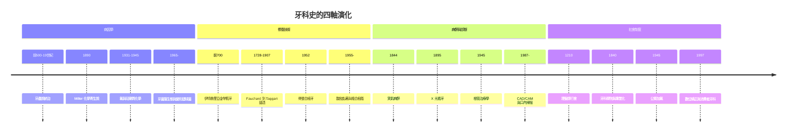

# 牙科的歷史：從史前鑽牙、牙蟲之謎、化學寄生說到骨整合與數位微笑

> 本書以「推理探案」的體例，為人類牙科史上每個關鍵事件寫一篇 wiki：
> 謎題是什麼（牙痛的元兇是誰？如何讓缺牙再生？）？偵探是誰（拔牙匠、化學家、工程師、流行病學家）？線索與推理是什麼（化學寄生說、骨整合、氟與琺瑯質化學、咬合力學）？
> 每篇檔名以年份開頭（4 位數，負年以 `-` 開頭）。

## 雙線主軸

| 線 | 演變 |
|---|---|
| **病因認知線** | 牙蟲說/體液失調 → 化學寄生說（Miller, 1890）→ 氟與琺瑯質化學（1930s）→ 牙菌膜生態與分子生物學 |
| **修復技術線** | 拔牙/金絲縛牙 → 汞合金與假牙 → 窩洞分類與精密補牙（Black）→ 根管治療 → 植牙骨整合（Branemark）→ 酸蝕黏著 → CAD/CAM 數位牙科 |

---

## 年表（非常詳細版）

### 第一篇：史前手術與古代謎團——牙蟲說統治三千年

| 年份 | 事件 | 意義 | wiki |
|---|---|---|---|
| 約前 7000 | 巴基斯坦 Mehrgarh 出土 9 顆以燧石鑽頭鑽過的臼齒 | 人類最早的牙科手術 | [-0700-梅赫爾格爾史前鑽牙](-0700-梅赫爾格爾史前鑽牙.md) |
| 約前 700 | 伊特魯里亞人以金帶縛牢人牙與牛牙製成假牙橋 | 最早成功的修復體與牙科金工 | [-0700-伊特魯里亞金帶假牙](-0700-伊特魯里亞金帶假牙.md) |
| 約前 500 | 美索不達米亞至中世紀的「牙蟲（dental worm）」說：《漢摩拉比法典》前後的楔形文字、印度《吠陀》、埃及紙草 | 一個錯誤理論統治 5000 年 | [-0500-牙蟲說的五千年統治](-0500-牙蟲說的五千年統治.md) |
| 659 | 唐代《新修本草》記載「銀膏」補牙（汞合金的最早記錄） | 汞合金比西方早約 1100 年 | [0650-唐代銀膏補牙](0650-唐代銀膏補牙.md) |

### 第二篇：拔牙匠的黃金時代與行會制度

| 年份 | 事件 | 意義 | wiki |
|---|---|---|---|
| 1210 | 法國 barber-surgeons（理髮外科行會）取得行醫執照，拔牙成為其核心業務 | 「理髮師兼拔牙匠」階級誕生 | [1210-理髮師外科行會](1210-理髮師外科行會.md) |
| 1683 | 雷文霍克以自製顯微鏡首次看見牙菌膜中的微生物 | 「牙齒上的小動物」——病因學的第一手目擊 | [1683-雷文霍克看見牙菌膜](1683-雷文霍克看見牙菌膜.md) |
| 1728 | Fauchard 出版《外科牙醫師》（Le Chirurgien Dentiste） | 「現代牙科之父」使牙科脫離理髮師 | [1728-Fauchard現代牙科之父](1728-Fauchard現代牙科之父.md) |

### 第三篇：科學化與麻醉革命

| 年份 | 事件 | 意義 | wiki |
|---|---|---|---|
| 1833 | 汞合金傳入美國，掀起長達半世紀的 Amalgam War | 材料安全之爭與牙科行業政治 | [1833-汞合金戰爭](1833-汞合金戰爭.md) |
| 1840 | 巴爾的摩牙科學院成立，世界首所牙科學院；同年 ASDS（ADA 前身）成立 | 牙科成為獨立專業與學科 | [1840-世界首所牙科學院](1840-世界首所牙科學院.md) |
| 1844 | Horace Wells 示範笑氣麻醉拔牙；1846 Morton 乙醚麻醉 | 無痛拔牙——麻醉醫學誕生於牙科診椅 | [1844-笑氣麻醉拔牙](1844-笑氣麻醉拔牙.md) |
| 1890 | G.V. Black 出版《牙體操作學》，提出窩洞分類與「擴展預防」原則 | 現代補牙幾何學的聖經 | [1890-GV Black窩洞分類](<1890-GV Black窩洞分類.md>) |
| 1890 | W.D. Miller 發表齲齒「化學寄生說」 | 齲齒病因學的牛頓時刻 | [1890-Miller化學寄生說](1890-Miller化學寄生說.md) |
| 1896 | Walkhoff 以倫琴新發現的 X 光拍攝牙齒 | 看不見的蛀洞從此現形 | [1895-X光透視牙齒](1895-X光透視牙齒.md) |

### 第四篇：預防的化學與修復的精密化

| 年份 | 事件 | 意義 | wiki |
|---|---|---|---|
| 1900 | Angle 於聖路易創立矯正學校，提出錯矜分類與「理想正常矜」 | 矯正學誕生，牙科第一次擁有自己的美學幾何 | [1900-Angle矯正學與錯矜分類](1900-Angle矯正學與錯矜分類.md) |
| 1907 | Taggart 發明精密鑄造嵌體，失蠟法進入牙科 | 補綴物從「敲打出來」變成「鑄造出來」 | [1907-Taggart精密鑄造](1907-Taggart精密鑄造.md) |
| 1931 | H.V. Churchill 化學分析證實斑釉牙之謎源於飲水中的氟；隨即 Dean 開展氟與齲齒的流行病學 | 從科羅拉多棕斑到防齲聖杯 | [1931-氟與斑釉之謎](1931-氟與斑釉之謎.md) |
| 1945 | Grand Rapids 全球首個自來水加氟試驗（10 年對照） | 公共衛生史上最偉大的預防實驗之一 | [1945-自來水加氟](1945-自來水加氟.md) |
| 1945–1950 | Grossman 等體系化根管治療學：清創、消毒、充填三段論 | 「保住牙齒」取代「拔掉牙齒」 | [1945-根管治療學體系化](1945-根管治療學體系化.md) |

### 第五篇：黏著、骨整合與數位革命

| 年份 | 事件 | 意義 | wiki |
|---|---|---|---|
| 1952 | Branemark 偶然發現鈦與骨的牢固結合，命名「骨整合（osseointegration）」；1965 首例鈦植牙 | 缺牙再生的工程學答案 | [1952-Branemark骨整合](1952-Branemark骨整合.md) |
| 1955 | Buonocore 提出酸蝕技術；1962 Bowen 發明 Bis-GMA 複合樹脂 | 黏著牙科的基石 | [1955-Buonocore酸蝕技術](1955-Buonocore酸蝕技術.md) |
| 1987 | CEREC CAD/CAM 系統上市，椅旁數位製作瓷嵌體 | 牙科進入數位製造時代 | [1987-CEREC數位牙科](1987-CEREC數位牙科.md) |
| 1997 | Align Technology 以 3D 列印與隱形牙套（Invisalign）顛覆矯正 | 矯正從鐵絲到演算法 | [1997-Invisalign隱形矯正](1997-Invisalign隱形矯正.md) |

---

## 核心線索：四大理論的接力

## 章節目錄

### 第一篇：史前手術與古代謎團
1. [-0700 梅赫爾格爾史前鑽牙](-0700-梅赫爾格爾史前鑽牙.md)
2. [-0700 伊特魯里亞金帶假牙](-0700-伊特魯里亞金帶假牙.md)
3. [-0500 牙蟲說的五千年統治](-0500-牙蟲說的五千年統治.md)
4. [0650 唐代銀膏補牙](0650-唐代銀膏補牙.md)

### 第二篇：拔牙匠的黃金時代
5. [1210 理髮師外科行會](1210-理髮師外科行會.md)
6. [1683 雷文霍克看見牙菌膜](1683-雷文霍克看見牙菌膜.md)
7. [1728 Fauchard現代牙科之父](1728-Fauchard現代牙科之父.md)

### 第三篇：科學化與麻醉革命
8. [1833 汞合金戰爭](1833-汞合金戰爭.md)
9. [1840 世界首所牙科學院](1840-世界首所牙科學院.md)
10. [1844 笑氣麻醉拔牙](1844-笑氣麻醉拔牙.md)
11. [1890 GV Black窩洞分類](<1890-GV Black窩洞分類.md>)
12. [1890 Miller化學寄生說](1890-Miller化學寄生說.md)
13. [1895 X光透視牙齒](1895-X光透視牙齒.md)

### 第四篇：預防的化學與修復的精密化
14. [1900 Angle矯正學與錯矜分類](1900-Angle矯正學與錯矜分類.md)
15. [1907 Taggart精密鑄造](1907-Taggart精密鑄造.md)
16. [1931 氟與斑釉之謎](1931-氟與斑釉之謎.md)
17. [1945 自來水加氟](1945-自來水加氟.md)
18. [1945 根管治療學體系化](1945-根管治療學體系化.md)

### 第五篇：黏著、骨整合與數位革命
19. [1952 Branemark骨整合](1952-Branemark骨整合.md)
20. [1955 Buonocore酸蝕技術](1955-Buonocore酸蝕技術.md)
21. [1987 CEREC數位牙科](1987-CEREC數位牙科.md)
22. [1997 Invisalign隱形矯正](1997-Invisalign隱形矯正.md)
