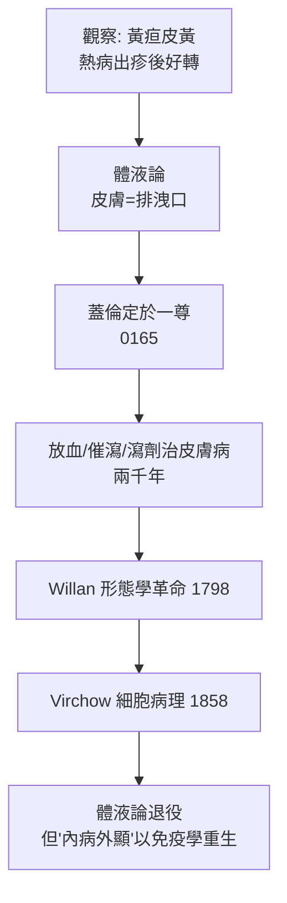

## -0400 - 希波克拉底與體液論皮膚病（內病外顯：兩千年解釋框架的開工）

## 案件摘要

**本案的兇手是一種看不見的液體，而犯罪現場是整片皮膚。**

西元前五世紀的科斯島上，希波克拉底學派提出：人體由四種體液（血液、黏液、黃膽汁、黑膽汁）構成，疾病是體液失衡的結果。皮膚病在此框架下被重新解釋——疹子不是皮膚自己的事，而是**身體把多餘或腐敗的體液排到表面的過程**。這個「皮膚是排洩口」的模型支配皮膚病學長達兩千年，直到 Willan 與 Virchow 才被拆解。

## 前因 -- 為什麼會有這個案子

- **希波克拉底之前的解釋是神學的**：癲癇被稱為「神聖病」，皮膚潰瘍是神罰。希波克拉底《論神聖病》斷言：一切疾病皆有其自然原因。
- **四體液說的宇宙論包裝**：血液—氣（春）、黏液—水（冬）、黃膽汁—火（夏）、黑膽汁—土（秋），疾病即四液比例失調。
- **皮膚症狀的觀察基礎**：黃疸使皮膚變黃（膽汁的外顯）、某些熱病出疹後病情好轉、冬天濕疹在春天緩解——這些真實觀察被體液論吸納為證據。
- **希波克拉底文集中的皮膚記載**：《內科論》（De morbis）描述膿皰、潰瘍、甲病與「psora」（脫屑性皮膚病），《論疾病七日曆》甚至以發疹日數預後。

## 線索與推理 -- 數學式、程式、理論

體液論本質上是一個**平衡動力學模型**。若以現代語言重寫：

$$ \text{健康} \iff \sum_i w_i \cdot \text{humor}_i = \text{目標平衡} \quad (i \in \{\text{血, 黏液, 黃膽, 黑膽}\}) $$

$$ \text{皮膚疹} = \text{過剩體液經皮膚的排出口流量} > 0 $$

```python
# 體液論的「排洩口」模型
def humor_balance(blood=1, phlegm=1, yellow_bile=1, black_bile=1):
    total = blood + phlegm + yellow_bile + black_bile
    if total != 4:
        excess = max(blood, phlegm, yellow_bile, black_bile) - 1
        # 排痧（crisis）：身體尋找排出口，皮膚是最方便的出口
        return f"過剩 {excess} → 經皮膚排出 → 發疹（發疹即治療的開始）"
    return "健康"

print(humor_balance(blood=1.6))
# 熱病發疹的古典解釋：疹子是身體在「自救」
```

關鍵推論有二。**其一**：體液論讓皮膚病獲得了「系統性解釋」——這是進步（不再歸咎神明）也是陷阱（停止尋找局部原因）。**其二**：發疹被視為治療過程而非疾病本身，由此推出一套放血、催瀉、飲食療法，「把多餘的液體排掉」。蓋倫將此體系精密化（`0165-蓋倫與體液論的皮膚病學.md`），兩千年後順勢療法仍以「psora 學說」的殭屍形式還魂。



最耐人尋味的線索：體液論的**核心直覺部分正確**。黃疸確實是膽紅素沈積；結節性紅斑確實是系統疾病（結核、發炎性腸道病）的皮膚窗口；乾癬確實與全身免疫相關。「皮膚是內病的窗戶」這句皮膚科格言，今天依然成立——只是窗戶後面的機制，從「四種液體」換成了細胞激素與自體抗體。

## 結案 -- 後果與影響

- **兩千年的治療慣性**：瀉劑、放血、催吐用於所有皮膚病，直到十九世紀。Hebra 嘲諷地說：體液論下的皮膚治療「讓病人餓瘦，皮疹也瘦了」。
- **「psora」的詛咒**：希波克拉底用 psora 統稱一切脫屑性皮膚病，這個模糊標籤使乾癬與癬混淆一千八百年，直到 1841 年才分家（`1841-乾癬與癬的分家.md`）。
- **醫學脫神化的先例**：以自然原因解釋疾病的立場，是日後一切皮膚病病因學（真菌、過敏、基因）的前提。
- **一句話結案**：體液論錯在液體、對在方向——皮膚確實是身體的公告欄，只是公告的文字還要兩千年才被解讀。

## 關鍵人物與文獻

- 希波克拉底（約前 460–前 370）——科斯島醫師，《希波克拉底文集》中《論神聖病》《內科論》為體液論皮膚病學的起點。
- Galen,《De humoribus》——體系化者。
- Karl Sudhoff 對希波克拉底文集皮膚篇的校勘；Litman & Litman, "The role of hippocampal... "(實為体液論史經典) A. D. Litman, *History of Dermatology* 相關綜述。
- 對照閱讀：`-1500-埃伯斯紙草與埃及皮膚處方.md`（經驗路線）與 `1798-Willan皮膚病分類學.md`（形態學路線）。
