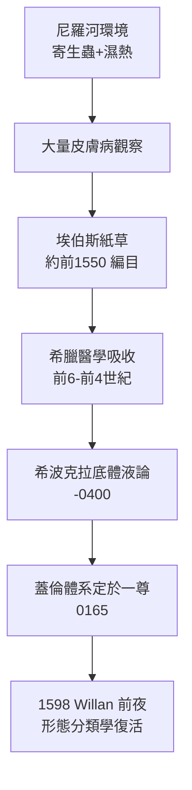

## -1500 - 埃伯斯紙草與埃及皮膚處方（最早的皮膚病檔案，寫在 20 公尺長的紙草上）

## 案件摘要

**本案偵破的，不是一種皮膚病，而是「用藥對付皮膚」這個行為的誕生。**

約西元前 1550 年，底比斯的醫者抄錄下一份長約 20 公尺、記載逾 700 種處方的醫學總匯——《埃伯斯紙草》。其中散布著對潰瘍、腫瘤、燒傷、癬、蟲咬、皮膚變色的描述與治法。在沒有顯微鏡、沒有病理學的青銅時代，埃及醫者憑肉眼與觸診，為皮膚上的每一種異常編目、歸類、開方。這份檔案將透過希臘醫學傳入地中海世界，成為皮膚科兩千年經驗傳統的第一塊基石。

## 前因 -- 為什麼會有這個案子

- **尼羅河畔是皮膚病的天堂**：濕熱、洪水、泥濘與寄生蟲（血吸蟲、蟯蟲）使埃及人飽受皮膚潰瘍、癬、膿皰與寄生蟲疹之苦。皮膚病是埃及最常見的疾病之一，醫者被迫累積大量觀察。
- **埃及醫學分工明確**：Herodotus 記載埃及醫師「各治一種病，有人只治眼、有人只治頭、有人只治牙、有人只治肚」——專科化傳統使皮膚病得到集中記錄。
- **紙草醫學文獻群**：與埃伯斯紙草並存的還有 Smith 紙草（外科）、Hearst 紙草等，顯示當時已存在成體系的醫學抄本傳統。
- **蟲論**：埃及醫學相信許多皮膚病由體內的蠕蟲（worm）引起——這是錯誤理論下的正確直覺：疥蟎確實存在，只是要等到 1687 年 Bonomo 才用顯微鏡抓到牠。

## 線索與推理 -- 數學式、程式、理論

埃及處方的「配方邏輯」可以用現代藥理拆解。以治療潰瘍與傷口的典型組合為例：

```python
# 埃伯斯紙草傷口處方的現代藥理拆解
def ebers_wound_dressing():
    ingredients = {
        "蜂蜜": "高滲透壓抑菌（現代證實對金黃色葡萄球菌有效）",
        "沒藥": "樹脂類抗菌與收斂",
        "亞麻布": "物理覆蓋與滲液吸收",
        "銅鹽/礬": "重金屬抑菌（銅離子破壞菌體蛋白）",
    }
    return "經驗有效、理論錯誤——但他們不知道自己為什麼有效"

print(ebers_wound_dressing())
```

埃伯斯紙草對皮膚病的分類直覺，其實暗合現代的形態分類：

| 紙草用語 | 推測對應的現代診斷 | 處方策略 |
|---|---|---|
| 潰瘍/開放性瘡 | 感染性潰瘍、下疳 | 清創＋蜂蜜敷料 |
| 腫/隆起 | 皮膚腫瘤、膿腫 | 外敷＋燒灼 |
| 變色/白斑 | 白斑、癩病樣皮損 | 隔離判斷＋植物染料掩飾 |
| 癬樣脫屑 | 頭癬、體癬 | 礦物鹽、植物油 |

關鍵推論：埃及醫者已經掌握**形態學分類的雛形**——按「長什麼樣」分組，而非按「誰得病」分組。這正是三千三百年後 Willan 分類學（`1798-Willan皮膚病分類學.md`）的核心原則。埃及人只是沒有出版圖譜。



值得偵查的細節：紙草中對「皮膚顏色變化」格外敏感——白斑、黃疸樣黃染、蒼白。這是因為在埃及人的病理模型裡，**皮膚顏色反映血液與體液狀態**。「皮膚是內部的窗戶」這個命題，第一次被寫下來就是在這卷紙草上。

## 結案 -- 後果與影響

- **經驗處方的千年存續**：蜂蜜敷料、礬類收斂、植物油保濕進入希臘羅馬醫學，一直用到十九世紀；現代傷口照護重新「發現」蜂蜜敷料，還給埃及人補上了致敬。
- **專科化傳統**：「只治一種病」的分工模式是皮膚科作為獨立專科的遠古原型。
- **蟲論的漫長等待**：蠕蟲致病說要等 1687 年顯微鏡時代才部分平反；「看不見的敵人」概念則要等到十九世紀的細菌學。
- **一句話結案**：皮膚科的第一件證物是處方，不是理論——人類先學會了「怎麼辦」，三千年後才搞懂「為什麼」。

## 關鍵人物與文獻

- 佚名埃及醫者——埃伯斯紙草的編纂者，紙草 1873 年由 Georg Ebers 在底比斯購得，現藏萊比錫大學。
- Herodotus,《歷史》卷二——埃及專科醫學的最早外部證言。
- Paul Ghalioungui, *The Ebers Papyrus: A Facsimile in Facsimile*（1986）；Nunn, *Ancient Egyptian Medicine*（1996）。
- 姊妹篇：`../性病的歷史/-1550-埃伯斯紙草與利未記的不潔.md`——同一份紙草裡的性病線索。
