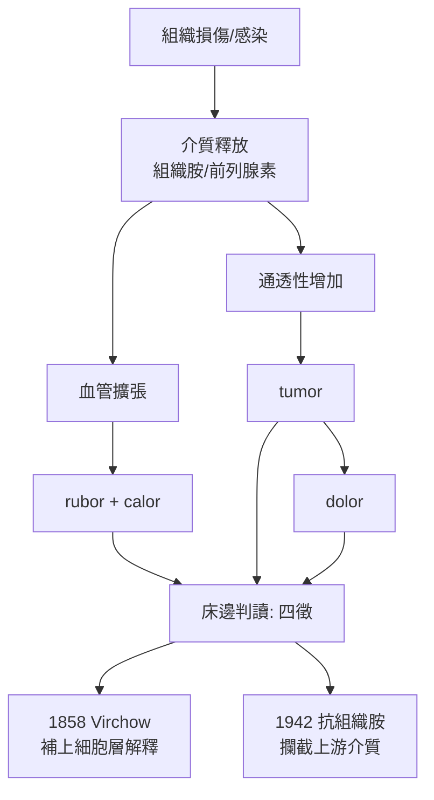

## 0030 - 塞爾蘇斯與炎症四徵（在皮膚上讀出炎症的指紋）

## 案件摘要

**本案只偵破了四個單字，卻破解了此後兩千年醫生在床邊看到的一切。**

西元一世紀，羅馬百科學家 Aulus Cornelius Celsus 在《論醫學》（De Medicina）中寫下炎症的四個表徵：**rubor（紅）、tumor（腫）、calor（熱）、dolor（痛）**。這四個拉丁字成為醫學史上最長壽的觀察工具——從羅馬軍團軍醫到現代急診室，凡是皮膚發炎的現場，辦案清單都是這四項。蓋倫後來加上第五徵 functio laesa（功能喪失），五人偵查小組正式成軍。

## 前因 -- 為什麼會有這個案子

- **羅馬的醫學情境**：羅馬醫學重實用輕理論——軍團需要處理傷口與膿瘍，皮膚與軟組織感染是最日常的敵人。
- **Celsus 的定位**：他不是執業醫師，而是編纂希臘醫學知識的百科作家；正因為是「編纂者」，他寫下的是當時最乾淨、最無理論包袱的臨床摘要。
- **炎症觀察的前史**：希波克拉底學派描述過膿瘍與丹毒，但未系統化；Celsus 的貢獻是把散落的觀察壓縮成**可操作的判讀法**。
- **《論醫學》失而復得**：此書在中世紀西歐佚失，1478 年在佛羅倫斯被重新印刷——文藝復興的醫生們第一次「見到」這位羅馬人，四徵才真正開始支配教科書。

## 線索與推理 -- 數學式、程式、理論

四徵不是四個平行現象，而是**同一個病理過程的四個投影**。用現代血管生物學重寫：

| 四徵 | 現代機制 | 觀察部位 |
|---|---|---|
| rubor（紅） | 微血管擴張、血流增加 | 表面 |
| calor（熱） | 血流量上升使局部溫度升高 | 觸診 |
| tumor（腫） | 血管通透性增加、血漿滲出至組織間隙 | 肉眼/觸診 |
| dolor（痛） | 組織水腫牽張神經末梢＋發炎介質（緩激肽、P物質）致敏 | 主訴 |

$$ \text{損傷} \rightarrow \text{血管擴張} \Rightarrow \begin{cases} \text{rubor} \\ \text{calor} \end{cases} \quad;\quad \text{通透性}\uparrow \Rightarrow \text{tumor} \Rightarrow \text{dolor} $$

```python
# 四徵的因果鏈（而非並列清單）
def inflammation_signature(injury=True):
    if not injury:
        return "無徵"
    vasodilation = True          # → rubor, calor
    permeability = vasodilation  # → tumor（滲出）
    pain = tumor_and_mediators   # → dolor（滲出張力＋介質致敏）
    return {"rubor": vasodilation, "calor": vasodilation,
            "tumor": permeability, "dolor": pain}

tumor_and_mediators = True
print(inflammation_signature())
```

關鍵推論：Celsus 做的事，本質上是**把病理過程降維成床邊可觀測的向量**。在沒有顯微鏡、不知道白血球的時代，四徵是炎症的完整「外部指紋」。皮膚科之所以是炎症觀察的最佳現場，正因為皮膚讓四徵全部裸露可見——內臟炎症只能看到發燒與疼痛，皮膚炎症則紅腫熱痛一目了然。



後世驗證極其漂亮：1858 年 Virchow 解剖顯微鏡下的炎症，發現四徵的細胞與血管基礎（`1858-Virchow細胞病理學與皮膚病理.md`）；二十世紀藥理學則依四徵定量評分藥效——抗組織胺抑制风团（tumor+rubor）、NSAID 抑制前列腺素（calor+dolor）。Celsus 的四個字，等於寫好了現代抗發炎藥的臨床試驗終點指標。

## 結案 -- 後果與影響

- **兩千年的判讀標準**：四徵至今仍是炎症診斷的床邊框架，寫進每一版體格檢查教科書。
- **皮膚科的天賦地位**：炎症最可見的器官是皮膚，使皮膚科成為炎症研究與過敏研究的前線（見 `1895-Jadassohn斑貼試驗.md`）。
- **第五徵的補位**：蓋倫補上 functio laesa，使判讀從外觀延伸到功能。
- **一句話結案**：好的分類不是解釋，而是讓解釋成為可能——四徵解釋不了炎症，但它讓每一代醫生看見了同一件東西。

## 關鍵人物與文獻

- Aulus Cornelius Celsus（約前 25–約 50）——《De Medicina》八卷，四徵出自卷四；1478 年佛羅倫斯重印本使四徵重入歐洲醫學。
- 蓋倫——補充 functio laesa。
- Virchow,《Die Cellularpathologie》（1858）——四徵的細胞病理學解讀。
- W. B. Kannel 與炎症史綜述：W. H. L.？參見 M. L. N. Willoughby, *A History of Inflammation* 相關回顧與 Stoeckle 的 Celsus 研究。
