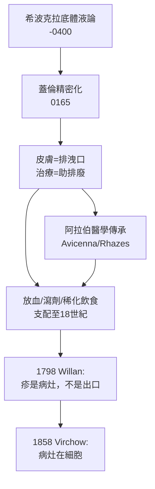

## 0165 - 蓋倫與體液論的皮膚病學（排洩口理論的極盛與僵化）

## 案件摘要

**本案的偵探不是辦案的，他是來關閉案卷的。**

西元二世紀，帕加馬的蓋倫（Galen）把希波克拉底的體液論推向精密的頂峰。在他的體系裡，皮膚病被統一解釋為**血液中腐敗體液經皮膚排出的現象**：疹子是排洩，潰瘍是排洩口潰堤，癬是體液「酸敗」的痕跡。體系華麗、自洽、無所不包——正因為無所不包，它也什麼都不用再做。此後一千四百年，皮膚病學在蓋倫的框架裡原地踏步，直到 Willan（`1798-Willan皮膚病分類學.md`）重新打開案卷。

## 前因 -- 為什麼會有這個案子

- **羅馬帝國的醫學市場**：蓋倫在羅馬治療貴族與皇帝（他治好過 Marcus Aurelius），需要有說服力的體系性理論——體液論正好是市場最接受的敘事。
- **解剖學的加持**：蓋倫從角鬥士傷口與動物解剖累積了解剖學權威，使他的理論自帶「我看過身體內部」的說服力。
- **體液論的推論壓力**：若疾病是體液失衡，那麼所有器官的症狀都應該能追溯到同一組失衡——皮膚病當然也不例外。
- **蓋倫本人的臨床經驗**：他確實觀察到放血後某些皮膚症狀改善（巧合與自然病程被系統性誤讀），強化了「排廢」模型。

## 線索與推理 -- 數學式、程式、理論

蓋倫的皮膚病理模型可以形式化為一條「體液水力學」：

$$ \text{肝臟製血} \xrightarrow{\text{靜脈}} \text{全身} \xrightarrow{\text{過剩/腐敗}} \text{皮膚排出口} \Rightarrow \text{發疹} $$

```python
# 蓋倫模型的「水庫—排洪」結構
def galen_skin_model():
    liver = {"產血": True, "雜質": 0.3}      # 體液製造與摻雜
    if liver["雜質"] > 0.2:
        # 皮膚是身體的排洪道之一（其他：腎、腸、月經）
        return "腐敗體液 → 經皮膚排出 → 疹 = 排廢進行中（勿強行止住）"
    return "健康"

print(galen_skin_model())
```

關鍵推論的陷阱在於：**排廢模型的治療學反轉**。若疹子是排廢，那麼治療目標不是「止疹」，而是「幫助排廢」——放血、瀉劑、發汗劑、飲食稀化療法全部合理化。皮膚局部治療（敷料、藥膏）淪為次要，因為「皮膚只是出口，不是病灶」。



本案最值得偵查的對照組：同時代的阿拉伯醫學。Rhazes（拉齊斯，9 世紀）在《論天花與麻疹》中首次區分兩種發疹熱病——他是**在蓋倫框架內做精細觀察**的典範：體系未變，觀察精度卻可以無限提升。這預示了體液論的結局：不是被證偽擊倒，而是被 Willan 式的分類學「用更好的描述架空」。

## 結案 -- 後果與影響

- **一千四百年的理論鎖死**：放血與瀉劑成為皮膚病的標準治療，直到 Hebra 時代仍見殘餘。Hebra 曾挖苦：「教科書裡皮膚病人被放掉的血，足以填滿一座湖。」
- **體系性遮蔽效應**：因為「皮膚不是病灶」，局部真菌、寄生蟲等真實原因長期無人追查——Gruby 1843 年發現頭癬真菌時，面對的就是這堵理論高牆（`1843-Gruby發現頭癬真菌.md`）。
- **教學壟斷**：蓋倫著作成為中世紀大學醫學教育的核心，皮膚病在教科書中只佔體液論的一節。
- **一句話結案**：最危險的理論不是錯的理論，而是錯得太完整的理論——它把所有觀察都消化掉，也就消化掉了反例。

## 關鍵人物與文獻

- 蓋倫（129–約 216）——帕加馬／羅馬，《De hummoribus》《De methodo medendi》；皮膚症狀散見於各臨床著作。
- Rhazes（854–925）——《Kitab al-Jadari wa al-Hasba》（論天花與麻疹），體液框架下的精細發疹病學。
- Avicenna（980–1037）——《醫典》（Canon）皮膚章，中世紀歐洲皮膚病知識的主要來源。
- Vivian Nutton 的蓋倫研究；K. F. Schaller 的《皮膚病學史》綜述。
