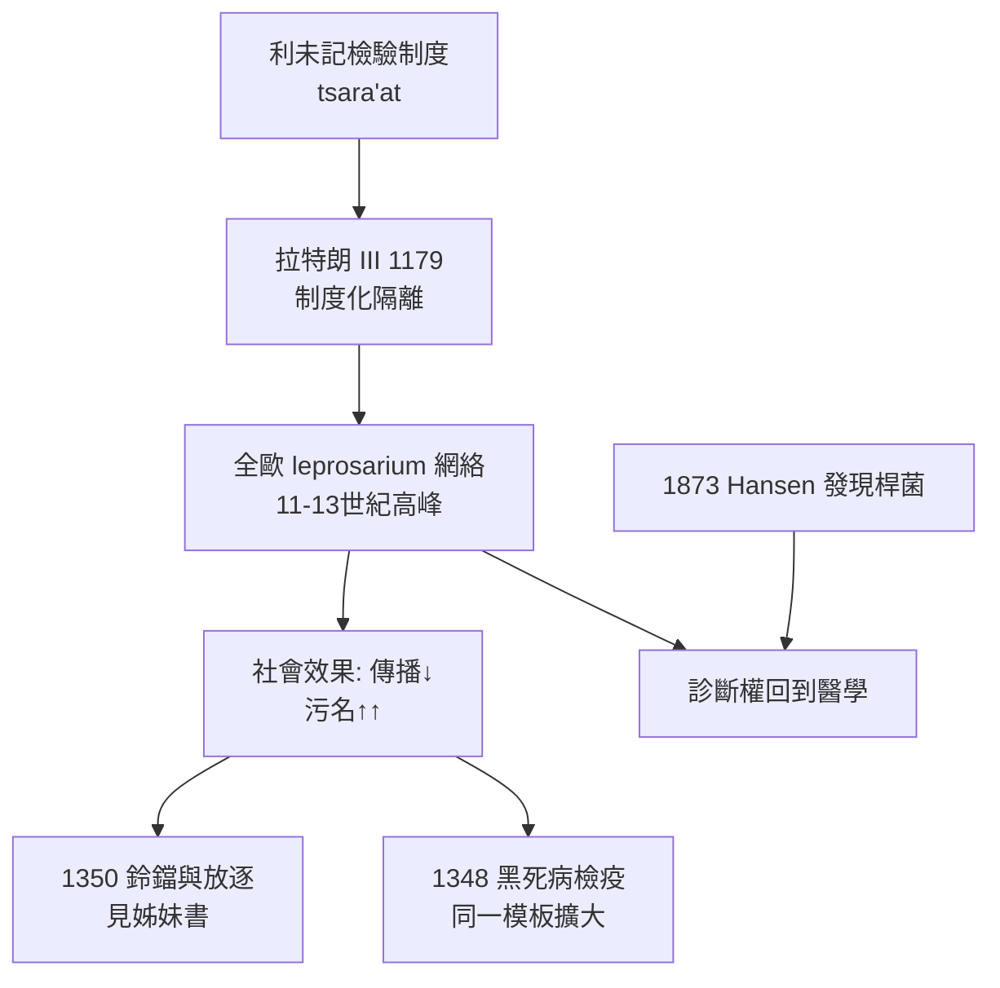

## 1179 - 痲瘋隔離與拉撒路病院（看得見的病，變成看得見的制度）

## 案件摘要

**本案的被告不是病人，而是一種「以病劃界」的社會工程。**

1179 年，拉特朗第三次大公會議（Third Council of the Lateran）正式規定：痲瘋病人（癩病患者）應居住於專屬病院、設立專屬禮拜堂與墓地、不得與健康人同住共餐。此令不是創新，而是把已經蔓延數百年的自發隔離**升格為全歐洲的教會法**。皮膚上可見的損害，從此成為司法分類的依據——人類第一次為一種皮膚病建立了橫跨千年的制度性隔離體系。

## 前因 -- 為什麼會有這個案子

- **癩病的西進**：麻風分枝桿菌（*Mycobacterium leprae*，1873 年才由 Hansen 發現）隨羅馬軍團與中世紀的人口流動（十字軍東征被普遍指控為放大器）傳遍歐洲，十一至十三世紀達到流行高峰，法國曾有多達兩千所病院。
- **利未記的遺產**：《利未記》第 13–14 章的「tsara'at」檢驗程序（祭司檢查、隔離七日、復檢）提供了現成的分類與隔離範本（見 `../性病的歷史/-1550-埃伯斯紙草與利未記的不潔.md`）。
- **「拉撒路」的符號**：路加福音中財主門外的乞丐拉撒路，使癩病與「謙卑的受難者」形象綁定；病人被要求在人群近前時搖鈴、穿辨識衣物。
- **中世紀的恐懼結構**：都市化使人群密集，可見的潰爛皮膚成為「傳染＋罪罰」想像的完美載體。

## 線索與推理 -- 數學式、程式、理論

教會法的隔離設計，實際上是一套**基於可見症狀的傳播控制演算法**：

```python
# 拉特朗 III 的隔離邏輯（vs 利未記 13 章的檢驗邏輯）
def leper_status(inspection):
    # inspection: 祭司/醫師對可見皮損的判讀（結節? 潰瘍? 感覺喪失?）
    if inspection["nodules"] or inspection["anesthesia"]:
        return {"residence": "leprosarium(病院)", "chapel": "專屬",
                "social_contact": "隔離", "bell": True}
    return "存疑 → 隔離複查（七日/十三日規則的教會版）"

print(leper_status({"nodules": True, "anesthesia": True}))
```

從流行病學上看，隔離確實有部分效力——麻風桿菌的傳染力遠低於結核，長期隔離患者能截斷相當比例的傳播鏈：

$$ R_{\text{隔離}} = R_0 \times (1 - p_{\text{隔離覆蓋率}} \times e) $$

其中 $e$ 為隔離效力。但本案最刺眼的不對稱在於：**制度的有效性與制度的殘酷性互不抵銷**。病人被「活埋」儀式宣告社會性死亡者有之；家產充公者有之。而且診斷權在祭司而非醫師——誤判（把銀屑病、白斑、狼瘡誤判為癩病）無上訴管道。



關鍵偵查發現：癩病隔離是後世**檢疫（quarantine）制度的原型機**。1348 年威尼斯對黑死病設立的 40 日隔離（quaranta giorni），其制度細胞正是 leprosarium。皮膚病學史在此處與公共衛生史交接：一種慢性皮膚病訓練出人類面對急性大疫的肌肉記憶。

## 結案 -- 後果與影響

- **制度遺產**：leprosarium → lazaretto → 近代傳染病院與法定傳染病通報（見 `../性病的歷史/1864-英國傳染病法案.md`）——「以症狀劃界＋行政隔離」的模板沿用至今。
- **污名的極致化**：可見皮損＋宗教敘事＝最強的社會排斥；這份污名結構將在梅毒（1494）與愛滋（1981）時代反覆復用。
- **十四世紀後流行退潮**：人群免疫、pathogen 毒力變化、都市衛生改善等假說並存——隔離制度在疫情退潮後仍續存數百年，證明制度比疾病長壽。
- **科學的終局**：1873 年 Hansen 在顯微鏡下找到桿菌（首例人類細菌病原的確認之一），癩病從「天罰」變成「感染」，診斷與處置權回到醫學；但污名並未隨之消散——挪威、夏威夷的隔離島（Molokaʻi）一直營運到二十世紀。
- **一句話結案**：當皮膚成為唯一證據，判決就註定冤錯；制度修正錯誤的速度，永遠趕不上它製造錯誤的速度。

## 關鍵人物與文獻

- 拉特朗第三次大公會議（1179）——Canonicus 23 條：癩病者設專屬病院與禮拜堂。
- Gerhard Henrik Armauer Hansen（1841–1912）——1873 年在卑爾根發現麻風桿菌，癩病史的分水嶺。
- Carole Rawcliffe, *Leprosy in Medieval England*（2006）；Luke Demaitre, *Leprosy in Premodern Medicine*（2007）。
- 姊妹篇：`../性病的歷史/1350-麻風鈴鐺與罪惡身體.md`。
