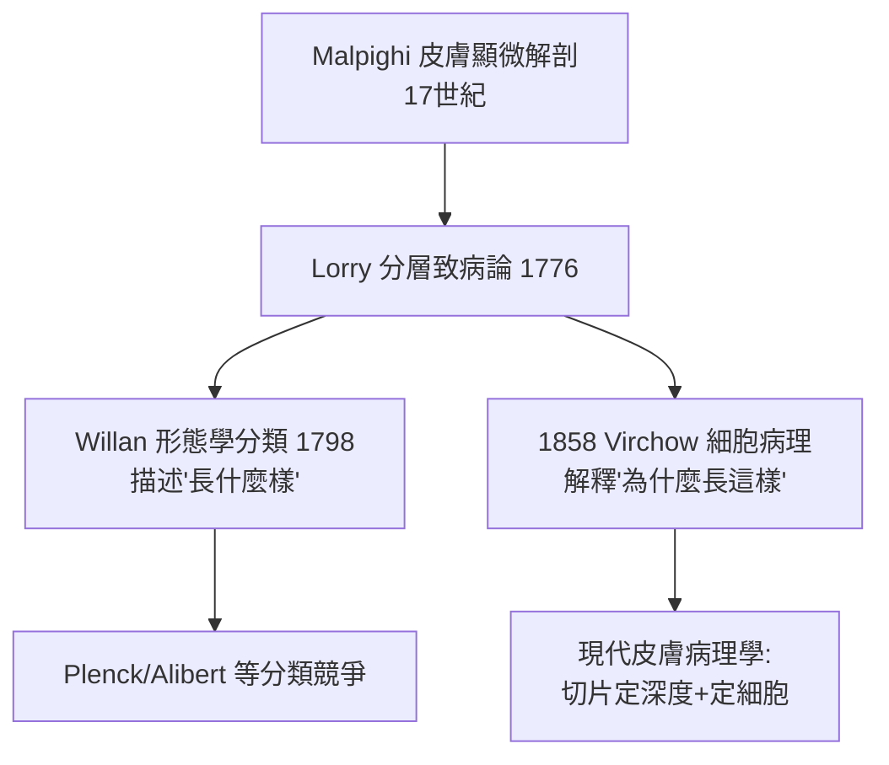

## 1776 - Lorry 皮膚分層論（把皮膚切開來辦案）

## 案件摘要

**本案的突破，是偵探第一次意識到：案發現場不是一層，是三層。**

1776 年，法國醫師 Anne-Charles Lorry 出版《Tractatus de morbis cutaneis》，提出一個此前無人系統陳述的觀點：**皮膚不是一塊均質的「外皮」，而是分層的結構；不同皮膚病的病灶位於不同深度**——表皮病、真皮病、皮下病各有其疾，診斷應以「病在哪一層」為線索。在 Willan 之前二十年，Lorry 已經為皮膚病學裝上了「深度」這個維度。

## 前因 -- 為什麼會有這個案子

- **體液論的殘局**：十八世紀的皮膚病仍被「體液排出」理論籠罩，皮膚被視為均質的排洩膜，無人追問病灶的解剖位置。
- **解剖學的成熟**：Malpighi（1628–1694）已描述表皮與真皮交界（後稱 Malpighian 層）；顯微解剖使皮膚分層成為常識——但沒人把「分層」用於**疾病分類**。
- **Lorry 的立場**：他是巴黎的醫師與古典學者，走的是「用解剖學清理臨床混亂」的路線。
- **臨床痛點**：同樣是「紅斑」，有的會結疤、有的不會；有的能撕下一層膜、有的不能——這些差異暗示病灶深度不同，但當時沒有語言描述這件事。

## 線索與推理 -- 數學式、程式、理論

Lorry 的洞見可以形式化為一個**定位函數**：

$$ \text{診斷} \leftarrow f(\text{形態}, \; \underbrace{\text{深度}}_{\text{Lorry 的新變數}}) $$

```python
# Lorry 的「深度定位」模型
SKIN_LAYERS = ["表皮(epidermis)", "真皮(dermis)", "皮下(hypodermis)"]

def lorry_localize(lesion):
    clues = {
        "脫屑/水皰易破不結疤": "表皮",   # 表皮可再生，不留疤
        "硬結/疼痛/癒後結疤": "真皮",   # 真皮受損 → 纖維化
        "深在結節/凹陷性瘢痕": "皮下",
    }
    for pattern, layer in clues.items():
        if pattern in lesion["description"]:
            return layer
    return "需觸診：可推動? 與深部黏連?"

print(lorry_localize({"description": "硬結/疼痛/癒後結疤"}))
```

關鍵推論：**深度維度預言了現代皮膚病理學的核心邏輯**。「癒後是否留疤」其實是再生能力的判讀——表皮由角質細胞持續更新（今日所知角質層約 28 天週期），淺層損傷可再生無痕；真皮受損則由纖維母細胞以膠原填補，必然留疤。Lorry 不可能知道細胞週期，但他抓住了表型的影子。



本案還有一條有趣的支線：Lorry 用古典文獻考證古人的皮膚病描述，企圖把希波克拉底與蓋倫筆下的「psora」「impetigo」等詞對應到具體疾病——這是**詞彙考古學**的先聲。他的結論常錯，但方法正確：皮膚病命名史本身就是一樁懸案（Willan 將接手重審）。

## 結案 -- 後果與影響

- **深度維度入門**：分層致病論為後來的皮膚病理學（切片看深度、看浸潤層）預留了概念位置。
- **與 Willan 的分工**：Willan 主攻「形態」軸（斑、丘、皰、膿皰、結節），Lorry 補上「深度」軸——兩軸合起來就是現代皮疹描述的二維座標。
- **法國學派的伏筆**：Lorry 之後，Alibert（聖路易醫院）延續法國的皮膚病分類工程。
- **一句話結案**：把器官「切開」思考，是病理學思維入侵臨床的第一步——診斷從此不只是看，還要想像切面。

## 關鍵人物與文獻

- Anne-Charles Lorry（1726–1783）——《Tractatus de morbis cutaneis》（1776），被譽為法國皮膚病學的開山之作。
- Marcello Malpighi——表皮—真皮交界的顯微描述者。
- Karl Holubar & Frank Burnham, *Skin: A Living Envoy*（皮膚病學史料）；Jean Théodoridès 對法國十八世紀醫學的研究。
