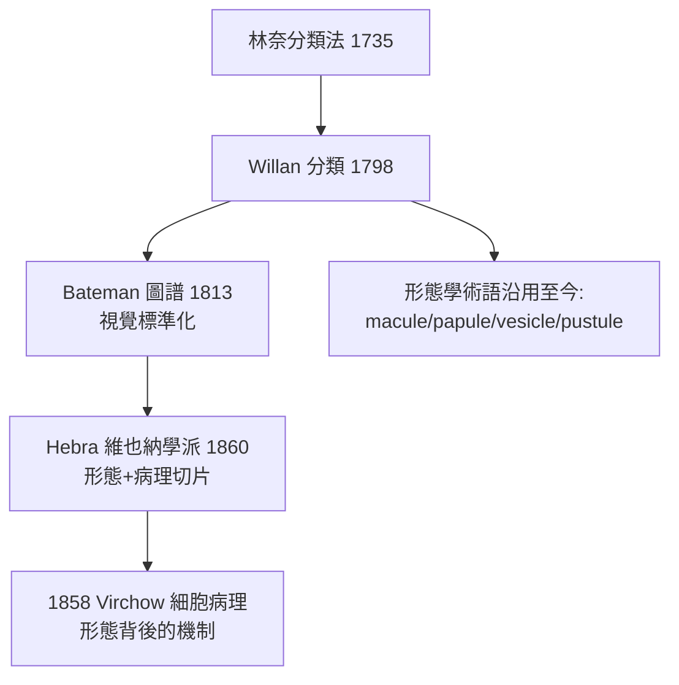

## 1798 - Willan 皮膚病分類學（皮膚科作為學科的出生證明）

## 案件摘要

**本案偵破的謎題：為什麼兩千年來沒有人給皮膚病「命名」？**

1798 年，倫敦聖巴塞洛繆醫院的內科醫師 Robert Willan 出版《On Cutaneous Diseases》，以林奈式分類法為皮膚病建立系統：先定義**基本皮損（原發病灶）**——斑疹（maculae）、丘疹（papulae）、結節（tubercula）、水皰（vesiculae）、膿皰（pustulae）、風團（bulae）等八目，再按皮損形態把疾病逐一歸位。皮膚病從此有了**可比對、可教學、可累積的名字**。這一年被公認為皮膚科作為獨立學科的誕生年。

## 前因 -- 為什麼會有這個案子

- **林奈革命的外溢**：1735 年林奈《自然系統》以形態特徵為生物分類，全歐洲的博物學都在模仿——Willan 的問題是：皮膚病能不能也這樣分？
- **體液論的潰堤**：十八世紀末，瀉劑放血治皮膚病的成效荒謬地低，而病理學（Morgagni 1761《論身體部位之病變與病因》）正把醫學目光拉回器官與局部。
- **倫敦的臨床富礦**：聖巴塞洛繆醫院門診湧入大量皮膚病人，Willan 在濟貧門診積累了數千例的第一手觀察。
- **前人的失敗樣本**：Plenck（1776）曾嘗試分類但過於粗糙；Lorry 有深度概念但未建立形態學詞彙表（`1776-Lorry皮膚分層論.md`）。

## 線索與推理 -- 數學式、程式、理論

Willan 的方法論核心：**先建字母，再拼單字**。基本皮損是字母，疾病是單字：

| 原發病灶（Willan 目） | 定義 | 典型疾病歸屬 |
|---|---|---|
| maculae（斑） | 僅變色、不可觸 | 玫瑰糠疹、白斑 |
| papulae（丘疹） | 實性隆起 <0.5cm | 扁平疣、丘疹性蕁麻疹 |
| vesiculae（水皰） | 內含清液的隆起 | 濕疹、單純皰疹 |
| pustulae（膿皰） | 內含膿液 | 膿皰瘡、痤瘡 |
| tubercula（結節） | 深在實性腫塊 | 狼瘡、癰 |
| bulae（風團/大皰） | 暫時性水腫性隆起 | 蕁麻疹、天皰瘡 |

$$ \text{疾病名} = (\text{皮損目}, \; \text{分布}, \; \text{病程}, \; \text{深度}) $$

```python
# Willan 分類演算法（形態學鍵值對）
def willan_classify(lesion, distribution, course):
    if lesion == "vesiculae" and distribution == "屈側對稱" and course == "慢性瘙癢":
        return "濕疹類（eczema）"
    if lesion == "bulae" and course == "反覆一過性":
        return "蕁麻疹（urticaria）"
    if lesion == "papulae" and distribution == "線狀抓痕":
        return "癢疹/疥瘡待排除"
    return "目錄比對中……"

print(willan_classify("vesiculae", "屈側對稱", "慢性瘙癢"))
```

關鍵推論：Willan 的革命性不在分類本身（分類從來可以更多），而在**把「可見形態」當成診斷的第一性證據**——不再問「病人是哪種體質」，而問「這個皮損屬於哪一目」。這使皮膚病學第一次可以（1）教學：學生照圖識病；（2）統計：同名病例可加總；（3）驗證治療：同一診斷下比較療效。科學方法的三大前提（命名、分類、可比較）一次到位。



當然，本案也要記下分類學的原罪：形態分類**描述症狀而非病因**。同一形態（如丘疹水皰）可能來自真菌、過敏或自體免疫——Willan 的系統把這些異因同貌的疾病綁在同一目下。這個「形態≠病因」的裂縫，要靠 Gruby 的真菌（1843）與 Jadassohn 的斑貼試驗（1895）逐步補上。

## 結案 -- 後果與影響

- **學科建制**：Willan 的分類使皮膚病學成為可考試、可開課、可建科的城市學科；倫敦隨之出現史上最早的皮膚病專門醫院（1860 年代 Blackfriars）。
- **術語長壽**：macule、papule、vesicle、pustule、wheal 等詞沿用至今——今天皮膚科住院醫師的第一課，仍是 Willan 的詞彙表。
- **圖譜傳統**：Bateman（`1813-Bateman皮膚圖譜.md`）與 Hebra（`1860-Hebra圖譜與維也納學派.md`）延續「文字＋版畫」的標準化路線。
- **一句話結案**：命名是治療的前提——一種沒有名字的疾病，既不能被研究，也不能被治癒，更不能被賠償。

## 關鍵人物與文獻

- Robert Willan（1757–1812）——《On Cutaneous Diseases》（1798–1808 分卷出版），附手工著色的精美版畫；死於肺結核，葬於馬德拉。
- Thomas Bateman——Willan 的繼承者與圖譜出版者。
- Giovanni Battista Morgagni,《De sedibus et causis morborum》（1761）——器官病理學的背景板。
- Karl Holubar, *The History of Dermatology*；Crissey & Parish, *The Dermatology and Syphilology of the Nineteenth Century*（1981）。
