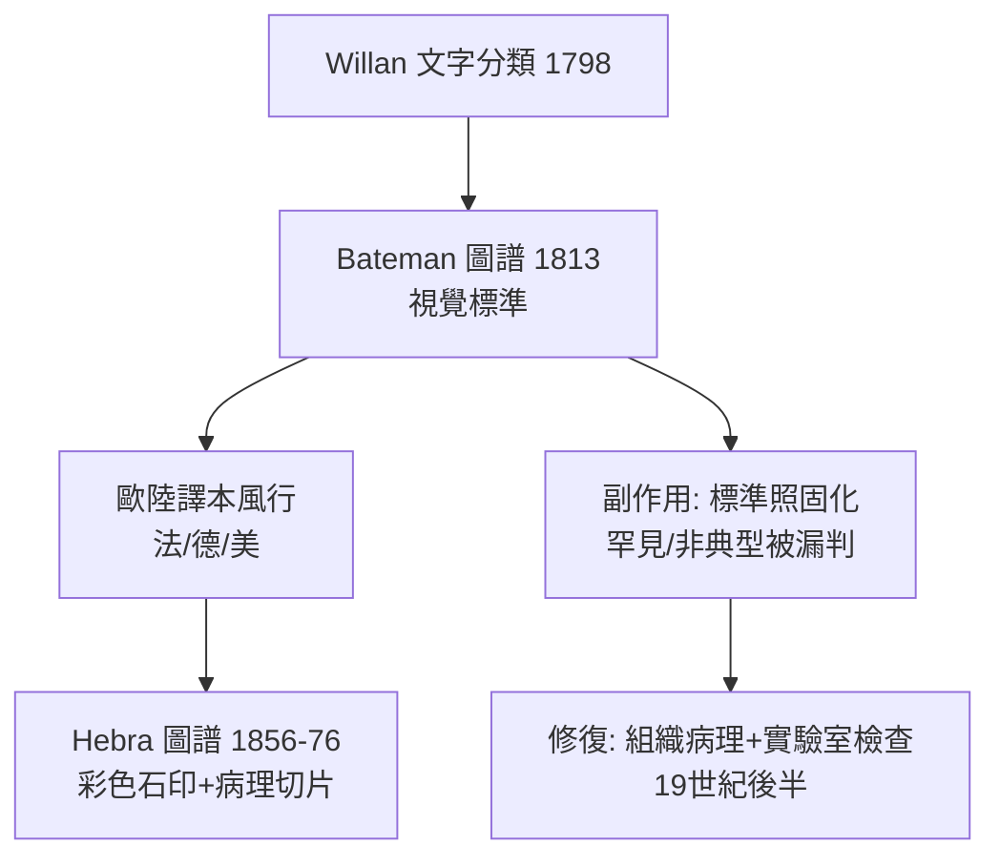

## 1813 - Bateman 皮膚圖譜（嫌犯照片簿的出版）

## 案件摘要

**分類學寫成了法典，但法庭需要照片。**

1813 年，Thomas Bateman 開始出版《Delineations of Cutaneous Diseases》（72 輯、全套 68 幅彩色版畫，陸續至 1817 年出齊；其《A Practical Synopsis of Cutaneous Diseases》則自 1813 年起成為通行教科書）。他把老師 Willan 的分類法配上**高精度手工著色版畫**：每一目、每一病都有可翻閱比對的「標準照」。從此，一個鄉間醫師不必去過倫敦門診，也能對著圖譜說出「這是 eczema 第 X 型」。診斷標準化完成了最後一哩。

## 前因 -- 為什麼會有這個案子

- **文字描述的天花板**：「紅色鱗屑性斑塊」可以指乾癬、玫瑰糠疹、體癬——語言的解析度不夠，圖像補位。
- **彩色印刷的技術窗口**：十八世紀末手工著色銅版畫（如 Audubon 的鳥類圖譜）技術成熟，醫學圖譜趕上了這班車。
- **Willan 早逝**：Willan 1812 年死於肺結核，圖譜工程由其弟子 Bateman 接手完成。
- **讀者市場**：拿破崙戰爭後的英國醫療市場擴大，全科醫師需要廉價、可靠的皮膚鑑別工具。

## 線索與推理 -- 數學式、程式、理論

圖譜的本質是**建立一個視覺參照系（golden set）**，把主觀描述變成相似度比對：

$$ \text{診斷} = \arg\min_{d \in \text{圖譜}} \; \text{dist}(\text{病人皮損}, \; \text{圖譜樣本}_d) $$

```python
# 圖譜比對的「樣本庫」模型
atlas = {
    "plate_12": {"dx": "Psoriasis", "keys": ["銀白色鱗屑", "伸側", "點狀出血"]},
    "plate_19": {"dx": "Eczema",   "keys": ["多形性", "滲出", "屈側"]},
}

def bateman_match(patient_findings):
    best, best_score = None, 0
    for plate in atlas.values():
        score = sum(k in patient_findings for k in plate["keys"])
        if score > best_score:
            best, best_score = plate["dx"], score
    return f"最相似: {best} (比對得分 {best_score}/3)"

print(bateman_match(["銀白色鱗屑", "伸側"]))
```

關鍵推論：圖譜完成了三件文字做不到的事——（1）**凍結標準**：版畫是權威樣本，爭議時「以圖為準」；（2）**跨語言傳播**：畫不需要翻譯，Willan 分類因此征服歐陸；（3）**訓練可規模化**：學徒制變成自學制。皮膚科是第一個以圖像為核心教材的臨床學科——這個傳統一直延續到今日的 dermoscopy AI。



本案也須記錄圖譜的暗面：**原型偏差**。版畫選用的是「教科書式」典型病例，臨床上的變異體（如發生在掌蹠的乾癬、擦爛部位的濕疹）在圖譜中缺席；一代醫師被訓練成「只認得照片上的病」。這個教訓，在兩百年後的皮膚影像 AI 深膚色樣本不足事件中又重演了一次。

## 結案 -- 後果與影響

- **Willan 學派的全球化**：Bateman 教科書再版十餘次，譯成法、德、美各版；美國第一位皮膚科教授（Henry D. Bulkley）直接繼承 Willan 分類。
- **圖像標準化傳統**：Hebra 的《皮膚病圖譜》（`1860-Hebra圖譜與維也納學派.md`）以更大開本與更準確的石印超越前作，但體例是 Bateman 式的。
- **分類與圖像的迴路**：教科書→門診分類→更多病例→修訂教科書，皮膚病學從此有了自我迭代的引擎。
- **一句話結案**：標準化的本質是「把一個人的眼光變成所有人的眼光」——Bateman 的版畫是皮膚科第一批公共財。

## 關鍵人物與文獻

- Thomas Bateman（1778–1821）——《Delineations of Cutaneous Diseases》（1813–1817）、《A Practical Synopsis of Cutaneous Diseases》（1813）。
- James Hope 等同時代的醫學版畫家傳統（彩色手工著色銅版畫）。
- Crissey & Parish, *The Dermatology and Syphilology of the Nineteenth Century*（1981）；Karl Holubar 關於醫學圖譜史的研究。
