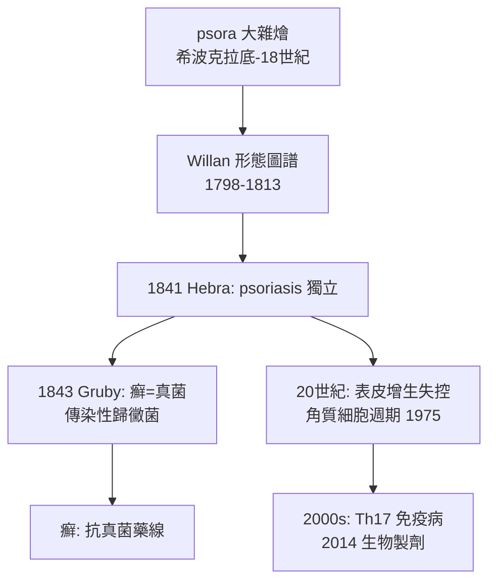

## 1841 - 乾癬與癬的分家（一個被叫了兩千年的錯誤名字）

## 案件摘要

**本案的兇手是一個詞：psora。**

從希波克拉底到十八世紀末，一切脫屑性皮膚病都被塞進「psora」（瘙癢/脫屑）這個模糊標籤。乾癬與黴菌感染共用一個名字、共用一種錯誤的「會傳染」的認知。1841 年前後，維也納的 Ferdinand von Hebra 完成了致命一擊：把 psoriasis（乾癬）從「癬」的家族中正式除名，確認它**不癢得那麼簡單、不傳染、有自己固定的形態與病程**。一個疾病實體的獨立，等於還給數十萬患者清白——他們不再是「髒病」的嫌疑人。

## 前因 -- 為什麼會有這個案子

- **詞彙考古的爛帳**：蓋倫以降，psora / lichen / lepra / impetigo 諸詞互相重疊，Celsus 筆下的皮肤瘡疡被後世隨意指認；Willan 自己也把乾癬歸在 lepra 目下。
- **臨床形態的累積證據**：Robert Willan 與 Bateman 已描繪乾癬的典型畫像（伸側對稱銀屑斑塊、刮屑見點狀出血）——「點狀出血徵」（Auspitz 徵的前身）暗示角化異常，不是黴菌。
- **社會壓力**：被判定為「癬」者疑似傳染病，常遭職場與公共浴場排斥；分家是醫學問題，也是平反問題。
- **順勢療法的幽靈**：Hahnemann 的順勢療法宣稱一切慢性病源於「psora 性病素質」——把這個詞的混亂推到頂點，正統醫學反而被逼著釐清它。

## 線索與推理 -- 數學式、程式、理論

鑑別乾癬與癬，當時可用的「檢驗」全部是床邊徵象：

```python
# 1841 年的分家鑑識（無顯微鏡、無培養版）
def separate_psoriasis_vs_tinea(lesion):
    evidence = []
    if lesion["刮屑"] == "層層銀屑+點狀出血":
        evidence.append("角化異常 → 支持 psoriasis")
    if lesion["指甲"] == "頂針樣凹陷":
        evidence.append("甲受累 → 支持 psoriasis")
    if lesion["邊緣"] == "離心性環狀、中央癒合":
        evidence.append("環形擴展 → 支持 tinea(癬)")
    if lesion["癢"] == "輕或無":
        evidence.append("psoriasis 常不癢; 癬癢")
    return evidence

print(separate_psoriasis_vs_tinea({"刮屑": "層層銀屑+點狀出血", "指甲": "頂針樣凹陷"}))
```

兩年後（1843）Gruby 在顯微鏡下抓到癬的真菌（`1843-Gruby發現頭癬真菌.md`），鑑識武器升級：**鏡檢陰性＋固定形態**，乾癬的「非傳染性」獲得實驗室背書。而乾癬自身的機密——表皮增生失控——則要等到二十世紀才被量化（`1975-乾癬角質細胞週期之謎.md`：表皮更替從 26 天縮到 3 天級）。



關鍵偵查發現：**命名即病因假說**。把乾癬與癬分開，等於宣告「這不是外來感染，是身體自己的病」——這個判斷比免疫學早了一百三十年。反過來，癬被確認為真菌後，「傳染」的指控有了科學依據，也有了正確的防控方法（不是燒掉病人的衣物，而是抗黴菌治療）。

## 結案 -- 後果與影響

- **疾病實體的獨立潮**：乾癬分家後，Hebra 與維也納學派繼續拆分狼瘡、紅斑、苔癬等混亂標籤——「分家」成為十九世紀皮膚病學的主旋律。
- **去污名的科學根據**：「乾癬不傳染」使患者得以就業、共浴、結婚——皮膚科第一次用分類學完成社會平反。
- **Auspitz 徵與刮屑技術**：床邊刮屑檢查成為皮膚科的標誌性操作，直到今天的皮膚鏡與真菌鏡檢仍是它的直系後代。
- **一句話結案**：乾癬花了一千八百年才拿到自己的名字——而在 1841 年之前，它頂著的其實是別人的罪名。

## 關鍵人物與文獻

- Ferdinand von Hebra（1816–1880）——維也納總醫院皮膚科主任，《皮膚病圖譜》作者，乾癬獨立命名的定案者（另見 `1860-Hebra圖譜與維也納學派.md`）。
- Robert Willan / Thomas Bateman——形態描述的奠基（雖然分類歸位仍待修正）。
- Heinrich Auspitz——1884 年描述點狀出血徵（Auspitz 徵）。
- Samuel Hahnemann 的「psora 學說」（1828,《慢性病論》）——本案的負面催化劑。
- L. Fry, "Psoriasis" 病史綜述；Nick Lowe 與 Hönigsmann 的維也納皮膚科史研究。
