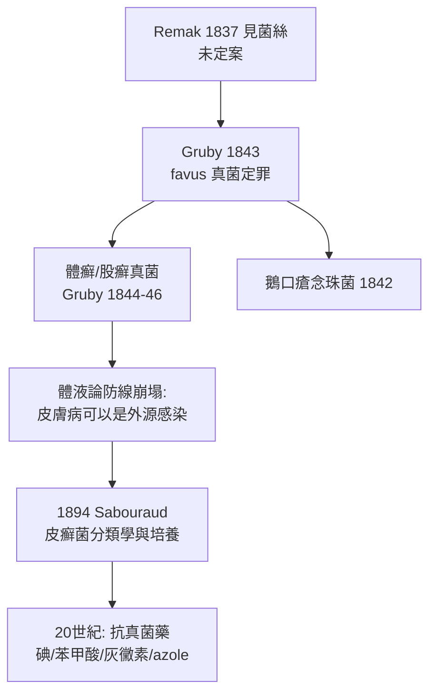

## 1843 - Gruby 發現頭癬真菌（皮膚病第一次抓到活的病原體）

## 案件摘要

**兩千年來，皮膚病都被解釋成體液的排出。本案第一次在「現場」抓到兇手——而兇手會發芽。**

1843 年，匈牙利裔巴黎醫師 David Gruby 在《巴黎醫學會檔案》連續發表論文，以顯微鏡證明：黃癬（favus，一種毀容性頭癬）由一種真菌引起（後命名 *Trichophyton schoenleinii*）。這是**人類第一次為一種皮膚病找到明確的微生物病原**——比細菌學革命早了三十多年。皮膚病學從體液論的陰影裡走出來，靠的不是新理論，而是一台顯微鏡與敢於說「這病是活的」的勇氣。

## 前因 -- 為什麼會有這個案子

- **favus 的社會存在**：黃癬在貧民窟兒童間流行，頭皮黃痂如蜂窩、終身脫髮——它明顯「在家庭內傳播」，是傳染說最有力的皮膚病樣本。
- **顯微鏡已就位**：Schwann（1839）證明酒精發酵由酵母菌引起，Robert Remak（1837）其實已在 favus 痂中看見菌絲但未定案——證據在案卷裡躺了六年，缺一個敢定罪的人。
- **體液論的殘餘防線**：主流學說仍稱 favus 是「體液素質」的表現，偶發的鏡下發現被視為「繼發的腐生雜物」。
- **Gruby 的位置**：他是巴黎的醫師兼精密顯微鏡觀察者，同時期還描述了口腔鵝口瘡的念珠菌（1842）與癬的多個種。

## 線索與推理 -- 數學式、程式、理論

定罪需要滿足「傳染三問」——Gruby 的推理鏈：

```python
def koch_criteria_predecessor(lesion):
    # 在 Koch 法則（1882）之前四十年的原始版因果論證
    q1 = lesion["鏡檢"] == "皮屑與毛幹內見菌絲+孢子"        # 病灶中恆有嫌犯
    q2 = lesion["家庭內傳播"] and lesion["共枕/共帽者同病"]  # 傳播途徑吻合
    q3 = lesion["健康頭皮接種試驗"] == "可誘發同形皮損"       # 實驗重演（Guichard 之後完成）
    return all([q1, q2, q3])

print(koch_criteria_predecessor({"鏡檢": "皮屑與毛幹內見菌絲+孢子",
                                 "家庭內傳播": True, "共枕/共帽者同病": True,
                                 "健康頭皮接種試驗": "可誘發同形皮損"}))
```

真菌致病的生物學基礎，今日可以用一句公式概括：

$$ \text{角蛋白} + \text{皮癬菌蛋白酶（keratinase）} \rightarrow \text{菌絲沿毛幹侵入} \Rightarrow \text{斷髮、脫屑、炎症} $$

皮癬菌（dermatophytes）是人類病原中的奇行種：**唯一以角蛋白為主食**的病原家族。它們不侵入活組織深部，只啃食角質層與毛幹——這解釋了為什麼癬永遠長在角質豐富處（頭皮、指甲、足底、股溝），也解釋了炎症程度取決於宿主免疫反應強度（動物來源菌種炎症劇烈、人來源者遷延低炎）。



關鍵偵查發現：Gruby 的定罪**同時審了兩案**——確立了癬是傳染病，也間接為「形態像癬但不傳染」的乾癬洗清了傳染嫌疑（`1841-乾癬與癬的分家.md`）。顯微鏡不只抓到兇手，還釋放了無辜者。

## 結案 -- 後果與影響

- **醫學真菌學的誕生**：Gruby 之後，Remak、Robin、Schönlein（favus 曾以其命名 Achorion schoenleinii）接力；1894 年 Sabouraud 建立皮癬菌培養分類體系（`1894-Sabouraud與皮癬菌真菌學.md`）。
- **先於細菌學革命**： Hansen 1873（麻風）、Neisser 1879（淋病）、Koch 1882（結核）——皮膚病學其實是醫學感染學說的先行者。
- **治療線**：從碘酊、水楊酸剝脫、X 光脫髮（20 世紀初的黑暗手段），到灰黃黴素（1958）與唑類（1970s–），癬終於成為可治癒病。
- **一句話結案**：當「傳染」從道德指控變成顯微鏡事實，防控就從燒衣服變成吃藥——病原學每前進一步，污名就讓出一步。

## 關鍵人物與文獻

- David Gruby（1810–1898）——1842 鵝口瘡、1843 favus、1844–46 體癬系列論文；醫學真菌學之父。
- Robert Remak（1815–1865）——1837 年先於 Gruby 見菌絲；也首創電療用於皮膚病。
- Johann Lukas Schönlein（1793–1864）——1839 年報告 favus 病例中的真菌（以他命名）。
- Raymond Sabouraud（1864–1938）——皮癬菌培養與分類集大成（1894，《Les trichophyties humaines》）。
- K. J. Kwon-Chung & J. E. Bennett, *Medical Mycology*（歷史章）；Drouhet & Dupont 的 Gruby 史論。
