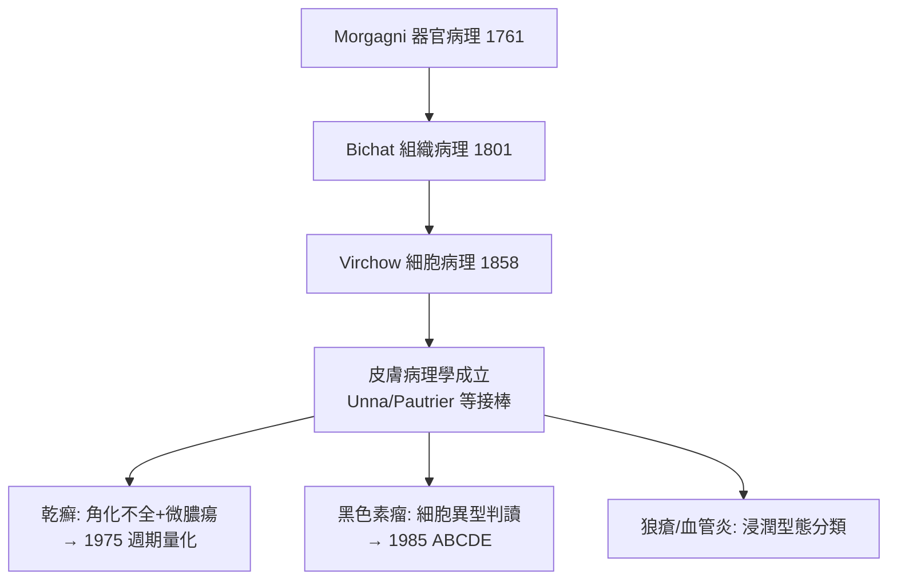

## 1858 - Virchow 細胞病理學與皮膚病理（診斷下沉到細胞層）

## 案件摘要

**器官太大了，病症的地圖要畫在細胞上。**

1858 年，柏林的 Rudolf Virchow 出版《Die Cellularpathologie in ihrer Begründung auf physiologische und pathologische Gewebelehre》，宣告：**疾病不是器官的抽象失衡，而是細胞的異常**——omnis cellula e cellula（一切細胞來自細胞）。對皮膚科而言，這意味著一場革命：皮膚病的真實案發現場不在「體液」也不在「皮膚」這個粗糙的器官名詞，而在角質細胞、黑色素細胞、血管內皮與浸潤的發炎細胞。皮膚病理學（dermatopathology）從此有了理論地基。

## 前因 -- 為什麼會有這個案子

- **器官病理學的頂點與瓶頸**：Morgagni（1761）與 Bichat（1801）把疾病定位到器官與組織，但同樣的「組織病變」可以有截然不同的病程——解析度不夠。
- **顯微鏡技術的成熟**：消色差透鏡（1830s）＋切片機（Cyanagelo，1840s–）使薄切片與高倍觀察成為例行公事。
- **細胞學說的攻防**：Schwann（1839）的細胞學說已被接受，但關於「新細胞從哪來」仍有自由細胞形成說的殘餘；Virchow 以細胞分裂一錘定音。
- **皮膚科的等待**：Willan 分類描述了形態（`1798-Willan皮膚病分類學.md`），但「銀屑斑塊裡到底發生了什麼」無人能答——需要有人把顯微鏡對準皮膚。

## 線索與推理 -- 數學式、程式、理論

Virchow 的綱領可以寫成一條「定位降階」：

$$ \text{病人} \rightarrow \text{器官} \rightarrow \text{組織} \rightarrow \underbrace{\text{細胞}}_{\text{Virchow 的案發現場}} \rightarrow \text{（後續：分子）} $$

```python
# Virchow 綱領下的皮膚切片判讀（現代皮膚病理學的雛形）
def derm_path_report(biopsy):
    return {
        "表皮": {"角化過度": biopsy["stratum_corneum厚度"],
                 "棘層增厚": biopsy["acanthosis"],      # 乾癬的標誌
                 "角化不全": biopsy["parakeratosis"]},   # 核未消失→增生過快
        "真皮": {"乳頭微膿瘍": biopsy["Munro微膿瘍"],
                 "發炎浸潤": biopsy["淋巴球/嗜中性球比例"]},
        "結論": "表皮增生過速+嗜中性球浸潤 → 支持 psoriasis"
    }

print(derm_path_report({"stratum_corneum厚度": "+++",
                        "acanthosis": True, "parakeratosis": True,
                        "Munro微膿瘍": True})["結論"])
```

關鍵推論：Virchow 把「形態」與「機制」焊接起來。Willan 的丘疹、水皰、銀屑，第一次獲得細胞層的解釋——水皰是細胞間水腫（海綿樣變）＋細胞壞死，銀屑是角化細胞增生過速（parakeratosis 暴露了細胞「來不及」成熟的證據）。**皮損的每一個臨床特徵，都是一條細胞病理學的線索。**



Virchow 的遺產也有陰影：他晚年堅拒細菌致病說（「一切細胞來自細胞，疾病來自細胞」），與 Koch 對抗結核菌問題——大師的框架太成功，反而攔住了下一層（微生物）的偵查。皮膚科幸運地兩邊都收了：病理切片看「身體的反應」，顯微鏡直接找「外來的兇手」。

## 結案 -- 後果與影響

- **皮膚病理學成為皮膚科的司法鑑識科**：Paul Gerson Unna（1880s 漢堡）建立皮膚組織化學與染色技術；現代的「皮膚切片+免染色標記」仍是 Virchow 綱領的直系操作。
- **診斷階層的制度化**：臨床形態（Willan）＋切片（Virchow）＝二重證據，皮膚科從「看圖識病」升級為「顯微定罪」。
- **腫瘤線**：黑色素瘤、鱗狀細胞癌的分級分期建立在細胞病理上，最終通向 1985 年的 ABCDE 早期診斷（`1985-黑色素瘤ABCDE判讀法.md`）。
- **一句話結案**：Virchow 沒有治好任何一種皮膚病，但他規定了此後每一種皮膚病「在哪一層、哪一種細胞」被審問。

## 關鍵人物與文獻

- Rudolf Virchow（1821–1902）——《Die Cellularpathologie》（1858），柏林 Charité；「omnis cellula e cellula」。
- Paul Gerson Unna（1850–1929）——皮膚病理與組織化學的實踐奠基者，染色法（orcein、polychrome methylene blue）發明人。
- Jean Darier、Gustav Riehl、Josef Jadassohn——二十世紀初皮膚病理教科書的一代宗師。
- L. J. Rather, *The Interpretation of the Cell*（1971）；B. J. Verbov 的 Unna 傳記研究。
