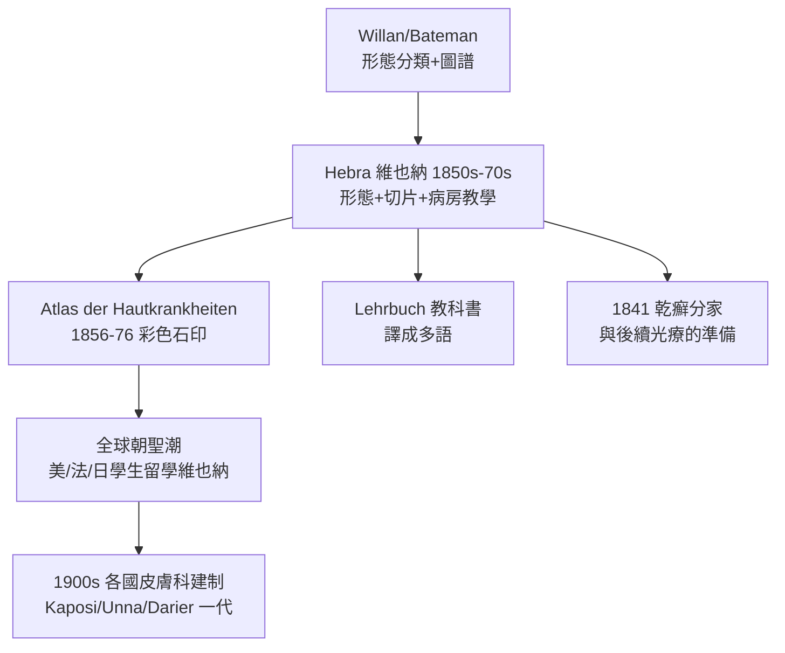

## 1860 - Hebra 圖譜與維也納學派（皮膚科的世界首都）

## 案件摘要

**本案偵破的謎題：一個城市如何壟斷一門學科四十年？**

1850–1880 年代，維也納總醫院的 Ferdinand von Hebra 以「臨床形態＋病理切片＋巨型圖譜＋病床教學」的四重方法，把皮膚病學變成可量產傳授的科學。他的《Atlas der Hautkrankheiten》（1856–1876）與《Lehrbuch der Hautkrankheiten》（1874）被譯成各國語言；全球的皮膚科醫師朝聖維也納，再從維也納把方法帶回波士頓、巴黎、東京。皮膚科的第一個「世界首都」就此誕生。

## 前因 -- 為什麼會有這個案子

- **維也納總醫院的規模**：逾兩千床的全球最大醫院，門診皮膚病人數以萬計——樣本量是學科革命的燃料。
- **Hebra 的出身**：他從皮膚病房的助理醫師做起，長期駐守病房，因此比任何教授都熟悉皮損的自然病程。
- **Willan–Bateman 傳統的輸入**：英國形態學分類已傳入歐陸，但與病理學尚未焊接。
- **十九世紀中葉的醫學改革**：維也納醫學院（Rokitansky 的病理學、Skoda 的理學診斷）正推動「以客觀觀察取代思辨」的運動，Hebra 是這場運動在皮膚科的執行人。

## 線索與推理 -- 數學式、程式、理論

Hebra 方法論的四重證據鏈：

```python
def hebra_method(case):
    evidence = {
        "臨床形態": willan_morphology(case),      # 屬於哪一目（斑/丘/皰…）
        "病程追蹤": follow_up(case),              # 自然史：從哪開始、如何演變
        "病理切片": virchow_section(case),        # 細胞層發生了什麼
        "治療反應": trial(case),                  # 以療效回饋修正診斷
    }
    return "四重證據吻合 → 教科書可寫、學生可考"

print(hebra_method({"皮損": "環狀鱗屑斑"}))
```

Hebra 的分類哲學也做了外科手術式的裁切：**按形態學主徵分組，砍掉體液論與「素質」（diathesis）的形上學**。他把皮膚病分為充血發疹、肥厚、萎縮、新生物等實用大類，每類下再按形態細分——這是一套「操作手冊」而非「宇宙論」：

$$ \text{Hebra 診斷} = (\text{形態主徵}, \; \text{病程}, \; \text{切片}) \;,\; \text{剔除非觀測變數（體液、素質）} $$



第二代的 Moritz Kaposi（Kaposi 肉瘤的描述者，1872）繼任後，維也納繼續統治至二十世紀初。學生名單本身就是皮膚科名人堂：Paul Gerson Unna 在此受訓，美國的 James C. White、日本的土肥慶藏皆承維也納脈絡。

關鍵偵查發現：維也納模式的本質是**把診斷變成可複製的流程**。同時代的巴黎（Alibert 的樹狀分類法）優雅而主觀，倫敦（Willan 學派）精確但規模小；維也納則以病床數＋切片室＋圖譜工廠，實現了「診斷的福特主義」。科學史的規律在此重演：**勝出的往往不是最聰明的方法，而是最可規模化的方法**。

## 結案 -- 後果與影響

- **學科建制的全球擴散**：1890 年代前後，美、德、日相繼在大學設立皮膚科講座；皮膚科從「內科的一節」變成獨立專科。
- **圖譜與教科書的黃金標準**：Hebra 圖譜的彩色石印水準在其後半世紀無人超越；Darier 的《Précis de dermatologie》（巴黎）接棒成為新一代教科書。
- **臨床研究方法**：以病房自然史為基礎的描述性研究，是後來各種臨床分型（蕁麻疹、狼瘡分型）的祖先。
- **一句話結案**：Hebra 證明了「看」可以是科學——前提是把看的方法教給一整座城市的醫生。

## 關鍵人物與文獻

- Ferdinand von Hebra（1816–1880）——《Atlas der Hautkrankheiten》（1856–1876，與解剖學畫家 Carl Heitzmann 合作）、《Lehrbuch der Hautkrankheiten》（1874）。
- Moritz Kaposi（1837–1902）——Hebra 的女婿與繼任者，1872 年描述 Kaposi 肉瘤。
- Crissey & Parish, *The Dermatology and Syphilology of the Nineteenth Century*（1981）；W. G. Plewig 與 K. F. Schaller 對維也納學派的史學研究。
