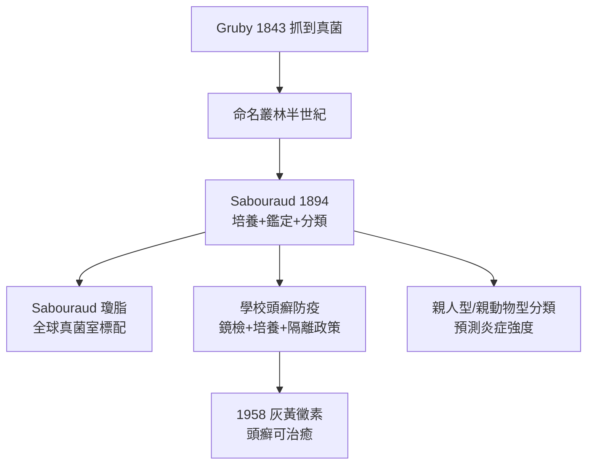

## 1894 - Sabouraud 與皮癬菌真菌學（把真菌關進培養皿編目）

## 案件摘要

**抓到兇手（1843 Gruby）之後，下一步是給每個兇手建立檔案。**

1894 年，巴黎聖路易醫院的 Raymond Sabouraud 出版《Les trichophyties humaines》，把 Gruby 以來散落的真菌觀察整合成系統：**培養基配方、形態鑑定、臨床對應**三合一。他設計的 Sabouraud 葡萄糖瓊脂（低 pH、高糖，抑制細菌、偏愛真菌）至今仍是全球真菌室的基本配備。從此「這是不是癬」不再靠猜——鏡檢加培養，三天出報告。

## 前因 -- 為什麼會有這個案子

- **Gruby 之後的半世紀混亂**：菌種命名叢林（同一真菌被命名七八次），臨床與實驗室對不上號——學童頭癬在學校爆發，防疫需要知道「是哪一種、怎麼傳、幾天好」。
- **巴斯德學派的風**：巴黎是微生物學首都（巴斯德 1885 狂犬疫苗、Koch 訪法），Sabouraud 在聖路易醫院的實驗室直接受益於純培養技術。
- **學校衛生運動**：十九世紀末法國與德國推動學童體檢，頭癬（teignes）是頭號目標——公共衛生需要真菌學提供「診斷＋傳播鏈」的證據。
- **聖路易醫院**：巴黎皮膚科的旗艦，Besnier（貝斯尼耶）的臨床傳統與 Sabouraud 的實驗室互補。

## 線索與推理 -- 數學式、程式、理論

Sabouraud 的鑑定流程是一條經典的「培養分型」管線：

```python
def sabouraud_pipeline(specimen):
    direct = koh_mount(specimen)        # KOH 直接鏡檢：菌絲/孢子有無
    culture = sda_medium(specimen)      # Sabouraud 瓊脂 25°C, 2-3 週
    if culture:
        return {
            "菌落形態": culture["正反面顏色+絨毛/粉末狀"],
            "鏡下": culture["大分生孢子/小分生孢子形態"],
            "臨床對應": {"毛內型": "斷髮黑點", "毛外型": "鱗屑環"},
        }
```

皮癬菌的「作案分型」沿用至今：

| 類別 | 代表菌 | 天然宿主 | 炎症反應 |
|---|---|---|---|
| 親人型（anthropophilic） | *T. rubrum*、*T. tonsurans* | 人 | 輕、遷延 |
| 親動物型（zoophilic） | *M. canis*（貓狗） | 動物 | 劇烈（宿主不適配） |

$$ \text{炎症強度} \propto \text{宿主—菌種的演化距離} $$

這條經驗律背後是免疫學：親動物型菌種的抗原對人類免疫系統是「陌生入侵者」，引發劇烈第四型反應與膿癬（kerion）；親人型則學會了低調——**病原與宿主的演化賽局，被 Sabouraud 用培養皿記錄了下來**。



Sabouraud 也有著名的偵辦失誤：他把大部分脫髮（包括斑禿）誤判為「隱匿性真菌感染」，堅持用 X 光脫髮治療斑禿——能量化病因前，大師也會把「未知」硬塞進自己的框架。X 光脫髮本身則成為二十世紀初的公衛災難（數千兒童日後甲狀腺癌風險升高）。

## 結案 -- 後果與影響

- **診斷金標準確立**：KOH 鏡檢＋Sabouraud 培養，服務皮膚科至今；Sabouraud 瓊脂配方 1896 年後基本未變。
- **分類學的現代化**：菌種概念（親人/親動物/親土壤三型）預告了後來的生態流行病學。
- **公共衛生工具化**：法國學校的頭癬篩檢（梳檢、伍氏燈的前身邏輯）使頭癬在二十世紀中葉從城市絕跡——伍氏燈（1925–）是本案的直接後代。
- **一句話結案**：培養皿是皮膚科的第一間鑑識實驗室——它把「像不像」升級成「是什麼」。

## 關鍵人物與文獻

- Raymond Jacques Adrien Sabouraud（1864–1938）——聖路易醫院真菌實驗室；《Les trichophyties humaines》（1894）、《Les teignes》（1910）。
- Henri Gougerot 等繼任者；Besnier 的臨床傳統（另見 `1933-異位性皮膚炎命名.md` 的 prurigo 線索）。
- C. W. Emmons 等的真菌分類史；Kwon-Chung & Bennett, *Medical Mycology*。
