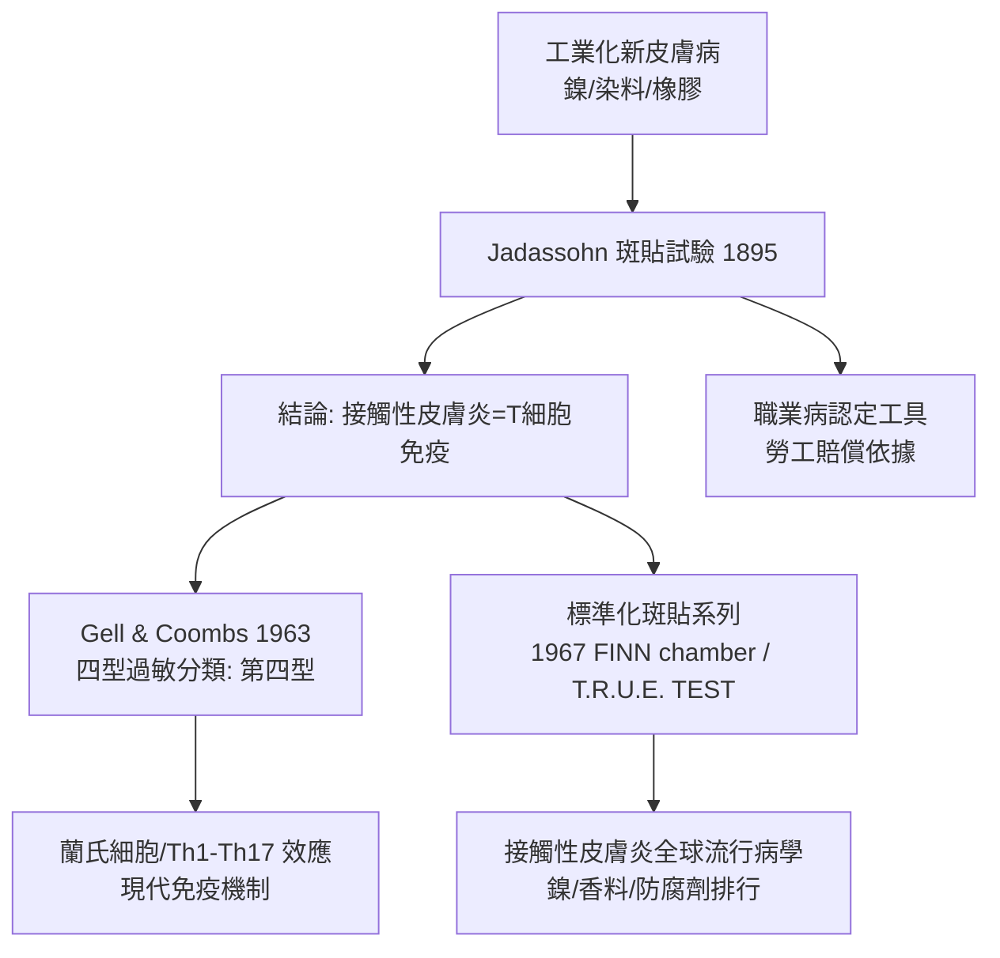

## 1895 - Jadassohn 斑貼試驗（在皮膚上重演犯罪現場）

## 案件摘要

**本案的偵查手法前所未見：不是去現場採證，而是把嫌犯帶回現場，重演案情。**

1895 年，布雷斯勞（Breslau）的皮膚科教授 Josef Jadassohn 做了一個簡單到近乎調皮的實驗：把疑似的過敏原（當時是汞製劑）貼在病人自己的正常皮膚上，48 小時後——貼處出現了與原發病灶一模一樣的紅斑水皰。**接觸性皮膚炎是免疫反應，不是「皮膚中毒」**——這個結論誕生了斑貼試驗（patch test），也誕生了後來被 Gell 與 Coombs（1963）編號為「第四型過敏」的整個領域。

## 前因 -- 為什麼會有這個案子

- **工業化製造了新皮膚病**：橡膠、染料、鎳、鉻酸鹽、水泥——十九世紀末的工廠與時裝（鎳扣、染料手套）製造了大量「碰了就疹」的病人，職業皮膚病成為勞工賠償的爭議焦點。
- **兩派解釋的對峙**：「接觸說」（病在接觸處）vs「體質/毒素說」（病人內在素質外顯）。若能只在局部重演病灶，接觸說即勝。
- **免疫學的前夜**：Behring 的抗毒素（1890）、Koch 的結核菌素反應（1891，遲發型細胞免疫的最早觀察）提供了「免疫記憶存在於血清之外」的線索。
- **Jadassohn 的位置**：他師承維也納的 Hebra-Kaposi 傳統，又在 Breslau 建立了重視實驗方法的皮膚科。

## 線索與推理 -- 數學式、程式、理論

斑貼試驗的邏輯，是用**空間控制變數**回答因果問題：

$$ \text{原發病灶} \xrightarrow{?} \text{過敏原} \quad\Longrightarrow\quad \text{對照皮膚} + \text{過敏原}_{48h} \xrightarrow{\text{陽性}} \text{因果確立} $$

```python
def patch_test(subject, allergen, reading_hours=48):
    # 同一病人、同一皮膚、只引入一個變數：過敏原
    naive_skin = "未曾暴露的前臂"
    result = expose(naive_skin, allergen, reading_hours)
    if result == "紅斑+丘疹水皰，28-72h 達峰":
        return "陽性：遲發型過敏（第四型）— 接觸性皮膚炎"
    return "陰性：可能為刺激性接觸炎或非接觸病因"

print(patch_test("鎳鈕扣接觸性皮膚炎病人", "硫酸鎳"))
```

為什麼反應要等 48 小時？因為第四型過敏是**細胞介導的**，走的是慢速動員：

$$ \text{半抗原穿透角質層} \xrightarrow{24h} \text{蘭氏細胞呈遞} \xrightarrow{\text{淋巴結}} \text{T 細胞增殖} \xrightarrow{\text{再循環}} \text{皮膚發炎（48–72h 峰值）} $$

它與第一型（IgE、蕁麻疹、數分鐘）的差別正是本案的偵查重點：**速率與浸潤細胞**。斑貼試驗讀的是「遲發相」，所以是 T 細胞案；劃痕試驗（Prick test）讀的是即發相，所以是 IgE 案——皮膚同時是兩套免疫系統的犯罪現場。



關鍵偵查發現：斑貼試驗把「皮膚」從被動的屏障重新定義為**主動的免疫器官**——蘭氏細胞（Langerhans cells，1868 年被看見、1973 年才確認是樹突狀抗原呈遞細胞）就駐守在表皮。皮膚不只是身體的包裝紙，而是全身最大的免疫哨站。

## 結案 -- 後果與影響

- **臨床工具的標準化**：1967 年芬蘭的 Finn chamber、後來的 T.R.U.E. TEST 使斑貼試驗全球統一；歐洲接觸性皮膚炎研究群（EECDRG）建立標準過敏原系列，鎳長期高居陽性率第一（女性約 15–20%）。
- **立法與產業**：歐盟 1994 年起限制含鎳飾品釋放量（Ni directive），使年輕女性鎳過敏率實測下降——**皮膚科試驗直接寫成了法規**。
- **免疫學的支點**：遲發型過敏→細胞免疫→T 細胞亞群研究；今日的免疫性接觸性蕁麻疹、藥物疹分型都從本案延伸。
- **一句話結案**：好的試驗設計勝過一千句爭論——Jadassohn 用一塊貼布，把病因學從辯論賽變成了重演實驗。

## 關鍵人物與文獻

- Josef Jadassohn（1863–1936）——1895 年首篇斑貼試驗報告；後主持皮膚病學巨編《Handbuch der Haut- und Geschlechtskrankheiten》。
- Bruno Bloch（1878–1933）——1911 年系統化斑貼試驗技術與組分（成分組合試驗），日內瓦學派。
- Gell & Coombs,《Clinical Aspects of Immunology》（1963）——四型過敏分類。
- Jean-Marie Lachapelle,《Patch Testing and Prick Testing》——現代操作經典。
