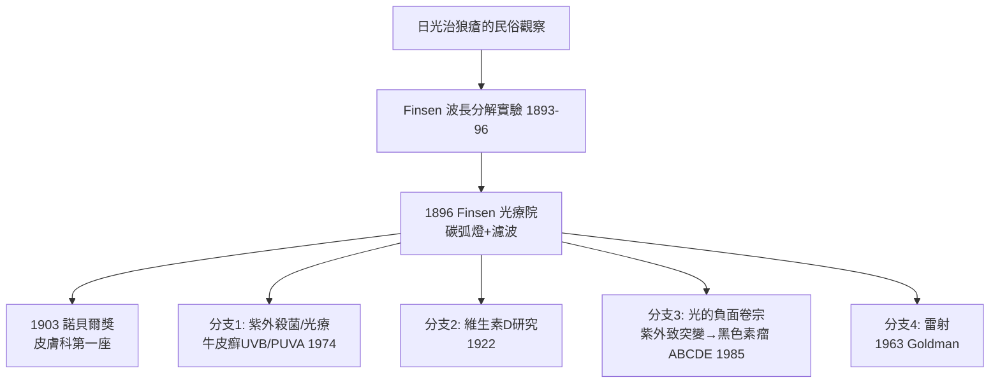

## 1903 - Finsen 光療與諾貝爾獎（皮膚科的第一座諾貝爾獎）

## 案件摘要

**本案的兇器是光，破案工具也是光。**

1903 年，丹麥醫師 Niels Ryberg Finsen 獲頒諾貝爾生理學或醫學獎——表彰他「以集中光線治療尋常狼瘡（lupus vulgaris，皮膚結核）」的貢獻。這是皮膚科歷史上的第一座諾貝爾獎，也是「光」第一次以治療者而非兇手的身份進入醫學殿堂。Finsen 光療院（Finsen Medical Lyceum, 1896）治療了上千名狼瘡病人：碳弧燈濾出紫紫外光，照在結核潰瘍的臉頰上，數月後病灶縮小、痂落、皮癒。

## 前因 -- 為什麼會有這個案子

- **狼瘡的殘酷**：皮膚結核侵蝕面部軟骨與皮膚（「狼」之名由此而來），患者多為年輕人，當時無藥可治（抗結核化療要到 1940s 鏈黴素）。
- **日光有益的民俗與觀察**：日光浴療養傳統（阿爾卑斯、北海灘）；Finsen 自己罹患慢性病，對「光與體力」的關係有切身疑惑。
- **光的物理學在成熟**：1889 年起紫外線殺菌力（Downes & Blunt 1877 已報告）與「光化學」概念普及；Finsen 的關鍵問題：**日光治狼瘡，到底是哪一段光在起作用？**
- **1893 年的前置實驗**：Finsen 以昆蟲與豚鼠實驗證明紫外段（而非可見光/紅外段）才是有效與傷害段——這是最早的「波長—生物效應」定量研究之一。

## 線索與推理 -- 數學式、程式、理論

Finsen 的推理可以寫成波長選擇問題：

$$ \text{療效} = \int_{\lambda_1}^{\lambda_2} I(\lambda) \cdot A_{\text{組織}}(\lambda) \, d\lambda \quad;\quad \lambda \approx 330\text{–}400\,\text{nm 之間的搜尋} $$

```python
def finsen_lamp():
    # 碳弧燈 + 水冷石英濾器：濾掉紅外(熱傷)、保留紫外
    return {
        "光源": "碳弧燈（強紫外）",
        "濾波": "水層吸收紅外熱 + 石英透紫外",
        "劑量": "每日 1-2 小時，連續數月",
        "原理": "紫外殺菌+免疫調節 → 結核病灶乾涸癒合",
    }

print(finsen_lamp()["原理"])
```

後世對其機制的補充很有意思：紫外光對結核桿菌有直接殺滅力（DNA 胸腺嘧啶雙聚體化），但**深部病灶其實照不到**——主要效力來自（1）表淺病灶的直接殺菌、（2）局部免疫刺激（殺死的菌體如原位疫苗）。Finsen 不知道免疫學，但劑量—療效曲線替他記了帳。



本案必須同時登記光的負面卷宗：同一批波長也是突變原——胸腺嘧啶雙聚體既殺細菌也傷人類 DNA。這條線最後通向皮膚癌的分子病理（p53 突變簽名、CC→TT 轉換）與黑色素瘤防曬運動（`1985-黑色素瘤ABCDE判讀法.md`）。Finsen 開啟的光之卷宗，正反兩面都要歸檔。

## 結案 -- 後果與影響

- **光療傳統的建立**：狼瘡光療沿用到 1940s 化療問世；其後代為牛皮癬的 UVB 療法與 PUVA（1974，補骨脂素+UVA），至今仍是乾癬、白斑、異位性皮膚炎的標準治療之一。
- **醫院建築的改變**：Finsen 光療院成為「陽光療養院」設計的模板（結核療養院的大露台）。
- **諾貝爾獎史**：1903 年 Finsen 與放射線（Béchamp？實為 danish 委員會頒給「light treatment」）——醫學獎史上唯一純粹頒給「用光治病」的一次。
- **一句話結案**：Finsen 贏在分解——把「日光」這團謎霧拆成波長、劑量、濾波三個可調變數，治療就從民俗變成工程。

## 關鍵人物與文獻

- Niels Ryberg Finsen（1860–1904）——《Om Anvendelse i Medicinen af koncentrerede kemiske Lysstraaler》（1896，論集中光線在醫學的應用）；因病重由兄長代領獎，1904 年病逝。
- Niels Finsen Medical Lyceum——1896 年哥本哈根成立，丹麥政府資助。
- H. Roelandts,"The history of phototherapy"（*Photodermatology* 綜述）；Katarina Norrbäck 的 Finsen 研究。
- 後續：PUVA（Parrish et al., 1974, *NEJM*）。
