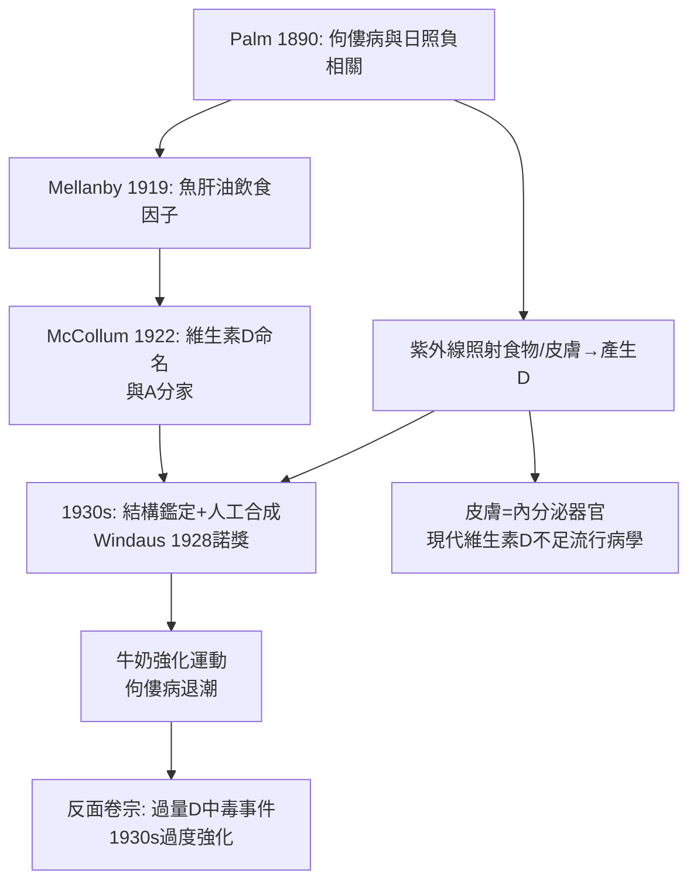

## 1922 - 維生素 D 與紫外線之謎（曬太陽為什麼能治佝僂病）

## 案件摘要

**本案的謎面：醫生們早就知道兩件事——曬太陽能治佝僂病，吃魚肝油也能治。一個是光，一個是食物，怎麼會是同一種藥？**

1922 年，約翰霍普金斯的 Elmer McCollum 與同事把「抗佝僂因子」從魚肝油中與維生素 A 分離開來，命名為**維生素 D**。同年並有關鍵一步：用紫外線照射不含維生素 D 的食物（以及後來證實：照射皮膚本身），竟能憑空「造出」抗佝僂能力。紫外線與魚肝油，原來是同一條生化路徑的兩個入口。皮膚，被確認為人體的內分泌器官——一座露天維生素工廠。

## 前因 -- 為什麼會有這個案子

- **佝僂病的工業化流行**：十九世紀末英國工業城市煙塵蔽日，貧民窟兒童高達八成有佝僂病（骨骼變形、顱骨軟化、O 型腿）——「英國病」。
- **兩條獨立的證據線**：(1) Palm（1890）流行病學調查：佝僂病與日照負相關；(2) 魚肝油療法（Mellanby 1919 以狗實驗證明飲食因子）。
- **維生素概念的競賽**：1913 年 McCollum 發現維生素 A（脂溶性生長因子）；抗佝僂因子是否就是 A？1922 年的破壞實驗（加熱破壞 A 後抗佝僂力仍在）把它們分家。
- **皮膚科的天賦位置**：光療（Finsen 1903，`1903-Finsen光療與諾貝爾獎.md`）已把「紫外線—皮膚—全身健康」的鏈條擺在案頭。

## 線索與推理 -- 數學式、程式、理論

謎題的解，是一條「光—化學—鈣」的轉換公式：

$$ 7\text{-脫氫膽固醇} \xrightarrow{\text{UVB}(290\text{–}315\,\text{nm})\text{ 於表皮}} \text{pre-}D_3 \xrightarrow{\text{熱異構}} D_3 \xrightarrow{\text{肝}25\text{-羥化}} 25(OH)D_3 \xrightarrow{\text{腎}1\alpha\text{-羥化}} 1,25(OH)_2D_3 \Rightarrow \text{鈣吸收}\uparrow $$

```python
def uv_to_bone(sunlight, skin, diet):
    uvb = sunlight["290-315nm"]
    if uvb > 0:
        d3 = skin["7-脫氫膽固醇"] * uvb   # 皮膚自己合成
    else:
        d3 = diet["魚肝油/強化食品"]        # 飲食補充
    calcium_absorption = d3 * active_form(d3)
    return "骨礦化恢復" if calcium_absorption > threshold else "仍佝僂"

print(uv_to_bone({"290-315nm": 1.0}, {"7-脫氫膽固醇": 1.0}, {"魚肝油/強化食品": 0}))
# 兩個入口，同一個終點
```

關鍵推論：這條路徑解釋了全部流行病學之謎——(1) 緯度梯度（高緯冬季 UVB 不足）、(2) 煙霧城市高發、(3) 深膚色族群在高緯度風險升高（黑色素是天然防曬，在低 UVB 環境變成缺 D 的代價）、(4) 為什麼魚肝油與日光等效（同一終點分子）。



## 結案 -- 後果與影響

- **公共衛生的標誌性勝利**：1930s 美國牛奶強化維生素 D，佝僂病在一代人之內從都市常見病變成罕見病——營養強化（fortification）成為與疫苗並列的群體干预典範。
- **皮膚科地位的提升**：皮膚被正式寫入內分泌與代謝生理學——皮膚科不再只是「看疹子」，也管代謝與光生物學。
- **反面卷宗**：1930s 過度強化造成嬰兒高血鈣中毒事件，催生強化劑量管制；二十一世紀「維生素 D 萬靈說」的熱潮又遭大型試驗（VITAL, 2018）潑冷水——劑量與適應症始終是本案的未結尾聲。
- **光生物學的統一**：從 Finsen 的殺菌光到維生素 D 的合成光，紫外線被完整歸檔為「雙面探員」——既治療（PSORIASIS UVB、白斑光療）也致癌（黑色素瘤，`1985-黑色素瘤ABCDE判讀法.md`）。
- **一句話結案**：皮膚是身體唯一用陽光做原料的化工廠——治好佝僂病的，從來不是魚肝油或太陽，而是經過它們的同一個分子。

## 關鍵人物與文獻

- Elmer Verner McCollum（1879–1967）——1922 年命名 vitamin D；「fat-soluble A/D 分家」實驗。
- Theobald Palm（1890）——日照流行病學經典調查；Edward Mellanby（1919）狗的佝僂病飲食實驗。
- Adolf Windaus——維生素 D 結構鑑定，1928 年諾貝爾化學獎。
- Michael Holick——現代皮膚維生素 D 合成與光生物學的集大成者（*NEJM* 2007 綜述）。
- Hess & Unger（1921）——紫外線照射治療佝僂病的臨床試驗，本案的臨床橋樑。
