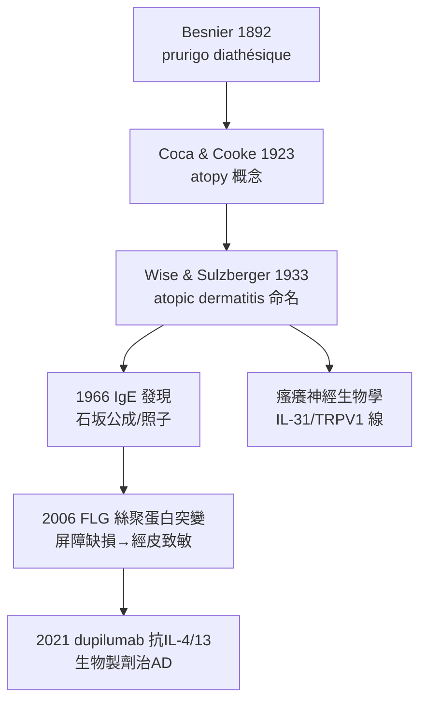

## 1933 - 異位性皮膚炎命名（把濕疹、氣喘、鼻塞綁進同一份家譜）

## 案件摘要

**本案的謎題：為什麼同一個孩子，先長奶癬、後來氣喘、再來花粉熱？皮膚、肺、鼻子三個器官，怎麼會是同一種病？**

1933 年，紐約的 Fred Wise 與 Marion Sulzberger 在論文中正式採用「atopic dermatitis（異位性皮膚炎）」一詞，接下 Coca 與 Cooke 1923 年鑄造的「atopy（異位體質）」概念：一種有家族遺傳傾向、對環境抗原產生過度敏感的體質。嬰兒濕疹——這個被各家命名了兩百年的雜燴（prurigo、neurodermatitis、eczema infantum）——終於有了能與氣喘、過敏性鼻炎歸檔同一抽屜的名字。皮膚科與過敏科自此結為連理。

## 前因 -- 為什麼會有這個案子

- **命名叢林的困局**：Besnier 1892 年的「prurigo diathésique」（素質性癢疹）已指出「癢—抓—苔癬化＋個人/家族過敏史」的組合，但「diathesis（素質）」一詞是蓋倫式形上學，科學界不買帳。
- **過敏學的誕生**：Portier & Richet 過敏反應（anaphylaxis, 1902）、Pirquet 的「變態反應」（allergy, 1906）、Coca & Cooke 的「atopy」（1923）——概念工具箱已備齊。
- **IgE 尚未發現**（要到 1966 年石坂夫婦），但臨床已知道：這類病人的皮膚劃痕反應（Prausnitz-Küstner 反應 1921）可以被血清轉移——「體內有一種可轉移的敏感因子」。
- **紐約的臨床富礦**：紐約醫院皮膚科門診的移民兒童大量湧現濕疹病例，Wise 與 Sulzberger 有足夠樣本做家族史與自然史研究。

## 線索與推理 -- 數學式、程式、理論

「atopic」的本質是一個**共病聚類（comorbidity clustering）**判斷：

$$ P(\text{氣喘} \mid \text{嬰兒濕疹}) \gg P(\text{氣喘}) \quad \text{且} \quad \text{家族內聚簇} \Rightarrow \text{同一體質, 不同靶器官} $$

```python
def atopic_march(cohort):
    # 異位性進行曲（atopic march）的臨床序列
    timeline = {"0-2歲": "皮膚(AD)", "3-6歲": "氣喘", "6歲+": "過敏性鼻炎"}
    # 進行曲的流行病學強度: 約半數重度AD兒童日後發生氣喘
    return timeline, "靶器官不同 → 共同機制: 過度敏感+屏障缺損"

print(atopic_march(None))
```

現代免疫學為這份家譜補上了基因組與分子層的解釋：

$$ \text{FLG（絲聚蛋白）功能缺失突變} \Rightarrow \text{皮膚屏障漏} \xrightarrow{\text{抗原入侵}} \text{Th2 偏斜} \Rightarrow \text{IgE}\uparrow + \text{瘙癢} $$

這是 2006 年 Irwin McLean 與 O'Regan 的關鍵發現：絲聚蛋白突變攜帶者異位性皮膚炎風險提升數倍，且是「先屏障缺損、後過敏」——**皮膚不只是症狀現場，而是過敏病的發動機**（經皮致敏）。1933 年的命名直覺，在 73 年後獲得分子級驗證。



## 結案 -- 後果與影響

- **診斷標準的百年工程**：從 Hanifin & Rajka（1980）的診斷準則到 Williams 英國準則（1994），命名之後是標準化——異位性皮膚炎成為全球可比較的研究實體。
- **皮膚—過敏軸的確立**：兒科與皮膚科聯合門診、「異位性進行曲」成為預防醫學干預點（潤膚劑預防試驗）。
- **治療革命**：類固醇→鈣調磷酸酶抑制劑（他克莫司 2000s）→抗 IL-4/13 生物製劑（dupilumab, 2017 FDA）與口服 JAK 抑制劑——由命名到機制再到標靶，本案是完整鏈條的起點。
- **一句話結案**：有些疾病的名字是描述，有些名字是假說——「異位性」三字是後者，而且是一個等了七十年才被驗證、至今仍在分期返款的假說。

## 關鍵人物與文獻

- Fred D. Wise 與 Marion B. Sulzberger（1933）——「atopic dermatitis」術語的臨床定案（Wise & Sulzberger 教科書編纂者）。
- Arthur Coca & Robert Cooke（1923）——「atopy」概念的鑄造者。
- Ernest Besnier（1892）——「prurigo diathésique」的前驅描述（聖路易醫院）。
- Irwin McLean & Aileen O'Regan（2006）——FLG 功能缺失突變與 AD（*Nature Genetics*）。
- K. C.? Ishizaka,石坂公成・照子（1966）——IgE 的發現。
- Hanifin & Rajka（1980）——AD 診斷標準經典。
