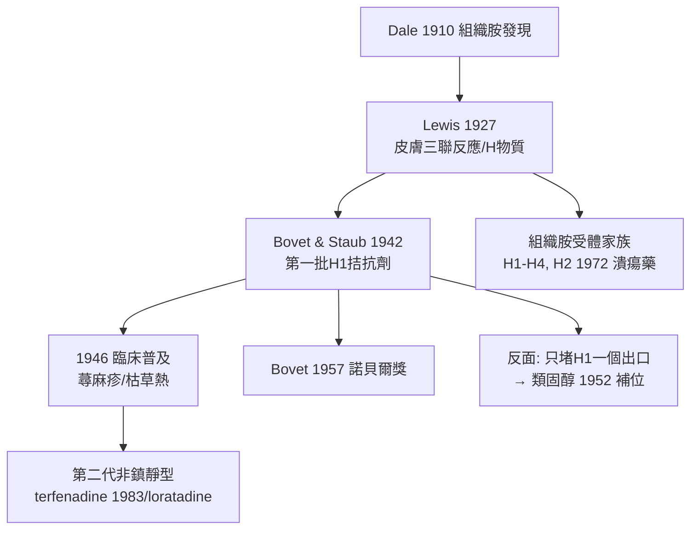

## 1942 - 抗組織胺的誕生（攔截過敏的第一個訊號分子）

## 案件摘要

**過敏案卷裡一直有個看不見的信使，本案是第一次成功攔截牠的信。**

1942 年，巴黎巴斯德研究所的 Daniel Bovet 與 Anne-Marie Staub 合成出第一批在動物體內有效的抗組織胺（如 1571 F 號化合物）；同年 Halpern 的 phenergan 前身與 1940s 後半的 antazoline、mepyramine 相繼問世。到 1946 年，蕁麻疹、枯草熱、血管性水腫的病人第一次有了一種「吃了就不那麼癢、不那麼腫」的藥。組織胺——這個 1910 年被 Dale 從 mold 提取物中發現、長期只是實驗室分子的物質——被確認為過敏反應的主要信使，而人類學會了冒充牠。

## 前因 -- 為什麼會有這個案子

- **組織胺的犯罪前科**：Dale 與 Laidlaw（1910）證明組織胺注射可重演過敏的諸多表現（血管擴張、通透性增加、支氣管收縮）；Lewis（1927）進一步證明**皮膚受刺激後自體釋放「H 物質」，性質似組織胺**（三聯反應：紅線、潮紅、風團）。
- **過敏大流行**：花粉熱與蕁麻疹在二十世紀上半葉迅速成為門診常見病，磺胺與青黴素的新過敏病例同步增加。
- **結構生物學的路徑**：Bovet 的工作源自乙醯膽鹼與腎上腺素受體藥理學的「結構類似物」策略——若組織胺有受體，就能造出佔住受體的冒牌貨。
- **法國染料工業**：巴斯德所與 Rhône-Poulenc 的合作使化合物庫（染料中間體）唾手可得——抗組織胺的祖先是染料。

## 線索與推理 -- 數學式、程式、理論

抗組織胺的原理是**競爭性拮抗**：

$$ \text{組織胺} + R_{H_1} \rightleftharpoons \text{反應} \quad vs \quad \text{抗組織胺} + R_{H_1} \rightleftharpoons \text{無反應（佔位）} $$

$$ \text{效應} \propto \frac{[\text{組織胺}]}{[\text{組織胺}] + K_i \cdot [\text{拮抗劑}]} $$

```python
def h1_blockade(histamine, antagonist, Ki=1.0):
    # 競爭性拮抗: 劑量效應被右移而非消除
    effect = histamine / (histamine + Ki * antagonist)
    return f"風團縮小至 {effect:.0%} — 過敏未被治癒, 但症狀被攔截"

print(h1_blockade(histamine=1.0, antagonist=4.0))
```

關鍵推論與其限制：第一代抗組織胺脂溶性高、穿透血腦屏障，帶來嗜睡（後來被轉用為安眠藥與暈車藥）；且**只攔截 H1 訊號**——過敏反應的上游（IgE、肥大細胞脫顆粒）與平行介質（白三烯、血小板活化因子）完全未被觸及。嚴重過敏（過敏性休克、血管性水腫的喉頭水腫）單靠它無效——這解釋了為什麼腎上腺素與類固醇仍是急症的必需品。



## 結案 -- 後果與影響

- **過敏治療的分水嶺**：抗組織胺使過敏從「無藥可醫的體質」變成「可管理的慢性病」，過敏門診與過敏學會在各國建制。
- **藥理學方法論的勝利**：受體—拮抗劑策略此後席捲藥學（H2 拮抗劑治潰瘍、β 阻斷劑、ACE 抑制劑都是它的直系後代）。
- **Bovet 1957 年諾貝爾獎**：表彰「與合成化合物抑制生物體內物質作用相關的發現」。
- **第二代的接力**：terfenadine（1983）開啟非鎮靜型世代（其心臟毒性教訓又催生了藥物代謝與 QT 間期研究——一種藥的副作用開出另一門學科）。
- **一句話結案**：抗組織胺沒有抓住兇手，只堵住了兇手的一個喇叭口——但單堵一個口，就已經讓數百萬人從撓癢的夜晚裡被放了出來。

## 關鍵人物與文獻

- Henry Dale（1875–1968）——1910 年與 Laidlaw 發現組織胺的藥理；1936 年諾貝爾獎（神經傳遞）。
- Thomas Lewis——皮膚三聯反應與「H 物質」，組織胺皮膚病理學的經典（1927）。
- Daniel Bovet 與 Anne-Marie Staub（1942）——第一批有效 H1 拮抗劑；Bovet 1957 年諾貝爾生理學或醫學獎。
- Bernard Halpern——法國抗組織胺計畫的臨床推手。
- W. W. Douglas,《Histamine and Antihistamines》藥理史；Emmanuel? 另見 Karch, *Drugs of the 20th Century* 綜述。
