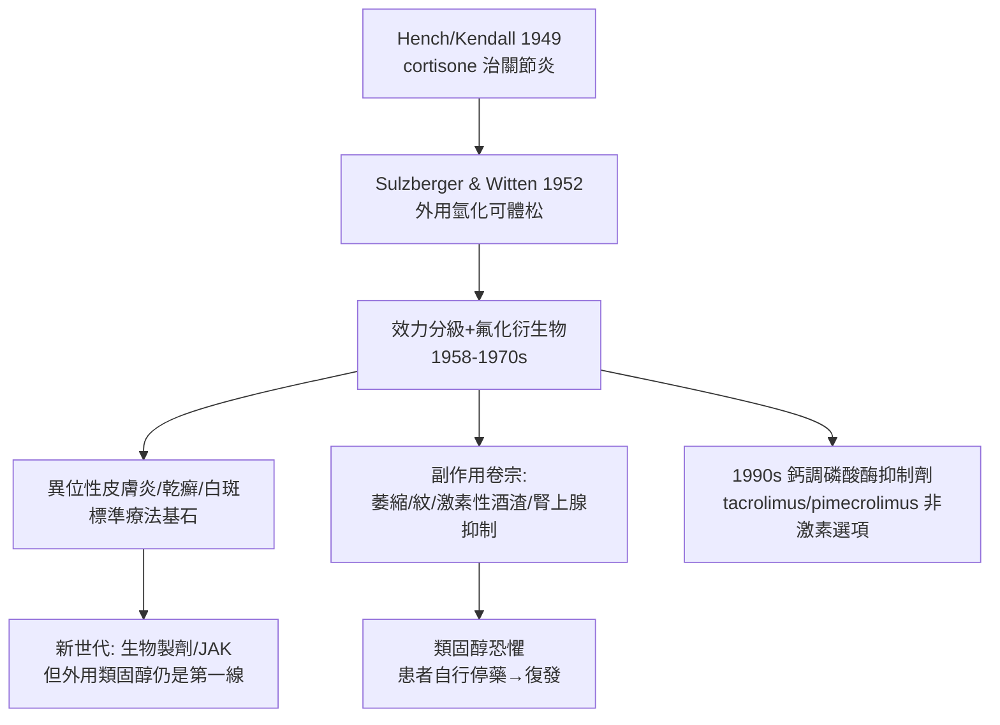

## 1952 - 外用類固醇革命（萬用消炎藥的誕生與濫用）

## 案件摘要

**本案的戰利品是一件幾乎能撲滅所有皮膚炎症的武器——本案的後遺症，是這件武器太好用。**

1952 年，Sulzberger 與 Witten 在紐約報告以氫化可體松外用治療異位性皮膚炎、濕疹、牛皮癬的成功；同年起 Merck 與其他藥廠的外用製劑問世。皮膚科迎來史上第一次「幾乎什麼炎症都有效」的藥物：紅斑消退、瘙癢止住、苔癬化軟化。此後七十年，外用類固醇成為全球開藥量最大的皮膚處方——而「類固醇恐懼」與「類固醇濫用」兩個相反的幽靈，也同時出鞘。

## 前因 -- 為什麼會有這個案子

- **腎上腺皮質的世紀發現**：Hench 與 Kendall 於 1948–49 年以 cortisone 治類風濕性關節炎震驚世界（1950 年諾貝爾獎）——糖皮質激素的全身抗炎效力已被證明。
- **問題：全身給藥代價太大**：口服/注射皮質素有庫欣症候群、水腫、血糖升高——需要局部化。
- **皮膚科的長期困境**：在此之前，濕疹與異位性皮膚炎只有焦油、收斂劑與熬人的濕敷；Hebra 時代的放血瀉劑早已破產。
- **Sulzberger 的地位**：異位性皮膚炎的命名者（`1933-異位性皮膚炎命名.md`），紐約皮膚科與皮膚病學研究的樞紐人物——他親手把新藥接進了最需要的疾病。

## 線索與推理 -- 數學式、程式、理論

糖皮質激素的抗炎作用是一條多出口的抑制網絡：

$$ \text{糖皮質激素} + \text{GR 受體} \xrightarrow{\text{入核}} \begin{cases} \text{NF-}\kappa\text{B / AP-1 轉錄抑制} \Rightarrow \text{細胞激素}\downarrow \\ \text{磷脂酶 A}_2\text{ 抑制（lipocortin）} \Rightarrow \text{前列腺素/白三烯}\downarrow \\ \text{血管收縮} \Rightarrow \text{紅斑}\downarrow \\ \text{T 細胞凋亡} \Rightarrow \text{免疫抑制} \end{cases} $$

```python
def topical_steroid(lesion, potency, duration):
    effect = {"紅斑": -0.8, "瘙癢": -0.7, "浸潤": -0.6}
    risks = 0
    if potency == "強效" and duration > 14:      # 部位-劑量-時間三角
        risks += 1  # 皮膚萎縮、微血管擴張
    if lesion["部位"] in ["臉", "皺褶處"] and potency != "弱效":
        risks += 2  # 薄皮膚部位高風險
    return "有效但須設停藥與部位規則" if risks else "常規安全使用"

print(topical_steroid({"部位": "臉"}, "強效", 21))
```

關鍵推論：外用類固醇的醫學難點不在效力，在**劑量—部位—時間的三維管理**。皮膚各處的屏障厚度差異巨大（陰囊吸收率可為掌部的數十倍），同一支藥膏在臉上是毒、在腳底剛好。1950s-60s 按效力分級（七級分類）與氟化衍生物（triamcinolone 1958、betamethasone、clobetasol 1970s）的出現，本質是把「萬用武器」改造成「可調節武裝」。



## 結案 -- 後果與影響

- **皮膚科的治療主力**：七十年来濕疹、乾癬、白斑（加光敏劑）、瘢痕性脫髮的處方基石；全球每年外用類固醇處方以億計。
- **副作用的完整卷宗**：皮膚萎縮、色素異常、激素性酒渣、隱匿真菌感染（tinea incognito）、嬰幼兒大面積使用的腎上腺抑制——副作用學本身成為皮膚科必修章節。
- **社會面的雙向幽靈**：「類固醇恐懼」（corticophobia）讓病人擅自停藥、病情失控；美白產品濫用強效類固醇（尤其在非洲與亞洲市場）則製造了大規模皮膚萎縮——同一種藥，被恐懼也被濫用。
- **替代品的追趕**：鈣調磷酸酶抑制劑（1990s–2000s）、外用 PDE4、外用 JAK（2021 ruxolitinib cream）——都是在「類固醇天花板」下的補位設計。
- **一句話結案**：史上最有效的外用藥教會皮膚科的不是「開什麼藥」，而是「開多久、開在哪、何時停」——劑量紀律是武器的槍管。

## 關鍵人物與文獻

- Marion B. Sulzberger 與 Victor Witten（1952）——外用氫化可體松的關鍵臨床報告。
- Philip S. Hench 與 Edward C. Kendall（1950 諾貝爾獎，與 Tadeusz Reichstein）——皮質激素的分離與臨床應用。
- 現代經典：Ruzicka 等的鈣調磷酸酶抑制劑研究；Eichenfield 等的 AD 外用治療指南。
- Crissey & Parish 與 Shelley 的二十世紀皮膚治療史綜述。
