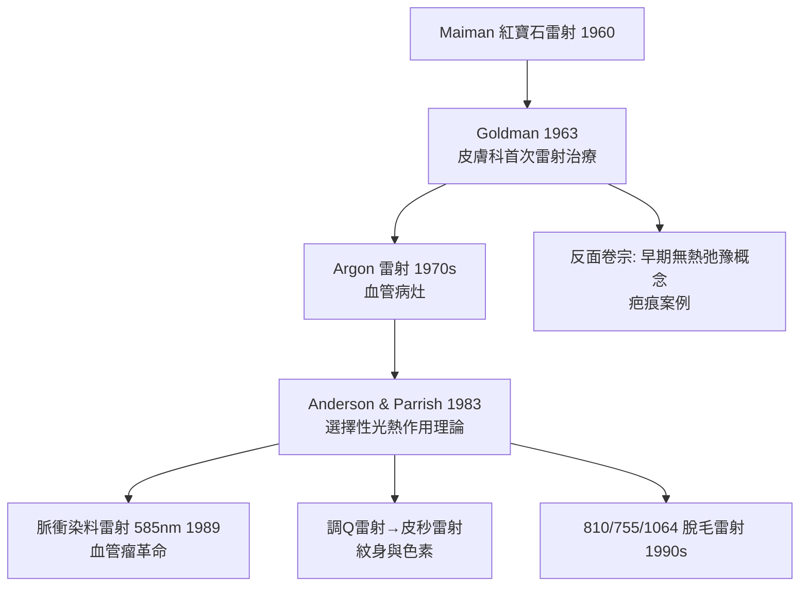

## 1963 - 皮膚雷射的起點（光變成手術刀之前）

## 案件摘要

**Finsen 用光治病五十九年後，光獲得了第二種武器化方式：聚焦。**

1963 年，辛辛那提的 Leon Goldman——皮膚科教授、也是「雷射生物醫學之父」——發表了以紅寶石雷射治療皮膚病變的先驅報告：黑色素含量高的病灶（色素痣、藍痣、紋身）選擇性吸收紅寶石雷射（694 nm）的能量而被破壞，周圍組織相對無恙。這份觀察埋下了三十年後「選擇性光熱作用」的種子：**光的治療力不在強度，而在波長與靶色基的匹配**。

## 前因 -- 為什麼會有這個案子

- **1960 年 Maiman 製出紅寶石雷射**：物理學界幾個月內就在構思醫療用途；醫學界則在找「第一個敢照的人」。
- **Goldman 的獨特位置**：他是皮膚科醫師、又與辛辛那提大學的雷射實驗室為鄰；他的格言是「雷射要在皮膚科生根，因為皮膚是唯一看得見治療全程的器官」。
- **既有的光療傳統**：Finsen（1903，`1903-Finsen光療與諾貝爾獎.md`）與 UVB 光療已建立「波長—劑量—組織反應」的思維框架，雷射只是把「波長選擇」推向極端單色化。
- **臨床未解需求**：鮮紅色血管瘤（port-wine stain）無法治療、紋身無法移除——都需要「只打壞目標色、不傷正常皮」的兵器。

## 線索與推理 -- 數學式、程式、理論

選擇性光熱作用（Anderson & Parrish, 1983）是 Goldman 直覺的定量版本：

$$ \text{選擇性破壞條件}: \quad \lambda_{\text{雷射}} \approx \lambda_{\text{靶色基吸收峰}} \quad;\quad \tau_{\text{脈衝}} < \tau_{\text{靶熱弛豫}} $$

```python
def selective_photothermolysis(laser, target):
    chromophores = {
        "血紅素": "585/595 nm 脈衝染料雷射 → 血管瘤/微血管擴張",
        "黑色素": "694 紅寶石/755 翠綠寶石/1064 Nd:YAG → 色斑/毛髮",
        "紋身墨水": "調Q納秒脈衝 → 碎墨入淋巴",
        "水": "CO2 10600/Er:YAG 2940 → 磨皮換膚",
    }
    return chromophores.get(target, "需色基")

print(selective_photothermolysis(None, "血紅素"))
```

關鍵推論：皮膚科的五種天然色基（黑色素、血紅素、含氧血紅素、水、紋身墨）各自有不同的吸收光譜與熱弛豫時間——**皮膚是一張天然的光譜靶紙**。這使皮膚科成為雷射應用的主戰場：血管雷射、色素雷射、脫毛雷射、換膚雷射，全部從 Goldman 1963 年的第一次照射分岔出來。



## 結案 -- 後果與影響

- **血管性病灶的治療革命**：1983 年理論＋1989 年脈衝染料雷射使 port-wine stain 從「無法治療的胎記」變成可控病灶，兒童不再帶著紅面罩長大。
- **醫美產業的誕生**：脫毛、換膚、色素治療使皮膚科延伸出醫療美容工業——也帶來非醫師操作與副作用的新監管議題。
- **理論先行的新常態**：Anderson & Parrish 1983 年的論文是「先算熱方程、再造機器」的典範——雷射皮膚科學從工匠轉為工程。
- **一句話結案**：Goldman 的遠見是把皮膚定義為「光的解剖學」——每一種顏色的病，都在等待對準它的那一種波長。

## 關鍵人物與文獻

- Leon Goldman（1906–1997）——1963 年紅寶石雷射皮膚應用首篇；《Lasers in Medicine》（與 R. J. Rockwell 合著，1971）；美國雷射醫學學會首任主席。
- Theodore Maiman（1960）——紅寶石雷射的發明者。
- R. Rox Anderson 與 John A. Parrish——「Selective photothermolysis」（*Science*, 1983），現代皮膚雷射的理論基石。
- Goldman L. et al.,"Radiation from a Q-switched ruby laser"（*J. Invest. Dermatol.*, 1963–65 系列）。
