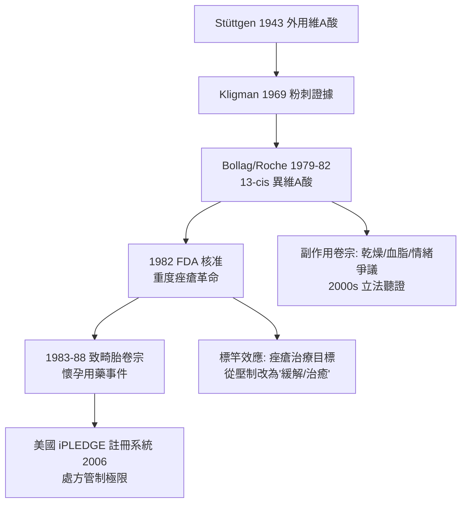

## 1982 - 異維 A 酸治痘（重度痤瘡第一次被「治癒」，代價是一個警告）

## 案件摘要

**痤瘡的治療史，一直是在油、細菌與角化之間圍剿；本案第一次直搗指揮部——皮脂腺本身。**

1982 年 9 月，美國 FDA 核准 13-cis 維 A 酸（isotretinoin，商品名 Accutane/Roaccutane）用於重度結節囊腫型痤瘡。效果空前：數月療程後多數病人皮脂分泌銳減、粉刺與囊腫消退，且**相當比例長期緩解甚至「治癒」**——此前的痤瘡治療（過氧化苯甲醯、抗生素、外用維 A 酸）都只是壓制。但藥物同時攜帶醫學史上最沉重的致畸胎警告：孕期服用可致嚴重胎兒畸形。一枚硬幣的兩面，都刻進了後來四十年的處方規則。

## 前因 -- 為什麼會有這個案子

- **痤瘡的病理三角**：皮脂過盛＋毛囊角化異常＋痤瘡桿菌（*Cutibacterium acnes*）增殖與炎症——重度型可毀容並留疤，青少年自殺率相關研究使其成為公共健康問題。
- **維 A 酸家族的譜系**：Stüttgen（1943）外用維生素 A 酸治角化病；Kligman（1969）證明全反式維 A 酸對粉刺有效；Roche 的 Werner Bollag 團隊在篩選維 A 酸衍生物時發現 13-cis 異構物口服可劇烈抑制皮脂腺。
- **意外之喜**：13-cis 本是為抗癌（急性前骨髓細胞白血病用 ATRA 是另一支線）與角化病研發；痤瘡是「碰上的金礦」。
- **需求背景**：重度痤瘡患者曾接受 X 光照射治療（1940s-60s 的常規，後因致癌被禁）、大劑量口服維生素 A（肝毒性）、長期抗生素（抗藥性上升）——都需要更好的武器。

## 線索與推理 -- 數學式、程式、理論

異維 A 酸的作用可以寫成一條「上游截流」公式：

$$ \text{isotretinoin} \Rightarrow \text{皮脂腺萎縮（皮脂}\downarrow 80\text{–}90\%） \Rightarrow \begin{cases} \text{痤瘡桿菌失去食物鏈}\downarrow \\ \text{毛囊角化正常化} \\ \text{炎症介質}\downarrow \end{cases} \Rightarrow \text{長期緩解} $$

```python
def isotretinoin_course(dose, months=5, weight_kg=60):
    cumulative = dose * 30 * months * weight_kg
    if cumulative >= 120 * weight_kg:            # mg/kg 累積劑量
        return "累積劑量達標 → 皮脂腺重設 → 緩解率高"
    return "未達標 → 復發風險上升"

print(isotretinoin_course(0.8))
```

其分子機制今日理解為**視黃酸受體（RAR/RXR）介導的基因調控**——異維 A 酸改變皮脂腺細胞與毛囊上皮的轉錄程式，使其退出「產油—角化」的工作模式。這是皮膚科第一種真正的「重設程式」藥物：療程結束後，器官的行為被改寫。



## 結案 -- 後果與影響

- **療效標竿**：累積劑量 120–150 mg/kg 成為全球處方共識；重度痤瘡的長期緩解率約三分之二——「痤瘡可以被治好」成為新的醫病期待。
- **風險管理的制度創新**：因致畸胎性，美國建立 iPLEDGE（2006）——藥物史上最嚴格的註冊給藥系統之一（避孕測試、每月登錄）；歐洲以妊娠預防計畫（PPP）執行。
- **科學遺產**：維 A 酸受體生物學開枝散葉——外用 tretinoin（光老化）、ATRA 治白血病（1988 上海王振義團隊的跨科勝利，皮膚科藥變成血液科神藥）、alitretinoin 治 Kaposi 肉瘤。
- **爭議卷宗**：情緒副作用與自殺風險的關聯經二十年研究仍為因果難題（重度痤瘡本身即風險因子）——本案提醒：當藥物有效到改變生活，副作用流行病學就會變成社會辯論。
- **一句話結案**：異維 A 酸證明皮膚病可以被「重設」而不只是「控制」——但重設身體的程式碼時，連讀取權限都得管到每一張處方。

## 關鍵人物與文獻

- Werner Bollag（Roche）——13-cis 維 A 酸的開發者；Peck 與 Yoder（NIH，1979–82）完成重度痤瘡的關鍵臨床試驗。
- Albert M. Kligman（1916–2010）——維 A 酸皮膚應用的奠基者（也是 1988 年白宮? 實為賓州大學「人體監獄試驗」爭議主角，需並列歸檔）。
- G. L. Peck et al.,"Treatment of nodulocystic acne with 13-cis-retinoic acid"（*NEJM*? 1979 *New England Journal of Medicine* 300:329）。
- 王振義與陳竺（1988）——全反式維 A 酸治療急性前骨髓細胞白血病。
- FDA iPLEDGE 計畫文件（2006）；R. Webster 等的異維 A 酸安全綜述。
