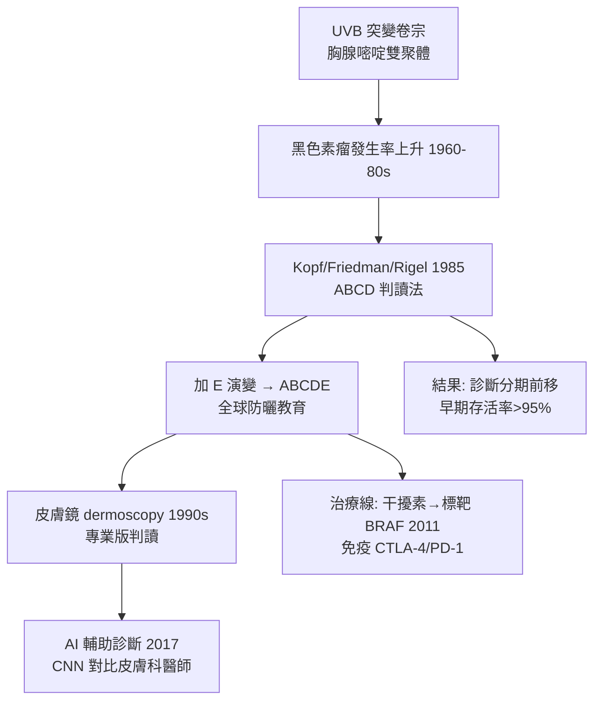

## 1985 - 黑色素瘤 ABCDE 判讀法（把皮膚癌的偵查權交給鏡子）

## 案件摘要

**本案偵破的謎題：如何讓一億個沒有顯微鏡的人，準確看出致命皮膚癌的早期特徵？**

1985 年，紐約大學的 Alfred W. Kopf、Robert Friedman 與 Darrell Rigel 在《Ca—A Cancer Journal for Clinicians》提出黑色素瘤早期判讀四徵——**A（Asymmetry 不對稱）、B（Border 邊緣不整）、C（Color 顏色不均）、D（Diameter 直徑 > 6 mm）**，後來加上 E（Evolution 演變）成為 ABCDE。這套「平民偵探手冊」把黑色素瘤的早期診斷從專家特權變成大眾技能，成為全球防癌教育最成功的範本之一。

## 前因 -- 為什麼會有這個案子

- **黑色素瘤的流行上升**：1960s–80s，西方國家黑色素瘤發生率每十年上升約 50–100%（休閒曬黑的興起、臭氧層與旅遊），死亡率同步攀升。
- **問題在「晚」**：局限性（第一期）黑色素瘤五年存活率 > 95%，轉移後驟跌至 < 15%——**診斷時機幾乎決定一切**。
- **專家判讀的瓶頸**：皮膚科醫師數量遠遠不夠掃描全人口的痣；需要把偵查能力下放到家庭與鏡子前。
- **紫外線致突變的卷宗已齊**：UVB 誘發胸腺嘧啶雙聚體（`1903-Finsen光療與諾貝爾獎.md` 的反面卷宗）、p53 與 CDKN2A 突變鏈——病因明確，剩下的是「早抓」。

## 線索與推理 -- 數學式、程式、理論

ABCDE 的本質，是把病理特徵**降維成肉眼可判讀的布林函數**：

```python
def abcde(mole):
    flags = {
        "A": mole["兩半不對稱"],
        "B": mole["邊緣不規則/模糊"],
        "C": mole["單一痣內顏色不均"],
        "D": mole["直徑>6mm"],
        "E": mole["近期大小/形狀/顏色變化"],
    }
    score = sum(flags.values())
    if score >= 2 or flags["E"]:
        return "警訊 → 皮膚科切片（stage 0-I 可治癒窗口）"
    return "常規追蹤"

print(abcde({"兩半不對稱": True, "邊緣不規則/模糊": True, "近期大小/形狀/顏色變化": True}))
```

背後的病理學依據：早期黑色素瘤的生長方式是**放射狀生長期（radial growth phase）**——在表皮內水平擴散，此時呈現不對稱、色斑、邊緣不整；一旦進入垂直生長期（結節化、深入真皮），轉移風險隨 Breslow 厚度（1970）指數上升：

$$ \text{轉移風險} \propto e^{\text{Breslow 厚度}} \quad;\quad \text{ABCDE 的目標} = \text{在垂直期之前截獲} $$



## 結案 -- 後果與影響

- **防癌教育的成功範本**：ABCDE 進入全球公衛教材、皮膚自我檢查（每月一次、鏡子＋手機拍照對照）成為標準動作；「看你的皮膚」從美容行為變成醫療行為。
- **診斷分期前移的證據**：澳大利亞與美國的黑色素瘤死亡率在發生率上升的同時趨於平緩或下降——早期診斷的功勞（加上防曬行為改變）。
- **技術接力**：皮膚鏡（dermoscopy，1990s 標準化）→ 全身攝影追蹤 → AI 判讀（2017 年 Nature 的 CNN 研究達到皮膚科醫師水準）——ABCDE 的「人眼布林函數」被不斷擴增解析度。
- **治療線的獨立爆發**：BRAF 抑制劑（vemurafenib, 2011）與免疫檢查點抑制劑（ipilimumab 2011、pembrolizumab 2014）改寫晚期黑色素瘤的死刑判決——與早期診斷線合流，黑色素瘤從最惡性的皮膚癌變成「可預防＋可早抓＋可免疫治療」的三重樣板。
- **一句話結案**：ABCDE 是醫學史上罕見的「把診斷標準寫成五個字母」的成功——它證明最好的早期診斷工具，是訓練一億雙眼睛。

## 關鍵人物與文獻

- Alfred W. Kopf、Robert J. Friedman、Darrell S. Rigel（1985）——ABCD 判讀法原始論文（*Ca* 35:130–151）；Rigel 後加 E。
- Alexander Breslow（1970）——腫瘤厚度的預後測量（Breslow 厚度）。
- R. Rox Anderson 的紫外線生物物理研究與防曬 SPF 標準化的推動。
- Esteva et al.,"Dermatologist-level classification of skin cancer with deep neural networks"（*Nature*, 2017）。
- Garbe & Leiter 的黑色素瘤流行病學綜述；WHO INTERSUN 紫外線防護綱要。
