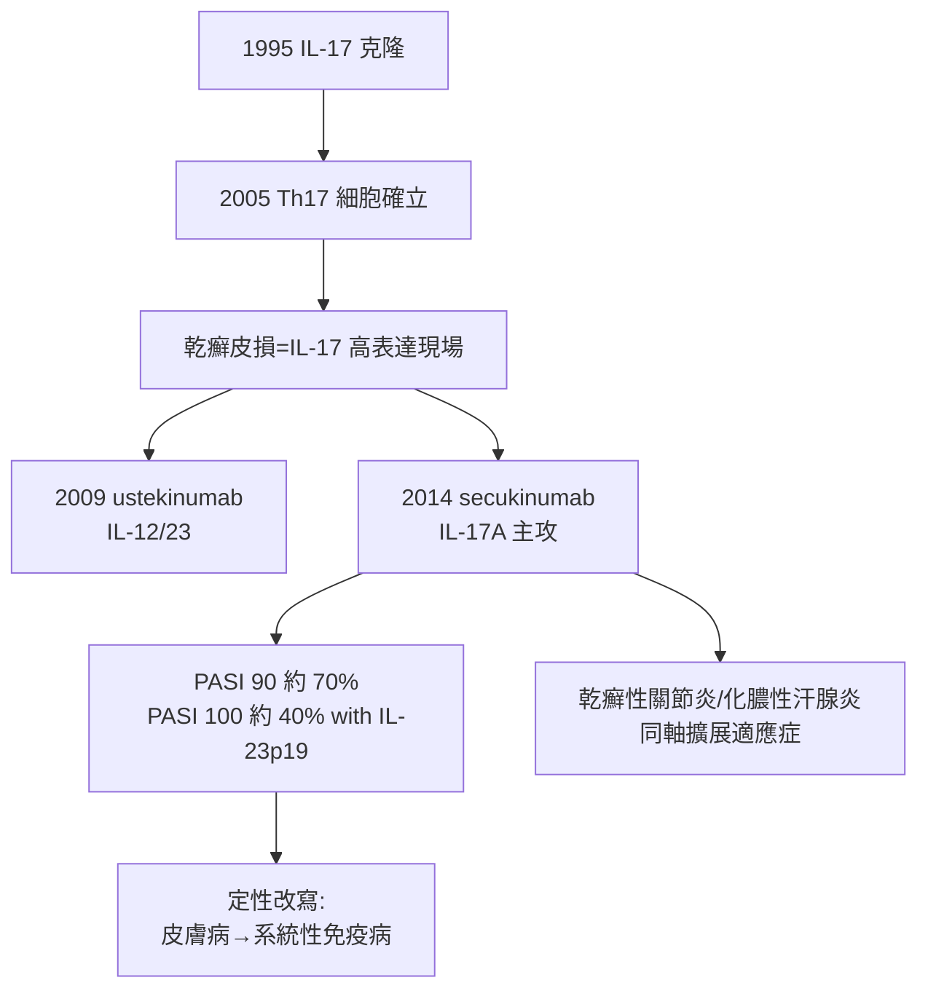

## 2014 - 生物製劑與乾癬免疫革命（Th17 主謀落網，PASI 90 成為新常態）

## 案件摘要

**乾癬的案子辦了兩千年：體液論（-0400）、增殖失控（1975）都當過主嫌。2014 年，主謀終於到案——名字叫 IL-17。**

2014 年 1 月，美國 FDA 核准 secukinumab（抗 IL-17A 單株抗體）的關鍵試驗結果：在 FIXTURE 等第二/三期試驗中，**約 60% 重度乾癬患者達到 PASI 90**（皮損面積與嚴重度改善九成）、約 30% 達到完全清除（PASI 100）。乾癬治療從「壓制」跨越到「幾乎清除」——這場勝利同時改寫了疾病定性：乾癬不是皮膚細胞增生病，而是**以 IL-23/IL-17 軸為核心的 Th17 免疫病**。皮膚、關節、心血管的乾癬譜系，第一次被同一種細胞激素邏輯貫通。

## 前因 -- 為什麼會有這個案子

- **免疫學的鋪路**：2005 年前後，Th17 細胞（第三種效應 T 細胞亞群）被確立（Bettelli、Kuchroo、Stockinger 等小鼠研究；人類 IL-17 由 Yao 1995 年克隆）——皮膚科醫師發現乾癬皮損正是 IL-17A、IL-22 高量表達的現場。
- **環孢素的啟示**：1986 年 Ellis 與 Krueger 報告免疫抑制劑環孢素顯著緩解乾癬——「乾癬是免疫病」的假說有了藥理學證據，但還不夠精確（環孢素是散彈槍）。
- **IL-12/23 的分岔**：ustekinumab（抗 p40，同時封鎖 IL-12 與 IL-23，2009 年 FDA 核准）先奏捷；動物模型隨後證明關鍵是 **IL-23 → Th17 → IL-17A/F → 角質細胞過度反應**——單鎖 IL-17A 即可開鎖。
- **生物製劑工業**：抗 TNF-α 藥物（etanercept 2002、adalimumab 2005 用於乾癬）已建立單株抗體治乾癬的先例與安全資料庫。

## 線索與推理 -- 數學式、程式、理論

乾癬免疫迴路的完整鏈條：

$$ \text{樹突細胞} \xrightarrow{\text{IL-23}} \text{Th17} \xrightarrow{\text{IL-17A/F + IL-22}} \text{角質細胞} \Rightarrow \begin{cases} \text{抗菌肽（LL-37）}\uparrow \\ \text{化學趨化因子}\uparrow \Rightarrow \text{嗜中性球浸潤} \\ \text{增殖失控（3-4 天週期）} \end{cases} $$

```python
def psoriasis_loop(dendritic_cell, keratinocyte):
    il23 = dendritic_cell["IL-23"]
    th17 = activate_th17(il23)
    il17 = th17["IL-17A"]
    keratinocyte["增殖"] *= 8          # 對應 1975 年的週期測量
    keratinocyte["抗菌肽/趨化因子"] += il17
    dendritic_cell["活化"] += keratinocyte["警報素"]   # 正回饋環
    return "自我維持的炎症迴路 — 打斷任一節點即緩解"

print(psoriasis_loop({"IL-23": 1.0}, {"增殖": 1.0}))
```

生物製劑的勝利來自**單節點高精度截擊**：

| 截擊點 | 藥物 | 核准年 | PASI 90 率（重度患者） |
|---|---|---|---|
| 抗 IL-12/23（p40） | ustekinumab | 2009 | 約 67% |
| 抗 IL-17A | secukinumab / ixekizumab | 2014 / 2016 | 約 68–70% |
| 抗 IL-17 受體 A | brodalumab | 2017 | 約 70% |
| 抗 IL-23（p19） | guselkumab / risankizumab | 2017 / 2019 | 約 73–75% |



關鍵偵查發現：這場革命重新解釋了舊證物——1975 年測得的角質細胞快轉（`1975-乾癬角質細胞週期之謎.md`）是 IL-17/IL-22 訊號的**輸出結果**；傳統治療（MTX、光療、環孢素）則是不精確地「全段封鎖」。生物製劑把因果鏈上每個節點都變成可單獨試驗的假說——這正是分子醫學的方法論樣板。

## 結案 -- 後果與影響

- **療效重設與患者生活重寫**：PASI 100（完全清除）成為臨床試驗的常規終點；乾癬患者的就業、社交與心理負擔實質下降（污名線的科學解方）。
- **疾病定性改寫**：乾癬併發關節炎、發炎性腸道病、代謝症候群的「系統性炎症」形象確立；皮膚科與風濕科、腸胃科共管同一病人。
- **同軸疾病的連鎖勝利**：IL-17 抑制劑接連拿下乾癬性關節炎、化膿性汗腺炎、強直性脊椎炎；IL-4/13 抑制劑（dupilumab）改寫異位性皮膚炎（`1933-異位性皮膚炎命名.md` 的兌現時刻）——皮膚科成為細胞激素靶向治療的最大試驗場。
- **代價卷宗**：高價、終身給藥、感染風險（黏膜念珠菌）、IBD 反效應（brodalumab？實為 IL-17 抑制劑可能加重 IBD）與自殺意念警示（brodalumab），以及全球可近性的巨大落差——免疫革命的果實，尚在分配。
- **一句話結案**：兩千年的皮膚病卷宗，最後靠一個細胞激素的名字結案——皮膚不是病灶的全部，但它是免疫系統最誠實的顯示器。

## 關鍵人物與文獻

- Yao, Spriggs 等（1995）——IL-17 的克隆與鑑定；Bettelli/Kuchroo、Stockinger、Miossec（IL-17 生物學）——Th17 時代的確立。
- Alice Gottlieb（1980s–90s）——乾癬免疫病理與早期生物製劑試驗的先驅。
- Christopher Griffiths、James Krueger、Jonathan Barker——乾癬免疫模型與臨床試驗網絡的核心推手。
- FIXTURE / ERASURE 試驗（secukinumab，*NEJM* 2014）；VOYAGE 1/2（guselkumab）。
- Nestle, Kaplan & Barker,"Psoriasis"（*NEJM*, 2009）——免疫轉型的權威綜述。
