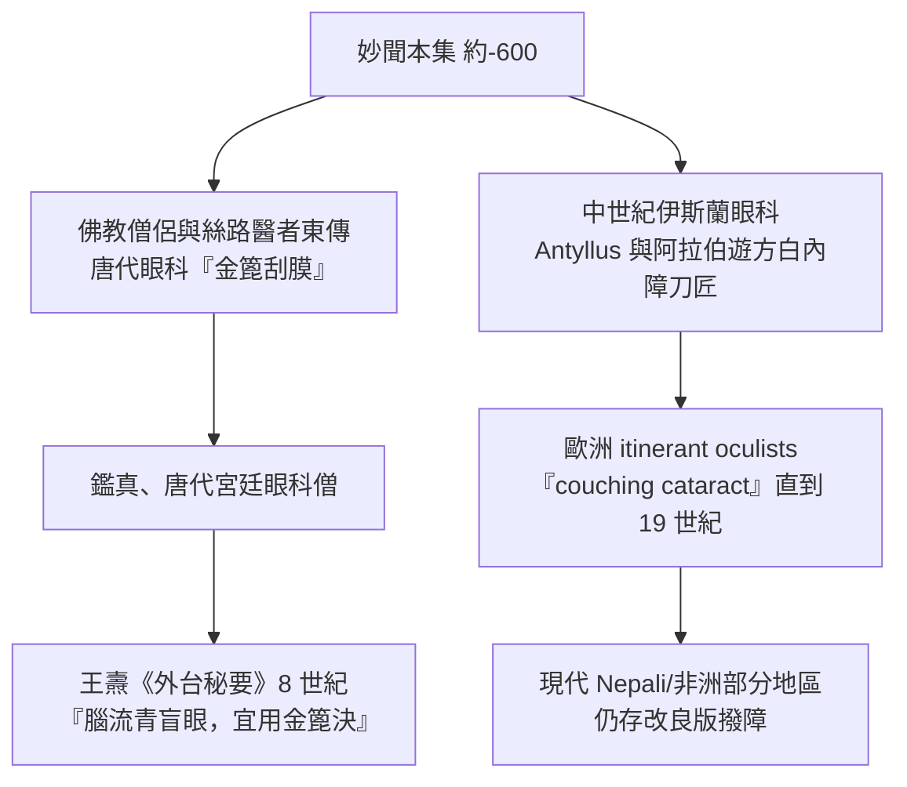

## -0600 - 妙聞金針撥障（白內障手術的最早完整記錄）

## 案件摘要

**本案偵破的是一個最古老的謎題：眼前那層「膜」究竟是什麼？**

約西元前 600 年（部分學者主張內容層可溯至更早的口傳時代），北印度 Kashi 王國的外科聖手妙聞（Sushruta）在《妙聞本集》（Sushruta Samhita）的 Uttara Tantra 章中，完整記載了「金針撥障」（couching）：醫師以加熱的金屬細針自角膜緣刺入前房，將混濁的水晶體**壓撥向下、使其脫離視軸**，光線重新進入眼內。病人在術後包眼靜養，許多人復得視物。這是外科醫師第一次宣稱：混濁不在「眼火」，不在「霧氣」，而在眼球內一個**可以撥動的實體**——病灶定位，就是本案的偵破成果。

## 前因 -- 為什麼會有這個案子

- **阿闥吠陀的線索**。約前 1000 年的《阿闥吠陀》已提及「Timira」（遮蔽瞳孔之暗），並把眼科（śālakya tantra，śalākā 即「針」）列為阿育吠陀八醫科之一——「以針治眼」是印度醫學的建制傳統。
- **無麻醉、無抗生素的約束條件**。撥障必須極快、極小切口、不縫合；這解釋了為何選擇「撥入玻璃體」而非「取出」——取出在當時等於感染與眼球毀壞。
- **競爭解釋並存**。希臘人說白內障是瞳孔前方的「下垂之膜」（hypochyma，kato River 下流之水凝結）；印度醫家則觀察到混濁隨年齡增長、撥開後光感立刻恢復——這是經驗證據對體液理論的無聲挑戰。
- **手術指南的誕生**。妙聞不只描述術式，還規範了病例選擇（僅成熟白內障）、術前體檢、器械消毒（熏煙）、術後併發症與失敗案例——一份真正的臨床試驗報告書。

## 線索與推理 -- 理論、推理過程與復原

**線索一：病灶定位的邏輯。** 撥障之所以成立，暗含一條推理鏈：

$$ \text{術前有光感} \;\Rightarrow\; \text{視神經與視網膜完好} \;\Rightarrow\; \text{障礙只在其前} \;\Rightarrow\; \text{移走該障礙即可復明} $$

妙聞的團隊用「光感測試」（在術前以手遮眼測患者能否辨光）把這條鏈變成了**術前篩檢標準**——適應症的概念由此誕生。

**線索二：術式的力學。** 復原其操作要點：

```python
# 《妙聞本集》撥障術流程復原（示意）
def couching(patient):
    assert patient.can_perceive_light()      # 光感陽性：視路後段健全
    assert patient.cataract_is_mature()      # 晶體完全混濁，易於下壓
    warm_needle(temperature="適度加熱")      # 兼具止血與慰藉
    puncture(site="角膜緣外側")              # 避開中央角膜光學區
    depress_lens(direction="下壓至玻璃體")   # 視軸讓位，光路打通
    seal_and_bandage()                       # 藥膏封口＋緊密包眼
    return "術後側臥靜養，禁咳嚏、禁用力"
```

**線索三：為何「撥向下」而不是「取出」。** 力學上，水晶體是個懸於眼內的雙凸透鏡：

$$ P_{\text{眼}} = P_{\text{角膜}} + P_{\text{晶體}} \approx +43D + +19D $$

撥障放棄了 $+19D$，只求光線入眼——病人術後成為**無晶體眼（aphakia）**，必須靠一枚約 $+10D\sim+12D$ 的凸透鏡補償，才能看清近處。妙聞的病人得到的是「遠視力與光感」，這在無法精密磨鏡的時代已足以改變人生。

**線索四：知識的傳播路徑。**



## 結案 -- 後果與影響

- **病灶定位的千年正確**。妙聞把白內障定位在水晶體，比歐洲普遍接受此結論早了近兩千年；Arabic 眼科與中世紀歐洲的 coucher（撥障師）沿用的正是這條印度路線。
- **「手術先行、理論補課」的醫史模式**。撥障在沒有光學理論的年代就以療效立足——眼科史上的理論（見 `1021-伊本海賽姆視覺光學.md`、`1604-克卜勒視網膜成像.md`）常在手術之後才解釋「為什麼有效」。
- **東傳與漢譯**。唐代文獻中的「金篦刮目」「金鍼決障」即此術東傳之證；劉禹錫詩「三秋傷望眼，終日哭途窮……師有金篦術，如何為發蒙」記錄了患者視角。
- **陰影面**。撥障的長期併發症——晶體皮質殘留誘發的葡萄膜炎、視網膜剝離、無晶體眼的深度遠視——使其在 Daviel 摘除術（見 `1745-達維爾白內障摘除術.md`）問世後逐步退場；但在缺乏手術顯微鏡的地區，改良式撥障至今仍以極低成本提供光感。
- **一句話結案**：在還不知道光為何物之前，印度外科醫師已經知道——把那塊混濁的透鏡撥開，世界就回來了。

## 關鍵人物與文獻

- **Sushruta（妙聞，約前 600，年代有爭議）**——傳說中的印度外科之父；《妙聞本集》載 120 種外科器械、300 種手術、1,100 種疾病，其中 76 種為眼病。
- **Vagbhata（伐八他，約 600 CE）**——在《八支心要》中整理並傳承撥障術，使知識跨越千年。
- 原始文獻——*Sushruta Samhita*, Uttara Tantra, ch. 17（Bhishagratna 英譯本, 1907）。
- **現代註腳**——印度 Aravind 眼科系統在 1980–90 年代曾以改良撥障大量處理積壓病例，之後全面轉向超音波乳化（見 `1967-凱爾曼超音波乳化手術.md`）；一個 2,600 年的術式，最終讓位給 3mm 切口的小機器。
