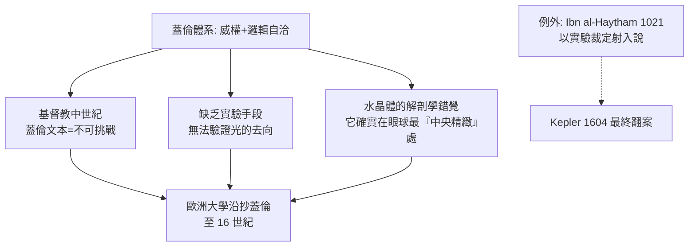

## 0150 - 蓋倫眼球解剖與視覺氣（一個美麗的錯誤統治 1,400 年）

## 案件摘要

**本案偵破失敗，但兇手的「錯誤畫像」卻成為中世紀的通緝令。**

約西元 150 年，帕加馬的蓋倫（Galen）在羅馬以牛、猴眼做系統解剖，寫下《論眼與其器官之用途》：他正確描述了鞏膜、脈絡膜、視網膜（retina 一詞的拉丁前身）、玻璃體與水晶體的層次關係，卻錯誤裁定——**視覺由「視覺氣（pneuma optikon）」從腦經視神經流入水晶體，再向外與環境交互而成**。水晶體被指定為「感知的樞紐」，角膜、瞳孔只是光線的守門人。這套「投射說」與亞里斯多德—歐幾里得的陣營拉鋸，直到 Ibn al-Haytham（見 `1021-伊本海賽姆視覺光學.md`）才被推翻。本案的教訓：解剖得越精細，未必錯得越少——錯在方向，不在細節。

## 前因 -- 為什麼會有這個案子

- **兩大學派對峙**。「射出說」（emission theory：眼睛射出光線觸物）源於畢達哥拉斯與歐幾里得的幾何學傳統；「射入說」（intromission：物體送出形像進入眼）源於原子論。兩派各有幾何與感官經驗的死角。
- **柏拉圖的調停方案**。《蒂邁歐篇》主張眼中之火與外光相遇結合成「視覺流」——折衷方案反而蓋住了射入說的正確火種。
- **蓋倫的醫學體系壓力**。他需要把眼納入「腦—神經—pneuma」的統一生理學：視神經是「軟神經」（載 pneuma），必須以管輸送感知力至眼——水晶體自然是終點站。
- **解剖對象的偶然性**。牛眼水晶體巨大、位於眼球中央偏前，恰似「感知器官」；若解剖對象是人或鳥，結論或許不同。

## 線索與推理 -- 理論與錯誤的結構

**線索一：蓋倫的生理學方程。** 把他的體系寫成公式：

$$ \text{pneuma}_{\text{腦}} \xrightarrow{\text{視神經管}} \text{水晶體} \xrightarrow{\text{與外氣交互}} \text{視覺} $$

錯誤核心：把**單向的能量/物質流**（pneuma 外流）當成了資訊流。正確圖像恰恰相反：

$$ \text{光}_{\text{外}} \xrightarrow{\text{角膜/晶體折射}} \text{視網膜} \xrightarrow{\text{視神經（內傳）}} \text{腦} $$

**線索二：他「答對了一半」的清單。**

| 蓋倫的結論 | 後世裁定 |
|---|---|
| 眼球分三層被膜 | 正確（纖維膜、血管膜、神經膜） |
| 水水晶體位於眼球前部中央 | 半對（位置描述過前、過中） |
| 視神經為空管輸送 pneuma | 錯（實為神經纖維束） |
| 水晶體是感知器官 | 錯（它只是透鏡） |
| 視網膜覆於玻璃體表面 | 正確（名稱與功能日後由 Kepler 學派確認） |

**線索三：為什麼 1,400 年無人推翻。**

**線索四：水晶體「過前」的持續影響。** 蓋倫畫的水晶體貼近角膜中央——這個錯誤在維薩留斯（1543）與 Platter（1583）的解剖中被逐一修正，最終為 Kepler 的成像理論（見 `1604-克卜勒視網膜成像.md`）鋪平了正確的幾何前提：光要經過角膜與晶體**兩道折射**才能聚焦。

## 結案 -- 後果與影響

- **臨床的悖論性收益**。因為水晶體被奉為「感知聖器」，中世紀醫師反而推論：白內障是瞳孔前方的假膜，撥開即可，**不可傷及水晶體**——這個錯誤的理論竟意外保護了「別摘除水晶體」的保守策略，也同時**延遲**了白內障摘除術約千年（見 `1745-達維爾白內障摘除術.md`）。
- **伊斯蘭光學的靶子**。蓋倫體系正是 Ibn al-Haytham 立論時要擊倒的對手；射出說的數學（歐幾里得視錐）被保留，物理方向被倒轉——偵探常常站在前案卷宗之上。
- **蓋倫式教學的解剖基礎**。三膜、四體液、pneuma 的教學框架使「眼科」在醫學院有了名分；他的《論眼》被 Hunayn ibn Ishaq 於 9 世紀譯入阿拉伯並增補（《眼之十論》），成為阿拉伯眼科黃金時代的教科書源頭（見 `1000-阿里伊本伊薩眼科專書.md`）。
- **一句話結案**：蓋倫證明了精細解剖不等於正確生理——他畫出了眼球的每一層，卻把光的方向畫反了；推翻他的不是新的刀，而是新的光。

## 關鍵人物與文獻

- **Galen（蓋倫，129–約 216）**——帕加馬—羅馬的醫學全能者；著述佔存世古希臘醫書近半，《論眼》（De usu partium 相關章節）為中世紀眼科權威。
- **Hunayn ibn Ishaq（809–873）**——景教徒翻譯家、眼科醫師，把蓋倫譯入阿拉伯語並撰《眼之十論》（Ten Treatises on the Eye），兼做過一次水晶體位置的實測修正。
- 原始文獻——Galen, *De usu partium corporis humani*, Book X；Hunayn, *Kitab al-'Ashr Maqalat fi al-'Ayn*。
- **現代註腳**——視網膜（retina）一名由後世學者沿用蓋倫的「蛛網狀膜」描述；他錯誤的 pneuma 理論卻意外留下「神經以化學信號傳導」的直覺雛形——一個錯誤的理論，常是正確理論的草稿。
