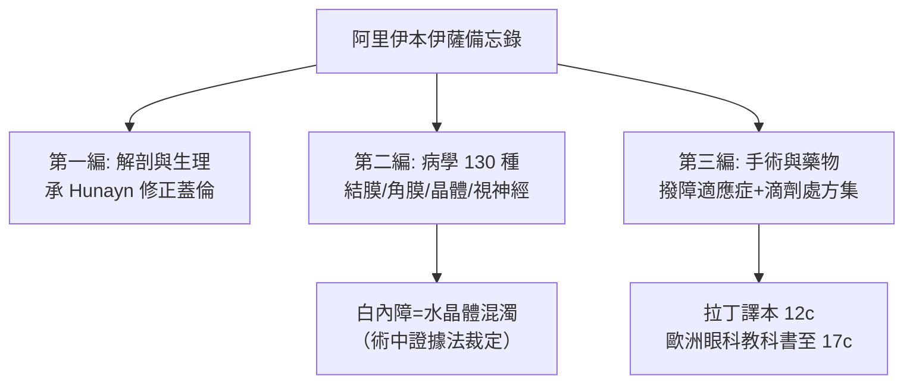

## 1000 - 阿里伊本伊薩眼科專書（《眼科醫師備忘錄》：中世紀的眼科聖經）

## 案件摘要

**本案偵破的是：白內障病灶的正確解剖定位——在水晶體，而非瞳孔前的「假膜」。**

約西元 1000 年，巴格達眼科醫師阿里伊本伊薩（Ali ibn Isa，拉丁化 Jesus/Jesu Haly）完成《眼科醫師備忘錄》（Tadhkirat al-Kahhalin，"Memoir for the Oculists"）。全書三編：一論眼解剖與生理、二論眼病（共約 130 種）、三論手術與藥物——其中以清晰語言宣告白內障是**水晶體本身的混濁**（"sudaf"，水泛入晶），並區分其為可撥之成熟期與不可撥之早期。此書經拉丁譯本（Constatinus 非洲譯者系統，12 世紀）成為歐洲眼科權威，直到 17 世紀 Hirschberg 稱它為「中世紀最傑出的眼科手冊」。本案的成果：在沒有顯微鏡與檢眼鏡的時代，僅憑視診、觸診與撥障的術中手感，就鎖定了病灶器官。

## 前因 -- 為什麼會有這個案子

- **巴格達眼科的建制化**。阿拔斯王朝把 kahhal（眼科醫師）列為國家考核的專科職業；市場上有眼科執照制度，眼病專書自 9 世紀起層出：Hunayn《眼之十論》、Thabit ibn Qurra《論眼病》。
- ** Hunayn 的解剖修正**。Hunayn ibn Ishaq 在翻譯蓋倫後親自解剖，指出水晶體位置比蓋倫所畫更偏前——為「病灶在水晶體」的診斷提供了正確的地圖。
- **臨床病例海量**。波斯與兩河流域強日照、沙塵、沙漠眼病（結膜炎、沙眼、翼狀贅片）流行，白內障撥障術由遊方術士執行、水準參差——需要一份「官方手冊」統一標準。
- **藥物學的積累**。阿拉伯醫學發展出滴劑、軟膏、粉劑的系統劑型；鴉片、莨菪、沒藥、乳香、龍腦各有適應症——需要「處方集」。

## 線索與推理 -- 理論與診斷邏輯

**線索一：白內障定位的三段論。** Ibn Isa 的推理可以重構為：

$$
\begin{aligned}
&\text{前提 1: 撥障（把瞳孔區之物壓開）後病人即刻見物}\\
&\text{前提 2: 該物懸於瞳孔之後、玻璃體之前}\\
&\Rightarrow \text{結論: 混濁之物即水晶體，白內障=水晶體病，非瞳孔前膜}
\end{aligned}
$$

這是**術中證據法**：以手術結果反推解剖事實——手術室就是他的顯微鏡。

**線索二：分期的臨床判斷。** 他區分「未熟（不可撥）／成熟（可撥）」，其標準可寫成現代式：

```python
def couchable(cataract):
    if cataract.matured and cataract.lucid_border_disappeared:
        return True    # 混濁完全、瞳孔區全黑轉白
    if patient.light_perception_intact and patient.color_vision_ok:
        return True    # 光感與色覺健全：後段完好
    return False       # 未熟期下撥=併發症與復明失敗
```

「光感＋色覺健全方可手術」——黃斑功能評估的遠古直覺。

**線索三：處方集與劑型系統。** 書中滴眼劑配方有精確比例，例如單味或複方滴劑的溶質—溶劑框架：

$$ \text{滴劑} = \text{藥效成分（龍腦/沒藥/鴉片）} + \text{賦形（蜜/蛋清/玫瑰水）} $$

他記載 35 種滴眼劑、多種洗眼與敷法，並按結膜、角膜、葡萄膜、視神經疾病排序——疾病分類學的先聲。

**線索四：眼病全景的地圖。**



## 結案 -- 後果與影響

- **白內障定位塵埃落定**。「病灶在水晶體」經此書成為伊斯蘭—歐洲醫學的共識，為 Daviel 摘除術（見 `1745-達維爾白內障摘除術.md`）預先清除了「不可傷水晶體」的蓋倫教條（見 `0150-蓋倫眼球解剖與視覺氣.md`）。
- **眼科專科化模板**。解剖—疾病—手術—藥物的四段結構，是至今眼科教科書的目錄原型；「備忘錄」的寫作方式（供基層 kahhal 隨身查閱）預示了臨床口袋書。
- **東西傳播樞紐**。經西西里與托萊多的翻譯運動入歐；希臘—阿拉伯—拉丁三層疊壓使歐洲「Jesus Haly」的名字成為中世紀眼科的代名詞。
- **陰影面**。書中仍混有占星與體液解釋；撥障術的長期併發症未被系統追蹤——把「復明手冊」升級為「循證手冊」，還要等八百年。
- **一句話結案**：在光學理論誕生前一個世代，巴格達的眼科醫師已用「撥開它、看見了」這個手術台上最樸素的實驗，裁定白內障住在水晶體裡。

## 關鍵人物與文獻

- **Ali ibn Isa al-Kahhal（約 940–1010）**——巴格達 Christian 眼科世家出身；《備忘錄》有三編、130 種眼病、35 種滴劑。
- **Hunayn ibn Ishaq（809–873）**——譯者與《眼之十論》作者，本案的解剖地圖提供者。
- 原始文獻——*Tadhkirat al-Kahhalin*；Casey Wood 英譯本 *The Book of the Ten Treatises on the Eye*（1936）與 Hirschberg 的德文節譯。
- **現代註腳**——1990 年代起，Hirschberg《眼科學史》七卷本重估阿拉伯眼科：僅「白內障正確定位」一項，就讓 1000 年的巴格達比 1500 年前的巴黎更像現代眼科。
