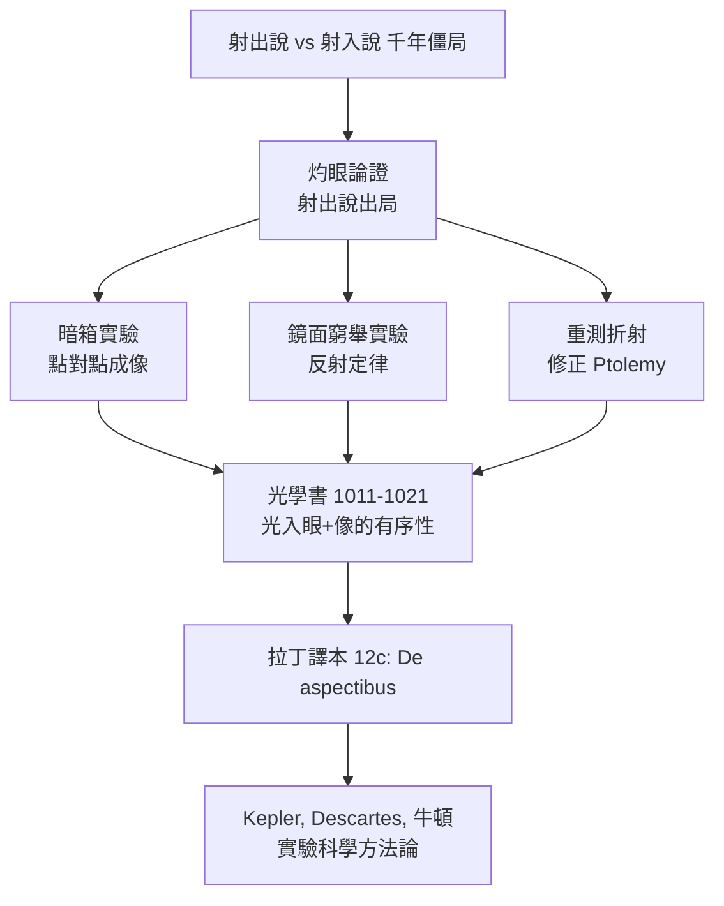

## 1021 - 伊本海賽姆視覺光學（光進入眼睛：實驗方法的誕生）

## 案件摘要

**本案偵破的是視覺的第一原理：光，到底是眼睛射出去的，還是走進眼睛來的？**

約 1011–1021 年間，被埃及哈里發哈基姆逼得裝瘋避禍、軟禁在開羅的物理學家伊本海賽姆（Ibn al-Haytham，拉丁化 Alhazen）寫下七卷《光學書》（Kitab al-Manazir）。他以一個簡單而致命的論證終結千年之爭：**直視強陽光會灼傷眼睛——若光是從眼睛射出的，怎麼會被自己射出的東西所傷？** 由此，他系統性地以實驗驗證光的直線傳播、反射定律、折射與小孔成像（camera obscura），並重建視覺理論：可見物體的每一點向各方向發射光，其中經眼屈光系統折射的光線在眼內形成「有序的像」。現代光學與實驗科學方法，在同一間囚室裡誕生。

## 前因 -- 為什麼會有這個案子

- **兩派僵局**。歐幾里得—托勒密的「射出說」有完美幾何（視錐、入射角＝反射角），卻答不了「夜間為何看不見」；亞里斯多德的「射入說」方向正確，卻沒有幾何。
- **蓋倫生理學的殘局**。視覺氣外流說（見 `0150-蓋倫眼球解剖與視覺氣.md`）在醫學界根深蒂固。
- **作者的職業意外**。Ibn al-Haytham 原受聘於哈基姆要「馴服尼羅河」，工程失敗後為保命假裝瘋癲，居家軟禁近十年——史學家常說：這十年是物理學史上產能最高的軟禁。
- **前代數據在手**。他批判性重測 Ptolemy《光學》的折射數據，發現其入射—折射角關係不符，堅持「結論須經實驗與數學雙重驗證」。

## 線索與推理 -- 理論與實驗

**線索一：射出說的死亡論證。**

$$ \text{若光由眼射出} \Rightarrow \text{眼對光免疫} \quad\text{但}\quad \text{直視太陽致盲} \Rightarrow \text{矛盾} $$

**線索二：反射定律的實驗重演。** 他以多孔暗箱與平面鏡驗證：

$$ \theta_{\text{入}} = \theta_{\text{反}} $$

並設計「一點經一鏡僅循一條路徑反射入眼」的實驗，反駁「每點有無數射線入眼」的托勒密式混亂——先以幾何窮舉可能的反射點，再以鏡面實驗刪除。

```python
# Ibn al-Haytham 的鏡面實驗重演：唯一反射路徑
def reflection_point(A, B, mirror_x=0):
    # A=光源, B=眼; 求鏡上反射點 P 使 A->P->B 路徑最短
    from math import inf
    best, best_P = inf, None
    for y in candidate_ys(mirror_x):        # 沿鏡面掃描（他的幾何窮舉）
        P = (mirror_x, y)
        L = dist(A, P) + dist(P, B)
        if L < best:
            best, best_P = L, P
    assert angle_in(best_P) == angle_out(best_P)   # 反射定律自動成立
    return best_P, best
```

**線索三：小孔成像——像的「有序性」。** 暗箱實驗顯示：每個物點的每一束光穿過小孔後在對壁形成對應光斑，全體光斑拼出**倒立的像**。他把這套「點對點映射」搬進眼球：角膜與水晶體的折射使入射光錐在眼內維持點對點秩序——這正是 Kepler 視網膜成像（見 `1604-克卜勒視網膜成像.md`）的直接前身。

**線索四：折射的實驗批判。** 他重測空氣—水、空氣—玻璃的折射，證明 Ptolemy 的比例式錯誤，並正確指出折射發生在介質交界、與密度差相關——Snell 定律（1637 年發表）前的最重要實驗數據集。



## 結案 -- 後果與影響

- **視覺理論翻案**。「光進入眼睛」成為不可逆的共識；水晶體從「感知器官」降格為「屈光元件」，為後世的成像數學（Kepler）清出正確的起跑線。
- **實驗方法的發明**。「真理須經系統觀察與可控實驗檢驗、並可用數學表述」——這套方法論經 Roger Bacon、Witelo、Grosseteste 傳入歐洲，被科學史家視為科學革命的方法論源頭之一。
- **眼鏡與光學儀器的合法化**。既然屈光是幾何問題，凸透鏡補償老視便是可以工業化生產的答案——1280 年代的眼鏡（見 `1285-眼鏡的發明.md`）站在他的理論之上。
- **陰影面**。他對眼內三層折射媒質的具體路徑仍有錯（誤以為晶體是感知中心的最後一道），最終一公里由 Kepler 跑完；「科學偵探」也會留下未結的懸案。
- **一句話結案**：一個被軟禁的工程師，用「太陽會燒傷眼睛」這個所有人都體驗過的事實，燒掉了千年錯誤——本案證明最強的證據，常常是常識。

## 關鍵人物與文獻

- **Ibn al-Haytham（965–約 1040）**——生於巴士拉、工作於開羅；《光學書》七卷，拉丁譯本 *De aspectibus* 於 12 世紀後期問世。
- **Kamal al-Din al-Farisi（1267–約 1320）**——波斯學者，以《光學書修訂》發展彩虹理論，證明本書在伊斯蘭世界的持續生產力。
- 原始文獻——*Kitab al-Manazir*；A. I. Sabra 英譯 *The Optics of Ibn al-Haytham*（1989）。
- **現代註腳**——2009 年聯合國教科文組織「國際光之年」以 1015 年《光學書》起始定年；月球上的 Alhazen 撞擊坑與巴基斯坦的 Aga Khan 大學 Alhazen 學會，都是本案的結案陳詞。
